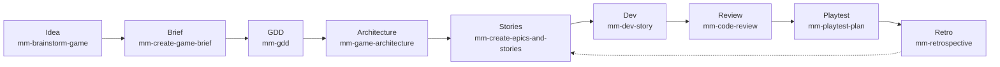

<p align="center">
  
</p>

<h1 align="center">MonkeyMode</h1>

<p align="center"><strong>I'm Monkey Game Developer 🐒</strong></p>

<p align="center">
  <a href="LICENSE"></a>
  <a href="#install"></a>
  <a href="#plugins"></a>
  <a href="CONTRIBUTING.md"></a>
</p>

<p align="center">
  <a href="#engines"></a>
  <a href="#engines"></a>
  <a href="#engines"></a>
  <a href="#engines"></a>
  <a href="#without-claude-code"></a>
</p>

<div align="center">

[English](README.md) · [한국어](README.ko.md) · [日本語](README.ja.md) · [简体中文](README.zh-CN.md) · [繁體中文](README.zh-TW.md) · [Español](README.es.md) · [Português (Brasil)](README.pt-BR.md) · [Français](README.fr.md) · **Deutsch** · [Русский](README.ru.md) · [Tiếng Việt](README.vi.md)

</div>

<p align="center"><a href="#install">Zur Installation ↓</a></p>

---

> [!TIP]
> Selbst ein nicht ganz so schlauer Agent (oder Dev) wird schlau, wenn er mit MonkeyMode läuft.

MonkeyMode ist ein Open-Source-Kit für die Spieleentwicklung mit KI-Coding-Agenten. Dein Agent kann schon Code schreiben; MonkeyMode bringt ihm bei, ein **Spiel** zu machen: es zu planen, zu entwerfen, Story für Story zu bauen, die eigene Arbeit zu prüfen und dieselben Engine-Fehler nicht zweimal zu machen.

```text
idea → brief → GDD → architecture → stories → dev → review → playtest → retro
```

Es wird als Claude-Code-Plugin-Marketplace ausgeliefert und funktioniert auch mit Agenten, die `AGENTS.md` lesen (Codex und andere).

| Enthalten | Anzahl | Was du bekommst |
|---|---:|---|
| Workflow-Skills | 43 | `mm-core`: Brief, GDD, Narrative, UX, Architektur, Epics und Stories, Entwicklung, Review, Tests, Playtest, Retrospektive, dazu `/mm-setup` |
| Persona-Agenten | 9 | `mm-agents`: Game Designer, Architekt, Entwickler, Solo-Dev, Analyst, PM, UX-Designer, Technical Writer, Party-Modus |
| Art- und Grafik-Tools | 4 | `mm-art-tools`: Concept Art und CLI-Harnesses für Blender, RenderDoc, Nsight Graphics |
| Engine-Adapter | 4 | Godot, Unity, Unreal, Bevy: Doku, verbotene Muster, Build- und Testbefehle, Multiplayer-Notizen |
| Guardrails | 3 Stufen | Automatisch geprüfte Regeln nach jeder Änderung und auf Wunsch vor jedem Commit |
| Betriebsdokumente für Agenten | 15 | `docs/ai/`: Ausführungsrichtlinie, Verifikations-Playbook, Netzwerk-Autorität, Übergabe, Pre-Commit-Ablauf |

<a id="install"></a>

## Schnellstart

**1. Installieren** (Claude Code)

```
/plugin marketplace add <owner>/MonkeyMode
/plugin install mm-core@monkeymode
/plugin install mm-unity@monkeymode   # pick your engine: mm-godot, mm-unity, mm-unreal, mm-bevy
```

Optionale Pakete: `/plugin install mm-agents@monkeymode`, `/plugin install mm-art-tools@monkeymode`.

**2. Spiel einrichten.** Öffne dein Spielprojekt in Claude Code und führe **`/mm-setup`** aus. Es stellt dir ein paar Fragen, installiert alles und nennt dir den nächsten Schritt.

**3. Loslegen.** Führe den empfohlenen Skill aus, zum Beispiel `/mm-brainstorm-game` für eine neue Idee oder `/mm-document-project` für eine bestehende Codebasis. Frag `/mm-help`, wann immer du nicht weißt, was als Nächstes kommt.

> [!NOTE]
> Voraussetzungen: Claude Code v2.1.271 oder neuer (Plugin-Einstellungen mit festen Auswahlmöglichkeiten), Python 3.11+ und [`uv`](https://docs.astral.sh/uv/) (Workflow-Skripte und Guardrails), PowerShell 7 für die `.ps1`-Tools, Node.js 18+ für die lokale Konzept-/Entscheidungsseite.

<a id="features"></a>

## Warum MonkeyMode

| Funktion | Was das heißt |
|---|---|
| **Workflow vom Design bis zum Release** | Jeder Schritt ist ein Skill, der eine echte Datei schreibt, die du behältst: Brief, GDD, Architektur, Stories, Review-Notizen, Playtest-Pläne |
| **Prüfen statt behaupten** | Agenten bauen, testen, starten und machen Screenshots, bevor sie „fertig“ sagen; Ungeprüftes wird als `unverified` notiert |
| **Guardrails** | Fragile Szenensuchen, blockierende Aufrufe, unsicherer Netzwerkcode und Secrets im Repository werden nach jeder Änderung blockiert |
| **Engine-Wissen** | Godot, Unity, Unreal und Bevy haben eigene Regeln, Befehle und Multiplayer-Notizen; alles andere ist gemeinsam |
| **Passt sich dir an** | Sagst du, dass du keinen Code liest, erklären die Agenten in einfachen Worten mit Screenshots, prüfen alles selbst und fragen vor riskanten Schritten |
| **Multiplayer-tauglich** | Engine-neutrale Autoritätsregeln und Teststufen (M0-M3) für Netzwerkfunktionen |

<a id="workflow"></a>

## Der Workflow



| Schritt | Ausführen | Ergebnis |
|---|---|---|
| 1. Idee | `mm-brainstorm-game` | Eine Brainstorming-Session in `_mm-output/` |
| 2. Brief | `mm-create-game-brief` | Kernfantasie, Zielgruppe, Hook, Referenzen, Umfang |
| 3. Design | `mm-gdd` (+ `mm-create-narrative`, `mm-ux`) | GDD, Epic-Überblick, Entscheidungslog |
| 4. Architektur | `mm-game-architecture`, `mm-generate-project-context` | Architektur, Guardrail-Vorschläge, Regelblatt des Projekts |
| 5. Stories | `mm-create-epics-and-stories`, `mm-check-implementation-readiness` | Epics und Stories mit Risiko- und Verifikationsstufe |
| 6. Sprint | `mm-sprint-planning`, `mm-sprint-status` | `sprint-status.yaml` |
| 7. Entwicklung | `mm-create-story` → `mm-dev-story` | Code, Tests und ein vierteiliger Bericht |
| 8. Review | `mm-code-review` | Review-Befunde und Folgeaufgaben |
| 9. Playtest | `mm-playtest-plan`, `mm-performance-test` | Playtest- und Performance-Testpläne |
| 10. Retro | `mm-retrospective` | Erkenntnisse nach jedem Epic |

<details>
<summary><strong>Abkürzungen, Tests und was „fertig“ bedeutet</strong></summary>

**Abkürzungen:** `mm-quick-dev` für kleine Änderungen ohne die ganze Kette; `mm-correct-course`, wenn ein Sprint aus dem Ruder läuft; `mm-document-project`, um eine bestehende Codebasis zu beschreiben; `mm-investigate` zum Debuggen; `mm-walkthrough` für eine geführte Tour durch eine Änderung; `mm-write-handoff`, wenn du mitten in einer Aufgabe aufhörst.

**Tests:** `mm-test-framework` richtet ein Test-Framework für deine Engine ein, `mm-test-design` plant die Abdeckung, `mm-test-automate` und `mm-e2e-scaffold` schreiben Tests, `mm-test-review` prüft sie.

**Fertig:** Jede Story wird in vier Teilen berichtet: was sich geändert hat, was es beeinflussen kann, wie es geprüft wurde (mit Belegen) und Folgeaufgaben. Die Verifikationsstufen sind L1 (statische Prüfungen), L2 (Verhalten beobachtet) und L3 (Integration; im Multiplayer mit mehreren verbundenen Spielern, Stufen M0-M3).

Die vollständige Schritttabelle mit Ausgabepfaden steht im [Benutzerhandbuch](docs/GUIDE.md#4-the-end-to-end-process).

</details>

<a id="plugins"></a>

## Plugins

| Plugin | Inhalt |
|---|---|
| **`mm-core`** (erforderlich) | 43 `mm-`-Workflow-Skills, das `/mm-setup`-Onboarding, Betriebsdokumente für Agenten (`docs/ai/`), der Guardrail-Checker mit After-Edit-Hook, ein Profil für Secrets und persönliche Pfade, eine Konzeptgalerie und eine Entscheidungsseite |
| **`mm-unity`** | Verbotene C#-APIs, Regeln zur Assembly-Richtung, Batch-Mode-Test-/Build-Skripte, Mirror- und Netcode-Notizen, Checkliste für den Asset-Import |
| **`mm-godot`** | GDScript-Regeln zu Node-Pfaden und Signalen, Headless-Testbefehle, Notizen zum High-Level-Multiplayer |
| **`mm-unreal`** | UObject/GC-Regeln, verbotene C++-Muster, UBT- und Automation-Test-Befehle, Replikationsnotizen |
| **`mm-bevy`** | Kein Blockieren in Systems, System-Reihenfolge, Clippy-Verbote, cargo-test-Befehle, lightyear/replicon/renet-Notizen |
| `mm-agents` (optional) | Persona-Agenten und Party-Modus |
| `mm-art-tools` (optional) | `mm-concept-art` (ChatGPT-Prompts, Codex CLI oder Alternativen) und CLI-Harnesses für Blender, RenderDoc, Nsight Graphics |

<details>
<summary><strong>mm-core: alle 43 Skills</strong></summary>

| Bereich | Skills |
|---|---|
| Ideen und Design | `mm-brainstorm-game`, `mm-brainstorming`, `mm-forge-idea`, `mm-create-game-brief`, `mm-gdd`, `mm-create-narrative`, `mm-ux`, `mm-prd`, `mm-prfaq`, `mm-spec`, `mm-research` |
| Architektur und Planung | `mm-game-architecture`, `mm-generate-project-context`, `mm-create-epics-and-stories`, `mm-check-implementation-readiness`, `mm-sprint-planning`, `mm-sprint-status`, `mm-correct-course` |
| Bauen und Review | `mm-create-story`, `mm-dev-story`, `mm-quick-dev`, `mm-quick-dev-auto`, `mm-code-review`, `mm-review`, `mm-investigate`, `mm-walkthrough`, `mm-write-handoff`, `mm-document-project` |
| Tests und Playtests | `mm-test-framework`, `mm-test-design`, `mm-test-automate`, `mm-e2e-scaffold`, `mm-test-review`, `mm-performance-test`, `mm-playtest-plan`, `mm-retrospective` |
| Helfer | `mm-setup`, `mm-help`, `mm-customize`, `mm-advanced-elicitation`, `mm-clarify-ambiguous-request`, `mm-present-alternatives`, `mm-decision-picker` |

</details>

<details>
<summary><strong>mm-agents und mm-art-tools</strong></summary>

| Plugin | Skills |
|---|---|
| `mm-agents` | `mm-agent-game-designer`, `mm-agent-game-architect`, `mm-agent-game-dev`, `mm-agent-game-solo-dev`, `mm-agent-analyst`, `mm-agent-pm`, `mm-agent-ux-designer`, `mm-agent-tech-writer`, `mm-party-mode` |
| `mm-art-tools` | `mm-concept-art`, `mm-cli-blender`, `mm-cli-renderdoc`, `mm-cli-nsight-graphics` |

</details>

<details>
<summary><strong>Gemeinsam vs. pro Engine</strong></summary>

| Gemeinsam (mm-core) | Pro Engine (mm-&lt;engine&gt;) |
|---|---|
| Workflow-Vorlagen: Game Brief, GDD, Narrative, UX, PRD, Architektur, Epics/Stories, Story, Playtest-Plan, Performance-Testplan, Testdesign, Code-Review-Checkliste, Retrospektive, Entscheidungslog, Projektkontext | Vorlage für den Projektkontext |
| Agentenverhalten, Verifikation, Übergabe, Scope-Kontrolle, Git-Hygiene, Team-Workflow | Architektur-Nachtrag (Szenen-/Asset-Struktur; GDScript/C#, C#, C++/Blueprint, Rust/ECS) |
| Guardrail-Checker, After-Edit- und Pre-Commit-Hooks, Secrets-Profil | Guardrail-Profil der Engine und verbotene Muster |
| Selbstprüfungs-Tools (Logs, Screenshots, Start mehrerer Instanzen) | Build- und Testbefehle (Unity liefert zusätzlich Skripte) |
| Engine-neutrale Regeln zur Netzwerk-Autorität und Teststufen | Multiplayer-Notizen (Mirror/NGO, Replikation, High-Level-Multiplayer, lightyear/renet) |
| Leitfäden zur Asset- und Charakter-Pipeline | `.gitignore`- / LFS-Hinweise, Asset-Import (Unity) |

</details>

<a id="engines"></a>

## Engines

| Engine | Plugin | Highlights | Verifikation |
|---|---|---|---|
| **Godot 4** | `mm-godot` | Nach unten aufrufen, nach oben signalisieren; typisiertes GDScript; `@rpc("any_peer")` prüft den Absender; GUT- und gdUnit4-Befehle | Mit der Godot-4.7-Doku abgeglichen |
| **Unity** | `mm-unity` | Kein szenenweites `Find*`, kein `Resources.Load`, kein `async void`; `.asmdef`-Regeln; Batch-Mode-Skripte; Mirror- und NGO-Notizen | Für Unity 6; Prüfung durch die Community nötig |
| **Unreal Engine 5** | `mm-unreal` | `UPROPERTY() TObjectPtr<>`-Member; kein synchrones Laden zur Laufzeit; validierte Server-RPCs; `Automation RunTest` | Teilweise mit der UE-5.9-Doku abgeglichen |
| **Bevy** | `mm-bevy` | Systems blockieren nie; explizite Reihenfolge; Simulation in `FixedUpdate`; Clippy `disallowed-methods` | Mit Bevy 0.20 abgeglichen |

Alles, was ein Adapter nicht bestätigen konnte, ist in seiner Doku als *needs verification* markiert. „Andere“ Engines bekommen eine Vorlage zum Ausfüllen.

<a id="guardrails"></a>

## Guardrails und Coding-Level

`mm-core` hat zwei Einstellungen über dich, festzulegen unter `/plugin` → MonkeyMode core → configure (oder `claude plugin configure mm-core@monkeymode`). Lässt du sie leer, fragt `/mm-setup` nach.

| Einstellung | Auswahl |
|---|---|
| `coding_level` | Ich kann Code lesen / Ich kann keinen Code lesen |
| `uses_chatgpt` | ja / nein („Für Bilder empfehlen wir ChatGPT“) |

| Coding-Level | Guardrails | Wie die Agenten arbeiten |
|---|---|---|
| **Ich kann keinen Code lesen** | Immer **strict** | Sie prüfen alles selbst (Tests, Build, Spiel starten), erklären in einfachen Worten mit Screenshots und fragen vor dem Löschen, Refactoring, Installieren, Committen oder Pushen |
| **Ich kann Code lesen** | **strict**, **standard** (Standard) oder **relaxed** | Berichte kommen als Diff-Zusammenfassung mit dem Grund für jede Änderung |

| Stufe | Wirkung |
|---|---|
| **strict** | Jede Regel blockiert die Änderung, auch die Keine-Kommentare-Regel, wenn das Engine-Profil sie hat |
| **standard** | Regeln blockieren; Kommentare sind erlaubt |
| **relaxed** | Regelverstöße erscheinen als Warnungen; nichts blockiert (der optionale Pre-Commit-Hook prüft weiterhin) |

<a id="setup"></a>

## Was `/mm-setup` fragt

<details>
<summary><strong>Die neun Fragen</strong></summary>

| # | Frage | Was die Antwort ändert |
|---|---|---|
| 1 | Kannst du Code lesen? | „Nein“ erzwingt strict-Guardrails und Agenten, die sich selbst prüfen und einfach erklären |
| 2 | Engine: Godot / Unity / Unreal / Bevy / Andere | Installiert den Adapter dieser Engine (die erkannte Engine ist vorausgewählt) |
| 3 | Nutzt du auch ChatGPT? | Ja: Concept Art kommt als einfügefertige ChatGPT-Prompts. Nein: Codex CLI oder Alternativen |
| 4 | Solo oder im Team? | Im Team kommen Branch- und Pull-Request-Regeln und eine Review-Checkliste dazu |
| 5 | Genre, Zielplattformen | Werden in `AGENTS.md` und der Konfiguration festgehalten |
| 6 | Multiplayer? (und maximale Spielerzahl) | Fügt die Netzwerk-Leitfäden und die Guardrails nur für Netzwerkspiele hinzu |
| 7 | Phase: Idee / Planung / Produktion / Feinschliff | Wählt den ersten empfohlenen Skill |
| 8 | Guardrail-Stufe (nur wenn du Code liest) | strict / standard / relaxed |
| 9 | Doku-Ordner | Wo die gesamte MonkeyMode-Doku landet (Standard `docs/`) |

Den vollständigen Ablauf mit allen Verzweigungen findest du in [`docs/ONBOARDING.md`](docs/ONBOARDING.md).

</details>

<details>
<summary><strong>Was in deinem Projekt landet</strong></summary>

```
AGENTS.md            MonkeyMode section (rules, your answers, engine snippet)
CLAUDE.md            @AGENTS.md
.monkeymode/         config.json (your project answers)
_mm/                 workflow runtime: config, catalog, scripts, custom/ overrides
docs/ai/             agent operating docs
docs/engine/         engine adapter docs
docs/project/        your approved design (filled over time)
docs/work/           work records and handoffs
guardrails/          secrets.json + <engine>.json
tools/               guardrail checker, verification tools
.githooks/           optional pre-commit guardrails
```

Führst du `/mm-setup` erneut aus, zeigt es deine aktuellen Antworten und fragt, was du ändern willst; deine eigenen Änderungen außerhalb der MonkeyMode-Abschnitte bleiben erhalten.

</details>

<a id="without-claude-code"></a>

## Ohne Claude Code (AGENTS.md-Agenten)

```
git clone <MonkeyMode repo URL>
uv run MonkeyMode/plugins/mm-core/skills/mm-setup/scripts/setup_project.py --target <your game> --interactive --apply --copy-skills agents
```

Es stellt dieselben Fragen, installiert dieselben Dateien und kopiert die Skills nach `.agents/skills/`. Siehe [`docs/ONBOARDING.md`](docs/ONBOARDING.md#without-claude-code-codex-and-other-agentsmd-agents).

## Anpassen

| Was | Wo |
|---|---|
| Projektregeln | `AGENTS.md` (außerhalb der MonkeyMode-Marker), `docs/ai/` und `docs/engine/` in deinem Projekt. Sie haben Vorrang vor den Skill-Anweisungen |
| Skill-Verhalten | `_mm/custom/<skill-name>.toml` (Team) oder `<skill-name>.user.toml` (persönlich); Arrays wie `persistent_facts` werden an die Standardwerte angehängt. `/mm-customize` führt dich durch |
| Guardrails | `guardrails/<engine>.json` oder ein neues Profil `guardrails/<name>.json` (Format in `docs/ai/12`). Agenten lockern sie nie von sich aus |

<details>
<summary><strong>Installation testen</strong></summary>

```
claude plugin validate .                      # marketplace
claude plugin validate plugins/mm-core       # each plugin
claude --plugin-dir ./plugins/mm-core --plugin-dir ./plugins/mm-unity
```

Der letzte Befehl startet Claude Code für eine Sitzung mit geladenen Plugins, ohne den Marketplace hinzuzufügen. Mitwirkende führen außerdem die Skript-Tests und `uv run tools/scrub.py` aus (siehe [CONTRIBUTING.md](CONTRIBUTING.md)).

</details>

## Dokumentation

| Dokument | Inhalt |
|---|---|
| [Benutzerhandbuch](docs/GUIDE.md) | Installation, das Setup-Interview, der komplette Workflow mit Skill und Ausgabedatei für jeden Schritt, Guardrails, Bilder, Engine-Notizen, FAQ |
| [Onboarding](docs/ONBOARDING.md) | Das Ablaufdiagramm des Setups und was jede Antwort ändert |
| [Inventar](docs/INVENTORY.md) | Gemeinsam vs. pro Engine, Zuordnung der Skill-Namen |
| [Mitwirken](CONTRIBUTING.md) | Skills, Engine-Adapter und Guardrail-Regeln hinzufügen; Tests; PR-Checkliste |

## Mitwirken

Beiträge sind willkommen: siehe [CONTRIBUTING.md](CONTRIBUTING.md) und den [Verhaltenskodex](CODE_OF_CONDUCT.md). Korrekturen an den Engine-Adaptern sind besonders willkommen: offene Punkte sind in jedem Adapter als *needs verification* markiert.

## Credits und Lizenz

MonkeyMode steht unter der MIT-Lizenz ([LICENSE](LICENSE)). Die Workflow-Skills basieren auf der [BMad Method](https://github.com/bmad-code-org/BMAD-METHOD) und dem Modul BMad Game Dev Studio (MIT), die Grafik-Tool-Skills auf [CLI-Anything](https://github.com/HKUDS/CLI-Anything) (Apache-2.0). MonkeyMode ist unabhängig und wird von deren Autoren nicht unterstützt. Details und jede Änderung: [NOTICE](NOTICE), [THIRD_PARTY_NOTICES.md](THIRD_PARTY_NOTICES.md).

---

<p align="center">
  <br />
  <sub><strong>I'm Monkey Game Developer 🐒</strong> · Wenn MonkeyMode deinem Spiel hilft, gib ihm einen Stern</sub>
</p>

<!-- Star history: once the repository has a public owner, replace <owner> below and uncomment.
<p align="center"><a href="https://www.star-history.com/#<owner>/MonkeyMode&Date">/MonkeyMode&type=Date" alt="Star history" width="600" /></a></p>
-->
