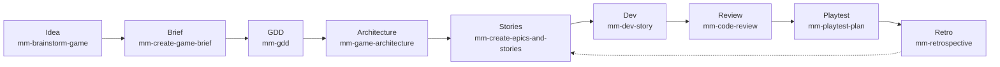

<p align="center">
  
</p>

<h1 align="center">MonkeyMode</h1>

<p align="center"><strong>I'm Monkey Game Developer 🐒</strong></p>

<p align="center">
  <a href="LICENSE"></a>
  <a href="#install"></a>
  <a href="#plugins"></a>
  <a href="CONTRIBUTING.md"></a>
</p>

<p align="center">
  <a href="#engines"></a>
  <a href="#engines"></a>
  <a href="#engines"></a>
  <a href="#engines"></a>
  <a href="#without-claude-code"></a>
</p>

<div align="center">

[English](README.md) · [한국어](README.ko.md) · [日本語](README.ja.md) · [简体中文](README.zh-CN.md) · [繁體中文](README.zh-TW.md) · **Español** · [Português (Brasil)](README.pt-BR.md) · [Français](README.fr.md) · [Deutsch](README.de.md) · [Русский](README.ru.md) · [Tiếng Việt](README.vi.md)

</div>

<p align="center"><a href="#install">Ir a la instalación ↓</a></p>

---

> [!TIP]
> Hasta un agente (o un dev) no muy listo se vuelve listo cuando trabaja con MonkeyMode.

MonkeyMode es un kit de desarrollo de videojuegos de código abierto para agentes de programación con IA. Tu agente ya sabe escribir código; MonkeyMode le enseña a hacer un **juego**: planificarlo, diseñarlo, construirlo historia a historia, comprobar su propio trabajo y no repetir dos veces los mismos errores del motor.

```text
idea → brief → GDD → architecture → stories → dev → review → playtest → retro
```

Se distribuye como un marketplace de plugins de Claude Code y también funciona con agentes que leen `AGENTS.md` (Codex y otros).

| Incluye | Cantidad | Qué te aporta |
|---|---:|---|
| Skills de flujo de trabajo | 43 | `mm-core`: brief, GDD, narrativa, UX, arquitectura, épicas e historias, desarrollo, revisión, pruebas, playtest, retrospectiva, y `/mm-setup` |
| Agentes con personalidad | 9 | `mm-agents`: diseñador de juegos, arquitecto, desarrollador, dev en solitario, analista, PM, diseñador UX, redactor técnico, modo fiesta |
| Herramientas de arte y gráficos | 4 | `mm-art-tools`: arte conceptual y CLI para Blender, RenderDoc, Nsight Graphics |
| Adaptadores de motor | 4 | Godot, Unity, Unreal, Bevy: documentación, patrones prohibidos, comandos de build y pruebas, notas de multijugador |
| Guardarraíles | 3 niveles | Reglas comprobadas automáticamente tras cada edición y, si quieres, antes de cada commit |
| Documentos operativos para agentes | 15 | `docs/ai/`: política de ejecución, guía de verificación, autoridad de red, traspaso, procedimiento previo al commit |

<a id="install"></a>

## Inicio rápido

**1. Instala** (Claude Code)

```
/plugin marketplace add <owner>/MonkeyMode
/plugin install mm-core@monkeymode
/plugin install mm-unity@monkeymode   # pick your engine: mm-godot, mm-unity, mm-unreal, mm-bevy
```

Paquetes opcionales: `/plugin install mm-agents@monkeymode`, `/plugin install mm-art-tools@monkeymode`.

**2. Configura tu juego.** Abre tu proyecto en Claude Code y ejecuta **`/mm-setup`**. Te hace unas preguntas, lo instala todo y te dice el siguiente paso.

**3. Empieza a crearlo.** Ejecuta la skill que te recomiende, por ejemplo `/mm-brainstorm-game` para una idea nueva o `/mm-document-project` para un código existente. Pregunta a `/mm-help` siempre que no sepas qué viene después.

> [!NOTE]
> Requisitos: Claude Code v2.1.271 o posterior (ajustes de plugin con opciones fijas), Python 3.11+ y [`uv`](https://docs.astral.sh/uv/) (scripts del flujo de trabajo y guardarraíles), PowerShell 7 para las herramientas `.ps1`, Node.js 18+ para la página local de conceptos/decisiones.

<a id="features"></a>

## Por qué MonkeyMode

| Función | Qué significa |
|---|---|
| **Flujo del diseño al lanzamiento** | Cada paso es una skill que escribe un archivo real que conservas: brief, GDD, arquitectura, historias, notas de revisión, planes de playtest |
| **Verificar, no afirmar** | Los agentes compilan, prueban, ejecutan y hacen capturas antes de decir "hecho"; lo que no se comprobó se escribe como `unverified` |
| **Guardarraíles** | Búsquedas frágiles en la escena, llamadas bloqueantes, red insegura y secretos en el repositorio se bloquean tras cada edición |
| **Conocimiento del motor** | Godot, Unity, Unreal y Bevy tienen sus propias reglas, comandos y notas de multijugador; todo lo demás es común |
| **Se adapta a ti** | Si dices que no lees código, los agentes explican con palabras sencillas y capturas, lo verifican todo y preguntan antes de los pasos arriesgados |
| **Preparado para multijugador** | Reglas de autoridad independientes del motor y grados de prueba (M0-M3) para el trabajo en red |

<a id="workflow"></a>

## El flujo de trabajo



| Paso | Ejecuta | Produce |
|---|---|---|
| 1. Idea | `mm-brainstorm-game` | Una sesión de lluvia de ideas en `_mm-output/` |
| 2. Brief | `mm-create-game-brief` | Fantasía central, público, gancho, referencias, alcance |
| 3. Diseño | `mm-gdd` (+ `mm-create-narrative`, `mm-ux`) | GDD, esquema de épicas, registro de decisiones |
| 4. Arquitectura | `mm-game-architecture`, `mm-generate-project-context` | Arquitectura, propuestas de guardarraíles, hoja de reglas del proyecto |
| 5. Historias | `mm-create-epics-and-stories`, `mm-check-implementation-readiness` | Épicas e historias con niveles de riesgo y de verificación |
| 6. Sprint | `mm-sprint-planning`, `mm-sprint-status` | `sprint-status.yaml` |
| 7. Desarrollo | `mm-create-story` → `mm-dev-story` | Código, pruebas y un informe en cuatro partes |
| 8. Revisión | `mm-code-review` | Hallazgos de revisión y tareas de seguimiento |
| 9. Playtest | `mm-playtest-plan`, `mm-performance-test` | Planes de playtest y de pruebas de rendimiento |
| 10. Retro | `mm-retrospective` | Lecciones tras cada épica |

<details>
<summary><strong>Atajos, pruebas y cómo funciona "hecho"</strong></summary>

**Atajos:** `mm-quick-dev` para cambios pequeños sin la cadena completa; `mm-correct-course` cuando un sprint se desvía; `mm-document-project` para describir un código existente; `mm-investigate` para depurar; `mm-walkthrough` para un recorrido guiado por un cambio; `mm-write-handoff` cuando paras a mitad de una tarea.

**Pruebas:** `mm-test-framework` prepara un framework de pruebas para tu motor, `mm-test-design` planifica la cobertura, `mm-test-automate` y `mm-e2e-scaffold` escriben pruebas y `mm-test-review` las revisa.

**Hecho:** cada historia se informa en cuatro partes: qué cambió, a qué puede afectar, cómo se verificó (con pruebas) y tareas de seguimiento. Los niveles de verificación son L1 (comprobaciones estáticas), L2 (comportamiento observado) y L3 (integración; con varios jugadores conectados en multijugador, grados M0-M3).

La tabla completa de pasos con rutas de salida está en la [guía de usuario](docs/GUIDE.md#4-the-end-to-end-process).

</details>

<a id="plugins"></a>

## Plugins

| Plugin | Qué incluye |
|---|---|
| **`mm-core`** (obligatorio) | 43 skills de flujo `mm-`, la incorporación `/mm-setup`, documentos operativos para agentes (`docs/ai/`), el comprobador de guardarraíles con un hook tras cada edición, un perfil de secretos y rutas personales, una galería de conceptos y una página de decisiones |
| **`mm-unity`** | APIs de C# prohibidas, reglas de dirección entre ensamblados, scripts de pruebas/build en modo batch, notas de Mirror y Netcode, lista de importación de assets |
| **`mm-godot`** | Reglas de rutas de nodos y señales en GDScript, comandos de pruebas headless, notas de multijugador de alto nivel |
| **`mm-unreal`** | Reglas de UObject/GC, patrones de C++ prohibidos, comandos de UBT y pruebas automatizadas, notas de replicación |
| **`mm-bevy`** | Nada de bloqueos en sistemas, orden de sistemas, prohibiciones de Clippy, comandos de cargo test, notas de lightyear/replicon/renet |
| `mm-agents` (opcional) | Agentes con personalidad y modo fiesta |
| `mm-art-tools` (opcional) | `mm-concept-art` (prompts para ChatGPT, Codex CLI u otras opciones) y CLI para Blender, RenderDoc, Nsight Graphics |

<details>
<summary><strong>mm-core: las 43 skills</strong></summary>

| Área | Skills |
|---|---|
| Ideas y diseño | `mm-brainstorm-game`, `mm-brainstorming`, `mm-forge-idea`, `mm-create-game-brief`, `mm-gdd`, `mm-create-narrative`, `mm-ux`, `mm-prd`, `mm-prfaq`, `mm-spec`, `mm-research` |
| Arquitectura y planificación | `mm-game-architecture`, `mm-generate-project-context`, `mm-create-epics-and-stories`, `mm-check-implementation-readiness`, `mm-sprint-planning`, `mm-sprint-status`, `mm-correct-course` |
| Construcción y revisión | `mm-create-story`, `mm-dev-story`, `mm-quick-dev`, `mm-quick-dev-auto`, `mm-code-review`, `mm-review`, `mm-investigate`, `mm-walkthrough`, `mm-write-handoff`, `mm-document-project` |
| Pruebas y playtests | `mm-test-framework`, `mm-test-design`, `mm-test-automate`, `mm-e2e-scaffold`, `mm-test-review`, `mm-performance-test`, `mm-playtest-plan`, `mm-retrospective` |
| Ayudantes | `mm-setup`, `mm-help`, `mm-customize`, `mm-advanced-elicitation`, `mm-clarify-ambiguous-request`, `mm-present-alternatives`, `mm-decision-picker` |

</details>

<details>
<summary><strong>mm-agents y mm-art-tools</strong></summary>

| Plugin | Skills |
|---|---|
| `mm-agents` | `mm-agent-game-designer`, `mm-agent-game-architect`, `mm-agent-game-dev`, `mm-agent-game-solo-dev`, `mm-agent-analyst`, `mm-agent-pm`, `mm-agent-ux-designer`, `mm-agent-tech-writer`, `mm-party-mode` |
| `mm-art-tools` | `mm-concept-art`, `mm-cli-blender`, `mm-cli-renderdoc`, `mm-cli-nsight-graphics` |

</details>

<details>
<summary><strong>Común vs. por motor</strong></summary>

| Común (mm-core) | Por motor (mm-&lt;engine&gt;) |
|---|---|
| Plantillas del flujo: brief, GDD, narrativa, UX, PRD, arquitectura, épicas/historias, historia, plan de playtest, plan de pruebas de rendimiento, diseño de pruebas, lista de revisión de código, retrospectiva, registro de decisiones, contexto del proyecto | Plantilla de contexto del proyecto |
| Comportamiento del agente, verificación, traspaso, control del alcance, higiene de git, flujo de equipo | Anexo de arquitectura (estructura de escenas/assets; GDScript/C#, C#, C++/Blueprint, Rust/ECS) |
| Comprobador de guardarraíles, hooks tras la edición y antes del commit, perfil de secretos | Perfil de guardarraíles del motor y patrones prohibidos |
| Herramientas de autoverificación (logs, capturas, lanzamiento de varias instancias) | Comandos de build y pruebas (Unity incluye además scripts) |
| Reglas de autoridad de red y grados de prueba independientes del motor | Notas de multijugador (Mirror/NGO, replicación, multijugador de alto nivel, lightyear/renet) |
| Guías del pipeline de assets y personajes | Pistas de `.gitignore` / LFS, importación de assets (Unity) |

</details>

<a id="engines"></a>

## Motores

| Motor | Plugin | Lo más destacado | Verificación |
|---|---|---|---|
| **Godot 4** | `mm-godot` | Llamar hacia abajo, señalar hacia arriba; GDScript tipado; `@rpc("any_peer")` valida al emisor; comandos de GUT y gdUnit4 | Contrastado con la documentación de Godot 4.7 |
| **Unity** | `mm-unity` | Sin `Find*` en toda la escena, `Resources.Load` ni `async void`; reglas de `.asmdef`; scripts en modo batch; notas de Mirror y NGO | Orientado a Unity 6; necesita verificación de la comunidad |
| **Unreal Engine 5** | `mm-unreal` | Miembros `UPROPERTY() TObjectPtr<>`; sin cargas síncronas en tiempo de ejecución; Server RPC validados; `Automation RunTest` | Contrastado en parte con la documentación de UE 5.9 |
| **Bevy** | `mm-bevy` | Los sistemas nunca bloquean; orden explícito; simulación en `FixedUpdate`; Clippy `disallowed-methods` | Contrastado con Bevy 0.20 |

Todo lo que un adaptador no pudo confirmar está marcado como *needs verification* en su documentación. Los motores "Otro" reciben una plantilla para rellenar.

<a id="guardrails"></a>

## Guardarraíles y nivel de programación

`mm-core` tiene dos ajustes sobre ti, que se configuran en `/plugin` → MonkeyMode core → configure (o `claude plugin configure mm-core@monkeymode`). Si los dejas sin definir, `/mm-setup` te los pregunta.

| Ajuste | Opciones |
|---|---|
| `coding_level` | Sé leer código / No sé leer código |
| `uses_chatgpt` | sí / no ("Para imágenes recomendamos ChatGPT") |

| Nivel de programación | Guardarraíles | Cómo trabajan los agentes |
|---|---|---|
| **No sé leer código** | Siempre **strict** | Lo verifican todo ellos mismos (pruebas, build, ejecutar el juego), explican con palabras sencillas y capturas, y preguntan antes de borrar, refactorizar, instalar, hacer commit o push |
| **Sé leer código** | **strict**, **standard** (por defecto) o **relaxed** | Informan con un resumen del diff y el motivo de cada cambio |

| Nivel | Efecto |
|---|---|
| **strict** | Todas las reglas bloquean la edición, incluida la regla de no comentarios si el perfil del motor la tiene |
| **standard** | Las reglas bloquean; se permiten comentarios |
| **relaxed** | Las infracciones se muestran como avisos; nada bloquea (el hook opcional previo al commit sigue comprobando) |

<a id="setup"></a>

## Qué pregunta `/mm-setup`

<details>
<summary><strong>Las nueve preguntas</strong></summary>

| # | Pregunta | Qué cambia la respuesta |
|---|---|---|
| 1 | ¿Sabes leer código? | "No" impone guardarraíles strict y agentes que se autoverifican y hablan en lenguaje sencillo |
| 2 | Motor: Godot / Unity / Unreal / Bevy / Otro | Instala el adaptador de ese motor (el motor detectado viene preseleccionado) |
| 3 | ¿Usas también ChatGPT? | Sí: el arte conceptual llega como prompts de ChatGPT listos para pegar. No: Codex CLI u otras opciones |
| 4 | ¿En solitario o en equipo? | En equipo se añaden reglas de ramas y pull requests y una lista de revisión |
| 5 | Género, plataformas objetivo | Se registran en `AGENTS.md` y en la configuración |
| 6 | ¿Multijugador? (y máximo de jugadores) | Añade las guías de red y los guardarraíles solo para red |
| 7 | Etapa: idea / planificación / desarrollo / pulido | Elige la primera skill recomendada |
| 8 | Nivel de guardarraíles (solo si lees código) | strict / standard / relaxed |
| 9 | Carpeta de documentación | Dónde va toda la documentación de MonkeyMode (por defecto `docs/`) |

El flujo completo con todas sus ramas está en [`docs/ONBOARDING.md`](docs/ONBOARDING.md).

</details>

<details>
<summary><strong>Qué se instala en tu proyecto</strong></summary>

```
AGENTS.md            MonkeyMode section (rules, your answers, engine snippet)
CLAUDE.md            @AGENTS.md
.monkeymode/         config.json (your project answers)
_mm/                 workflow runtime: config, catalog, scripts, custom/ overrides
docs/ai/             agent operating docs
docs/engine/         engine adapter docs
docs/project/        your approved design (filled over time)
docs/work/           work records and handoffs
guardrails/          secrets.json + <engine>.json
tools/               guardrail checker, verification tools
.githooks/           optional pre-commit guardrails
```

Si vuelves a ejecutar `/mm-setup`, te muestra tus respuestas actuales y te pregunta qué cambiar; tus propias ediciones fuera de las secciones de MonkeyMode se conservan.

</details>

<a id="without-claude-code"></a>

## Sin Claude Code (agentes con AGENTS.md)

```
git clone <MonkeyMode repo URL>
uv run MonkeyMode/plugins/mm-core/skills/mm-setup/scripts/setup_project.py --target <your game> --interactive --apply --copy-skills agents
```

Hace las mismas preguntas, instala los mismos archivos y copia las skills en `.agents/skills/`. Consulta [`docs/ONBOARDING.md`](docs/ONBOARDING.md#without-claude-code-codex-and-other-agentsmd-agents).

## Personalización

| Qué | Dónde |
|---|---|
| Reglas del proyecto | `AGENTS.md` (fuera de los marcadores de MonkeyMode), `docs/ai/` y `docs/engine/` en tu proyecto. Prevalecen sobre las instrucciones de las skills |
| Comportamiento de las skills | `_mm/custom/<skill-name>.toml` (equipo) o `<skill-name>.user.toml` (personal); los arrays como `persistent_facts` se añaden a los valores por defecto. `/mm-customize` te guía |
| Guardarraíles | `guardrails/<engine>.json` o un perfil nuevo `guardrails/<name>.json` (formato en `docs/ai/12`). Los agentes nunca los relajan por su cuenta |

<details>
<summary><strong>Probar la instalación</strong></summary>

```
claude plugin validate .                      # marketplace
claude plugin validate plugins/mm-core       # each plugin
claude --plugin-dir ./plugins/mm-core --plugin-dir ./plugins/mm-unity
```

El último comando inicia Claude Code con los plugins cargados durante una sesión, sin añadir el marketplace. Quienes contribuyen ejecutan también las pruebas de los scripts y `uv run tools/scrub.py` (ver [CONTRIBUTING.md](CONTRIBUTING.md)).

</details>

## Documentación

| Documento | Contenido |
|---|---|
| [Guía de usuario](docs/GUIDE.md) | Instalación, la entrevista de configuración, el flujo completo con la skill y el archivo de salida de cada paso, guardarraíles, imágenes, notas de motores, FAQ |
| [Incorporación](docs/ONBOARDING.md) | El diagrama del flujo de configuración y qué cambia cada respuesta |
| [Inventario](docs/INVENTORY.md) | Común vs. por motor, tabla de nombres de skills |
| [Contribuir](CONTRIBUTING.md) | Añadir skills, adaptadores de motor y reglas de guardarraíles; pruebas; lista para PR |

## Contribuir

Las contribuciones son bienvenidas: consulta [CONTRIBUTING.md](CONTRIBUTING.md) y el [Código de conducta](CODE_OF_CONDUCT.md). Las correcciones a los adaptadores de motor son especialmente bienvenidas: los puntos pendientes están marcados como *needs verification* en cada adaptador.

## Créditos y licencia

MonkeyMode tiene licencia MIT ([LICENSE](LICENSE)). Sus skills de flujo de trabajo se basan en [BMad Method](https://github.com/bmad-code-org/BMAD-METHOD) y el módulo BMad Game Dev Studio (MIT), y las skills de herramientas gráficas en [CLI-Anything](https://github.com/HKUDS/CLI-Anything) (Apache-2.0). MonkeyMode es independiente y no cuenta con el respaldo de sus autores. Detalles y cada modificación: [NOTICE](NOTICE), [THIRD_PARTY_NOTICES.md](THIRD_PARTY_NOTICES.md).

---

<p align="center">
  <br />
  <sub><strong>I'm Monkey Game Developer 🐒</strong> · Si MonkeyMode te ayuda con tu juego, dale una estrella</sub>
</p>

<!-- Star history: once the repository has a public owner, replace <owner> below and uncomment.
<p align="center"><a href="https://www.star-history.com/#<owner>/MonkeyMode&Date">/MonkeyMode&type=Date" alt="Star history" width="600" /></a></p>
-->
