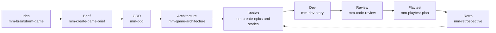

<p align="center">
  
</p>

<h1 align="center">MonkeyMode</h1>

<p align="center"><strong>I'm Monkey Game Developer 🐒</strong></p>

<p align="center">
  <a href="LICENSE"></a>
  <a href="#install"></a>
  <a href="#plugins"></a>
  <a href="#plugins"></a>
  <a href="CONTRIBUTING.md"></a>
  <a href="https://github.com/sponsors/AidenKim923"></a>
</p>

<p align="center">
  <a href="#engines"></a>
  <a href="#engines"></a>
  <a href="#engines"></a>
  <a href="#engines"></a>
  <a href="#without-claude-code"></a>
</p>

<div align="center">

[English](README.md) · [한국어](README.ko.md) · [日本語](README.ja.md) · [简体中文](README.zh-CN.md) · [繁體中文](README.zh-TW.md) · [Español](README.es.md) · [Português (Brasil)](README.pt-BR.md) · **Français** · [Deutsch](README.de.md) · [Русский](README.ru.md) · [Tiếng Việt](README.vi.md)

</div>

<p align="center"><a href="#install">Aller à l'installation ↓</a></p>

---

> [!TIP]
> Même un agent (ou un dev) pas très malin devient malin quand il tourne avec MonkeyMode.

MonkeyMode est un kit open source de développement de jeux pour les agents de programmation IA. Votre agent sait déjà écrire du code ; MonkeyMode lui apprend à faire un **jeu** : le planifier, le concevoir, le construire histoire par histoire, vérifier son propre travail et ne plus refaire deux fois les mêmes erreurs de moteur.

```text
idea → brief → GDD → architecture → stories → dev → review → playtest → retro
```

Il est distribué sous forme de marketplace de plugins Claude Code et fonctionne aussi avec les agents qui lisent `AGENTS.md` (Codex et autres).

| Inclus | Nombre | Ce que vous obtenez |
|---|---:|---|
| Skills de workflow | 43 | `mm-core` : brief, GDD, narration, UX, architecture, épopées et histoires, développement, revue, tests, playtest, rétrospective, et `/mm-setup` |
| Agents à personnalité | 9 | `mm-agents` : game designer, architecte, développeur, dev solo, analyste, PM, designer UX, rédacteur technique, mode fête |
| Sous-agents | 20 | `mm-agents` (16) plus un expert par plugin de moteur : conception, niveaux, code de gameplay, revue en lecture seule, QA, performance, réseau, tech art, UI/UX, narration, audio, économie, build et publication, localisation, audit des garde-fous, documentation |
| Outils art et graphismes | 4 | `mm-art-tools` : concept art et CLI pour Blender, RenderDoc, Nsight Graphics |
| Adaptateurs de moteur | 4 | Godot, Unity, Unreal, Bevy : documentation, motifs interdits, commandes de build et de test, notes multijoueur |
| Garde-fous | 3 niveaux | Des règles vérifiées automatiquement après chaque modification et, si vous le souhaitez, avant chaque commit |
| Documents opérationnels pour agents | 15 | `docs/ai/` : politique d'exécution, guide de vérification, autorité réseau, passation, procédure avant commit |

## Historique des étoiles

<a href="https://www.star-history.com/#AidenKim923/MonkeyMode&Date">
 <picture>
   <source media="(prefers-color-scheme: dark)" srcset="https://api.star-history.com/svg?repos=AidenKim923/MonkeyMode&type=Date&theme=dark" />
   <source media="(prefers-color-scheme: light)" srcset="https://api.star-history.com/svg?repos=AidenKim923/MonkeyMode&type=Date" />
   
 </picture>
</a>

<a id="install"></a>

## Démarrage rapide

**1. Installer** (Claude Code)

```
/plugin marketplace add AidenKim923/MonkeyMode
/plugin install mm-core@monkeymode
/plugin install mm-unity@monkeymode   # pick your engine: mm-godot, mm-unity, mm-unreal, mm-bevy
```

Packs optionnels : `/plugin install mm-agents@monkeymode`, `/plugin install mm-art-tools@monkeymode`.

**2. Configurer votre jeu.** Ouvrez votre projet de jeu dans Claude Code et lancez **`/mm-setup`**. Il vous pose quelques questions, installe tout et vous indique l'étape suivante.

**3. Commencer à le faire.** Lancez la skill recommandée, par exemple `/mm-brainstorm-game` pour une nouvelle idée ou `/mm-document-project` pour un code existant. Demandez à `/mm-help` dès que vous ne savez plus quoi faire ensuite.

> [!NOTE]
> Prérequis : Claude Code v2.1.271 ou plus récent (réglages de plugin à choix fixes), Python 3.11+ et [`uv`](https://docs.astral.sh/uv/) (scripts du workflow et garde-fous), PowerShell 7 pour les outils `.ps1`, Node.js 18+ pour la page locale de concepts/décisions.

<a id="features"></a>

## Pourquoi MonkeyMode

| Fonction | Ce que cela veut dire |
|---|---|
| **Workflow de la conception à la sortie** | Chaque étape est une skill qui écrit un vrai fichier que vous gardez : brief, GDD, architecture, histoires, notes de revue, plans de playtest |
| **Vérifier, pas affirmer** | Les agents compilent, testent, lancent et font des captures avant de dire « terminé » ; ce qui n'a pas été vérifié est noté `unverified` |
| **Garde-fous** | Recherches fragiles dans la scène, appels bloquants, réseau non sécurisé et secrets dans le dépôt sont bloqués après chaque modification |
| **Connaissance des moteurs** | Godot, Unity, Unreal et Bevy ont chacun leurs règles, commandes et notes multijoueur ; tout le reste est commun |
| **S'adapte à vous** | Si vous dites ne pas lire le code, les agents expliquent avec des mots simples et des captures, vérifient tout eux-mêmes et demandent avant les étapes risquées |
| **Prêt pour le multijoueur** | Règles d'autorité indépendantes du moteur et niveaux de test (M0-M3) pour le travail en réseau |

<a id="workflow"></a>

## Le workflow



| Étape | Lancer | Produit |
|---|---|---|
| 1. Idée | `mm-brainstorm-game` | Une séance de brainstorming dans `_mm-output/` |
| 2. Brief | `mm-create-game-brief` | Fantasme central, public, accroche, références, périmètre |
| 3. Conception | `mm-gdd` (+ `mm-create-narrative`, `mm-ux`) | GDD, plan des épopées, journal des décisions |
| 4. Architecture | `mm-game-architecture`, `mm-generate-project-context` | Architecture, propositions de garde-fous, fiche de règles du projet |
| 5. Histoires | `mm-create-epics-and-stories`, `mm-check-implementation-readiness` | Épopées et histoires avec niveaux de risque et de vérification |
| 6. Sprint | `mm-sprint-planning`, `mm-sprint-status` | `sprint-status.yaml` |
| 7. Développement | `mm-create-story` → `mm-dev-story` | Code, tests et un rapport en quatre parties |
| 8. Revue | `mm-code-review` | Constats de revue et tâches de suivi |
| 9. Playtest | `mm-playtest-plan`, `mm-performance-test` | Plans de playtest et de test de performance |
| 10. Rétro | `mm-retrospective` | Leçons après chaque épopée |

<details>
<summary><strong>Raccourcis, tests et définition de « terminé »</strong></summary>

**Raccourcis :** `mm-quick-dev` pour de petits changements sans toute la chaîne ; `mm-correct-course` quand un sprint dérape ; `mm-document-project` pour décrire un code existant ; `mm-investigate` pour déboguer ; `mm-walkthrough` pour une visite guidée d'un changement ; `mm-write-handoff` quand vous vous arrêtez en cours de tâche.

**Tests :** `mm-test-framework` met en place un framework de test pour votre moteur, `mm-test-design` planifie la couverture, `mm-test-automate` et `mm-e2e-scaffold` écrivent les tests, `mm-test-review` les vérifie.

**Terminé :** chaque histoire est rapportée en quatre parties : ce qui a changé, ce que cela peut affecter, comment c'est vérifié (avec preuves) et les suites à donner. Les niveaux de vérification sont L1 (contrôles statiques), L2 (comportement observé) et L3 (intégration ; avec plusieurs joueurs connectés en multijoueur, niveaux M0-M3).

Le tableau complet des étapes avec les chemins de sortie se trouve dans le [guide utilisateur](docs/GUIDE.md#4-the-end-to-end-process).

</details>

<a id="plugins"></a>

## Plugins

| Plugin | Contenu |
|---|---|
| **`mm-core`** (requis) | 43 skills de workflow `mm-`, l'accueil `/mm-setup`, des documents opérationnels pour agents (`docs/ai/`), le vérificateur de garde-fous avec un hook après modification, un profil secrets/chemins personnels, une galerie de concepts et une page de décision |
| **`mm-unity`** | API C# interdites, règles de dépendance entre assemblies, scripts de test/build en mode batch, notes Mirror et Netcode, checklist d'import d'assets et le sous-agent `mm-unity-expert` |
| **`mm-godot`** | Règles de chemins de nœuds et de signaux GDScript, commandes de test headless, notes sur le multijoueur haut niveau et le sous-agent `mm-godot-expert` |
| **`mm-unreal`** | Règles UObject/GC, motifs C++ interdits, commandes UBT et de tests automatisés, notes de réplication et le sous-agent `mm-unreal-expert` |
| **`mm-bevy`** | Aucun blocage dans les systèmes, ordre des systèmes, interdictions Clippy, commandes cargo test, notes lightyear/replicon/renet et le sous-agent `mm-bevy-expert` |
| `mm-agents` (optionnel) | 16 sous-agents Claude Code, agents à personnalité et mode fête |
| `mm-art-tools` (optionnel) | `mm-concept-art` (prompts ChatGPT, Codex CLI ou alternatives) et CLI pour Blender, RenderDoc, Nsight Graphics |

<details>
<summary><strong>mm-core : les 43 skills</strong></summary>

| Domaine | Skills |
|---|---|
| Idées et conception | `mm-brainstorm-game`, `mm-brainstorming`, `mm-forge-idea`, `mm-create-game-brief`, `mm-gdd`, `mm-create-narrative`, `mm-ux`, `mm-prd`, `mm-prfaq`, `mm-spec`, `mm-research` |
| Architecture et planification | `mm-game-architecture`, `mm-generate-project-context`, `mm-create-epics-and-stories`, `mm-check-implementation-readiness`, `mm-sprint-planning`, `mm-sprint-status`, `mm-correct-course` |
| Construction et revue | `mm-create-story`, `mm-dev-story`, `mm-quick-dev`, `mm-quick-dev-auto`, `mm-code-review`, `mm-review`, `mm-investigate`, `mm-walkthrough`, `mm-write-handoff`, `mm-document-project` |
| Tests et playtests | `mm-test-framework`, `mm-test-design`, `mm-test-automate`, `mm-e2e-scaffold`, `mm-test-review`, `mm-performance-test`, `mm-playtest-plan`, `mm-retrospective` |
| Assistants | `mm-setup`, `mm-help`, `mm-customize`, `mm-advanced-elicitation`, `mm-clarify-ambiguous-request`, `mm-present-alternatives`, `mm-decision-picker` |

</details>

<details>
<summary><strong>mm-agents et mm-art-tools</strong></summary>

| Plugin | Skills |
|---|---|
| `mm-agents` | `mm-agent-game-designer`, `mm-agent-game-architect`, `mm-agent-game-dev`, `mm-agent-game-solo-dev`, `mm-agent-analyst`, `mm-agent-pm`, `mm-agent-ux-designer`, `mm-agent-tech-writer`, `mm-party-mode` |
| `mm-art-tools` | `mm-concept-art`, `mm-cli-blender`, `mm-cli-renderdoc`, `mm-cli-nsight-graphics` |

| Plugin | Sous-agents |
|---|---|
| `mm-agents` | `mm-game-designer`, `mm-level-designer`, `mm-gameplay-programmer`, `mm-code-reviewer`, `mm-qa-tester`, `mm-performance-profiler`, `mm-network-engineer`, `mm-technical-artist`, `mm-ui-ux-designer`, `mm-narrative-writer`, `mm-audio-designer`, `mm-economy-balancer`, `mm-build-release-engineer`, `mm-localization`, `mm-guardrail-auditor`, `mm-docs-writer` |
| `mm-godot`, `mm-unity`, `mm-unreal`, `mm-bevy` | `mm-godot-expert`, `mm-unity-expert`, `mm-unreal-expert`, `mm-bevy-expert` |

Claude confie le travail à un sous-agent quand votre demande correspond à son rôle, ou vous l'appelez vous-même : `@agent-mm-agents:mm-qa-tester` ou « utilise l'agent mm-code-reviewer ». Quand utiliser chacun : [guide utilisateur](docs/GUIDE.md#5-agents).

</details>

<details>
<summary><strong>Commun vs. par moteur</strong></summary>

| Commun (mm-core) | Par moteur (mm-&lt;engine&gt;) |
|---|---|
| Modèles du workflow : brief, GDD, narration, UX, PRD, architecture, épopées/histoires, histoire, plan de playtest, plan de test de performance, conception des tests, checklist de revue de code, rétrospective, journal des décisions, contexte du projet | Modèle de contexte du projet |
| Comportement des agents, vérification, passation, maîtrise du périmètre, hygiène git, workflow d'équipe | Annexe d'architecture (structure des scènes/assets ; GDScript/C#, C#, C++/Blueprint, Rust/ECS) |
| Vérificateur de garde-fous, hooks après modification et avant commit, profil de secrets | Profil de garde-fous du moteur et motifs interdits |
| Outils d'autovérification (logs, captures, lancement de plusieurs instances) | Commandes de build et de test (Unity fournit aussi des scripts) |
| Règles d'autorité réseau et niveaux de test indépendants du moteur | Notes multijoueur (Mirror/NGO, réplication, multijoueur haut niveau, lightyear/renet) |
| Guides du pipeline d'assets et de personnages | Conseils `.gitignore` / LFS, import d'assets (Unity) |

</details>

<a id="engines"></a>

## Moteurs

| Moteur | Plugin | Points forts | Vérification |
|---|---|---|---|
| **Godot 4** | `mm-godot` | Appeler vers le bas, signaler vers le haut ; GDScript typé ; `@rpc("any_peer")` valide l'émetteur ; commandes GUT et gdUnit4 | Vérifié avec la documentation de Godot 4.7 |
| **Unity** | `mm-unity` | Pas de `Find*` sur toute la scène, de `Resources.Load` ni d'`async void` ; règles `.asmdef` ; scripts en mode batch ; notes Mirror et NGO | Cible Unity 6 ; vérification par la communauté nécessaire |
| **Unreal Engine 5** | `mm-unreal` | Membres `UPROPERTY() TObjectPtr<>` ; pas de chargement synchrone à l'exécution ; Server RPC validés ; `Automation RunTest` | Vérifié en partie avec la documentation d'UE 5.9 |
| **Bevy** | `mm-bevy` | Les systèmes ne bloquent jamais ; ordre explicite ; simulation dans `FixedUpdate` ; Clippy `disallowed-methods` | Vérifié avec Bevy 0.20 |

Tout ce qu'un adaptateur n'a pas pu confirmer est marqué *needs verification* dans sa documentation. Les moteurs « Autre » reçoivent un modèle à remplir.

<a id="guardrails"></a>

## Garde-fous et niveau en code

`mm-core` a deux réglages vous concernant, à définir dans `/plugin` → MonkeyMode core → configure (ou `claude plugin configure mm-core@monkeymode`). Si vous les laissez vides, `/mm-setup` vous les demande.

| Réglage | Choix |
|---|---|
| `coding_level` | Je sais lire le code / Je ne sais pas lire le code |
| `uses_chatgpt` | oui / non (« Pour les images, nous recommandons ChatGPT ») |

| Niveau en code | Garde-fous | Comment travaillent les agents |
|---|---|---|
| **Je ne sais pas lire le code** | Toujours **strict** | Ils vérifient tout eux-mêmes (tests, build, lancement du jeu), expliquent avec des mots simples et des captures, et demandent avant de supprimer, refactoriser, installer, commiter ou pousser |
| **Je sais lire le code** | **strict**, **standard** (par défaut) ou **relaxed** | Les rapports prennent la forme d'un résumé du diff avec la raison de chaque changement |

| Niveau | Effet |
|---|---|
| **strict** | Chaque règle bloque la modification, y compris la règle « pas de commentaires » quand le profil du moteur l'a |
| **standard** | Les règles bloquent ; les commentaires sont autorisés |
| **relaxed** | Les violations s'affichent comme avertissements ; rien ne bloque (le hook optionnel avant commit vérifie toujours) |

<a id="setup"></a>

## Ce que demande `/mm-setup`

<details>
<summary><strong>Les neuf questions</strong></summary>

| # | Question | Ce que la réponse change |
|---|---|---|
| 1 | Savez-vous lire le code ? | « Non » impose des garde-fous strict et des agents qui s'autovérifient et parlent simplement |
| 2 | Moteur : Godot / Unity / Unreal / Bevy / Autre | Installe l'adaptateur de ce moteur (le moteur détecté est présélectionné) |
| 3 | Utilisez-vous aussi ChatGPT ? | Oui : le concept art arrive sous forme de prompts ChatGPT prêts à coller. Non : Codex CLI ou alternatives |
| 4 | Seul ou en équipe ? | En équipe, ajoute des règles de branches et de pull requests et une checklist de revue |
| 5 | Genre, plateformes cibles | Enregistrés dans `AGENTS.md` et la configuration |
| 6 | Multijoueur ? (et nombre maximal de joueurs) | Ajoute les guides réseau et les garde-fous réservés au réseau |
| 7 | Stade : idée / planification / production / finition | Choisit la première skill recommandée |
| 8 | Niveau de garde-fous (seulement si vous lisez le code) | strict / standard / relaxed |
| 9 | Dossier de documentation | Où va toute la documentation MonkeyMode (par défaut `docs/`) |

Le parcours complet avec toutes ses branches est dans [`docs/ONBOARDING.md`](docs/ONBOARDING.md).

</details>

<details>
<summary><strong>Ce qui arrive dans votre projet</strong></summary>

```
AGENTS.md            MonkeyMode section (rules, your answers, engine snippet)
CLAUDE.md            @AGENTS.md
.monkeymode/         config.json (your project answers)
_mm/                 workflow runtime: config, catalog, scripts, custom/ overrides
docs/ai/             agent operating docs
docs/engine/         engine adapter docs
docs/project/        your approved design (filled over time)
docs/work/           work records and handoffs
guardrails/          secrets.json + <engine>.json
tools/               guardrail checker, verification tools
.githooks/           optional pre-commit guardrails
```

Relancer `/mm-setup` affiche vos réponses actuelles et demande ce qu'il faut changer ; vos propres modifications en dehors des sections MonkeyMode sont conservées.

</details>

<a id="without-claude-code"></a>

## Sans Claude Code (agents AGENTS.md)

```
git clone <MonkeyMode repo URL>
uv run MonkeyMode/plugins/mm-core/skills/mm-setup/scripts/setup_project.py --target <your game> --interactive --apply --copy-skills agents
```

Il pose les mêmes questions, installe les mêmes fichiers et copie les skills dans `.agents/skills/`. Voir [`docs/ONBOARDING.md`](docs/ONBOARDING.md#without-claude-code-codex-and-other-agentsmd-agents).

## Personnalisation

| Quoi | Où |
|---|---|
| Règles du projet | `AGENTS.md` (en dehors des marqueurs MonkeyMode), `docs/ai/` et `docs/engine/` dans votre projet. Elles priment sur les instructions des skills |
| Comportement des skills | `_mm/custom/<skill-name>.toml` (équipe) ou `<skill-name>.user.toml` (personnel) ; les tableaux comme `persistent_facts` s'ajoutent aux valeurs par défaut. `/mm-customize` vous guide |
| Garde-fous | `guardrails/<engine>.json` ou un nouveau profil `guardrails/<name>.json` (format dans `docs/ai/12`). Les agents ne les assouplissent jamais d'eux-mêmes |

<details>
<summary><strong>Tester l'installation</strong></summary>

```
claude plugin validate .                      # marketplace
claude plugin validate plugins/mm-core       # each plugin
claude --plugin-dir ./plugins/mm-core --plugin-dir ./plugins/mm-unity
```

La dernière commande lance Claude Code avec les plugins chargés le temps d'une session, sans ajouter la marketplace. Les contributeurs lancent aussi les tests des scripts et `uv run tools/scrub.py` (voir [CONTRIBUTING.md](CONTRIBUTING.md)).

</details>

## Documentation

| Document | Contenu |
|---|---|
| [Guide utilisateur](docs/GUIDE.md) | Installation, l'entretien de configuration, le workflow complet avec la skill et le fichier produit à chaque étape, garde-fous, images, notes sur les moteurs, FAQ |
| [Accueil](docs/ONBOARDING.md) | Le schéma du parcours de configuration et ce que change chaque réponse |
| [Inventaire](docs/INVENTORY.md) | Commun vs. par moteur, table des noms de skills |
| [Contribuer](CONTRIBUTING.md) | Ajouter des skills, des adaptateurs de moteur et des règles de garde-fous ; tests ; checklist de PR |

## Contribuer

Les contributions sont les bienvenues : voir [CONTRIBUTING.md](CONTRIBUTING.md) et le [Code de conduite](CODE_OF_CONDUCT.md). Les corrections des adaptateurs de moteur sont particulièrement bienvenues : les points encore ouverts sont marqués *needs verification* dans chaque adaptateur.

## Sponsoriser

MonkeyMode est gratuit et maintenu sur du temps libre. S'il vous fait gagner du temps sur votre jeu, vous pouvez soutenir son entretien (vérification des adaptateurs de moteur, nouveaux agents et skills, documentation en 11 langues) via GitHub Sponsors.

<p align="center">
  <a href="https://github.com/sponsors/AidenKim923"></a>
</p>

## Crédits et licence

MonkeyMode est sous licence MIT ([LICENSE](LICENSE)). Ses skills de workflow s'appuient sur [BMad Method](https://github.com/bmad-code-org/BMAD-METHOD) et le module BMad Game Dev Studio (MIT), et les skills d'outils graphiques sur [CLI-Anything](https://github.com/HKUDS/CLI-Anything) (Apache-2.0). MonkeyMode est indépendant et n'est pas approuvé par leurs auteurs. Détails et chaque modification : [NOTICE](NOTICE), [THIRD_PARTY_NOTICES.md](THIRD_PARTY_NOTICES.md).

---

<p align="center">
  <br />
  <sub><strong>I'm Monkey Game Developer 🐒</strong> · Si MonkeyMode vous aide pour votre jeu, laissez une étoile</sub>
</p>
