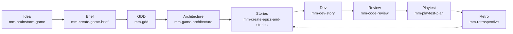

<p align="center">
  
</p>

<h1 align="center">MonkeyMode</h1>

<p align="center"><strong>I'm Monkey Game Developer 🐒</strong></p>

<p align="center">
  <a href="LICENSE"></a>
  <a href="#install"></a>
  <a href="#plugins"></a>
  <a href="#plugins"></a>
  <a href="CONTRIBUTING.md"></a>
  <a href="https://github.com/sponsors/AidenKim923"></a>
</p>

<p align="center">
  <a href="#engines"></a>
  <a href="#engines"></a>
  <a href="#engines"></a>
  <a href="#engines"></a>
  <a href="#without-claude-code"></a>
</p>

<div align="center">

[English](README.md) · [한국어](README.ko.md) · **日本語** · [简体中文](README.zh-CN.md) · [繁體中文](README.zh-TW.md) · [Español](README.es.md) · [Português (Brasil)](README.pt-BR.md) · [Français](README.fr.md) · [Deutsch](README.de.md) · [Русский](README.ru.md) · [Tiếng Việt](README.vi.md)

</div>

<p align="center"><a href="#install">インストールへ ↓</a></p>

---

> [!TIP]
> ちょっと賢くないエージェント(や開発者)も、MonkeyMode と一緒なら賢くなります。

MonkeyMode は AI コーディングエージェントのためのオープンソースのゲーム開発キットです。エージェントはもうコードを書けます。MonkeyMode はそのエージェントに**ゲーム**の作り方を教えます。計画し、設計し、ストーリー単位で作り、自分の作業を自分で確かめ、同じエンジンのミスを二度と繰り返さないようにします。

```text
idea → brief → GDD → architecture → stories → dev → review → playtest → retro
```

Claude Code のプラグインマーケットプレイスとして配布され、`AGENTS.md` を読むエージェント(Codex など)でも動作します。

| 内容 | 数 | できること |
|---|---:|---|
| ワークフロースキル | 43 | `mm-core`: ブリーフ、GDD、ナラティブ、UX、アーキテクチャ、エピックとストーリー、開発、レビュー、テスト、プレイテスト、振り返り、そして `/mm-setup` |
| ペルソナエージェント | 9 | `mm-agents`: ゲームデザイナー、アーキテクト、開発者、ソロ開発者、アナリスト、PM、UX デザイナー、テクニカルライター、パーティーモード |
| サブエージェント | 20 | `mm-agents`(16 個)とエンジンプラグインごとに専門家 1 つ: 企画、レベル、ゲームプレイのコード、読み取り専用のレビュー、QA、パフォーマンス、ネットワーク、テクニカルアート、UI/UX、ナラティブ、オーディオ、経済、ビルドとリリース、ローカライズ、ガードレール監査、ドキュメント |
| アート・グラフィックツール | 4 | `mm-art-tools`: コンセプトアートと Blender、RenderDoc、Nsight Graphics の CLI ハーネス |
| エンジンアダプター | 4 | Godot、Unity、Unreal、Bevy: ドキュメント、禁止パターン、ビルド・テストコマンド、マルチプレイのメモ |
| ガードレール | 3 段階 | 編集のたびに、必要ならコミットのたびに機械的にチェックするルール |
| エージェント運用ドキュメント | 15 | `docs/ai/`: 実行ポリシー、検証プレイブック、ネットワーク権限、引き継ぎ、コミット前の手順 |

## スター履歴

<a href="https://www.star-history.com/#AidenKim923/MonkeyMode&Date">
 <picture>
   <source media="(prefers-color-scheme: dark)" srcset="https://api.star-history.com/svg?repos=AidenKim923/MonkeyMode&type=Date&theme=dark" />
   <source media="(prefers-color-scheme: light)" srcset="https://api.star-history.com/svg?repos=AidenKim923/MonkeyMode&type=Date" />
   
 </picture>
</a>

<a id="install"></a>

## クイックスタート

**1. インストール** (Claude Code)

```
/plugin marketplace add AidenKim923/MonkeyMode
/plugin install mm-core@monkeymode
/plugin install mm-unity@monkeymode   # pick your engine: mm-godot, mm-unity, mm-unreal, mm-bevy
```

オプションパック: `/plugin install mm-agents@monkeymode`、`/plugin install mm-art-tools@monkeymode`。

**2. ゲームをセットアップ。** Claude Code でゲームプロジェクトを開き、**`/mm-setup`** を実行します。いくつか質問したあと、すべてをインストールして次の一歩を教えてくれます。

**3. 作り始める。** 勧められたスキルを実行します。新しいアイデアなら `/mm-brainstorm-game`、既存のコードベースなら `/mm-document-project` です。次に何をすべきか迷ったら、いつでも `/mm-help` に聞いてください。

> [!NOTE]
> 必要なもの: Claude Code v2.1.271 以降(固定の選択肢を持つプラグイン設定)、Python 3.11+ と [`uv`](https://docs.astral.sh/uv/)(ワークフロースクリプトとガードレール)、`.ps1` ツール用の PowerShell 7、ローカルのコンセプト/決定ページ用の Node.js 18+。

<a id="features"></a>

## MonkeyMode を使う理由

| 機能 | 意味 |
|---|---|
| **企画からリリースまでのワークフロー** | 各ステップがスキルで、残しておける実際のファイルを書きます: ブリーフ、GDD、アーキテクチャ、ストーリー、レビューメモ、プレイテスト計画 |
| **主張せずに確かめる** | エージェントは「完了」と言う前にビルド、テスト、実行、スクリーンショットで確かめ、確かめられなかったものは `unverified` と書きます |
| **ガードレール** | 壊れやすいシーン検索、ブロッキング呼び出し、安全でないネットワーク処理、リポジトリ内の秘密情報を編集のたびに止めます |
| **エンジンの知識** | Godot、Unity、Unreal、Bevy はそれぞれ専用のルール、コマンド、マルチプレイのメモを持ち、それ以外はすべて共通です |
| **あなたに合わせる** | コードが読めないと答えると、エージェントはやさしい言葉とスクリーンショットで説明し、すべてを自分で確かめ、危険な操作の前に確認します |
| **マルチプレイ対応** | ネットワーク処理のためのエンジン非依存の権限ルールとテスト等級(M0-M3) |

<a id="workflow"></a>

## ワークフロー



| ステップ | 実行 | 成果物 |
|---|---|---|
| 1. アイデア | `mm-brainstorm-game` | `_mm-output/` のブレインストーミングセッション |
| 2. ブリーフ | `mm-create-game-brief` | コアファンタジー、対象プレイヤー、フック、リファレンス、スコープ |
| 3. 設計 | `mm-gdd` (+ `mm-create-narrative`、`mm-ux`) | GDD、エピックの概要、決定ログ |
| 4. アーキテクチャ | `mm-game-architecture`、`mm-generate-project-context` | アーキテクチャ、ガードレールの提案、プロジェクトのルールシート |
| 5. ストーリー | `mm-create-epics-and-stories`、`mm-check-implementation-readiness` | リスクと検証レベル付きのエピックとストーリー |
| 6. スプリント | `mm-sprint-planning`、`mm-sprint-status` | `sprint-status.yaml` |
| 7. 開発 | `mm-create-story` → `mm-dev-story` | コード、テスト、4 部構成の報告 |
| 8. レビュー | `mm-code-review` | レビュー結果とフォローアップタスク |
| 9. プレイテスト | `mm-playtest-plan`、`mm-performance-test` | プレイテスト計画とパフォーマンステスト計画 |
| 10. 振り返り | `mm-retrospective` | エピックごとの学び |

<details>
<summary><strong>近道、テスト、「完了」の基準</strong></summary>

**近道:** フルの流れを通さない小さな変更には `mm-quick-dev`、スプリントが脱線したら `mm-correct-course`、既存のコードベースを説明するには `mm-document-project`、デバッグには `mm-investigate`、変更のガイドツアーには `mm-walkthrough`、作業を途中で止めるときは `mm-write-handoff`。

**テスト:** `mm-test-framework` はエンジンに合ったテストフレームワークを用意し、`mm-test-design` はカバレッジを計画し、`mm-test-automate` と `mm-e2e-scaffold` はテストを書き、`mm-test-review` はテストをチェックします。

**完了:** すべてのストーリーは 4 つの部分で報告します。何を変えたか、何に影響しうるか、どう確かめたか(根拠つき)、フォローアップ。検証レベルは L1(静的チェック)、L2(動作を確認)、L3(統合。マルチプレイでは複数プレイヤーを接続して M0-M3 の等級)です。

出力パスを含む全ステップの表は[ユーザーガイド](docs/GUIDE.md#4-the-end-to-end-process)にあります。

</details>

<a id="plugins"></a>

## プラグイン

| プラグイン | 内容 |
|---|---|
| **`mm-core`** (必須) | `mm-` ワークフロースキル 43 個、`/mm-setup` オンボーディング、エージェント運用ドキュメント(`docs/ai/`)、編集後フック付きのガードレールチェッカー、秘密情報・個人パスのプロファイル、コンセプトギャラリーと決定ページ |
| **`mm-unity`** | C# の禁止 API、アセンブリの依存方向ルール、バッチモードのテスト・ビルドスクリプト、Mirror と Netcode のメモ、アセットインポートのチェックリスト、`mm-unity-expert` サブエージェント |
| **`mm-godot`** | GDScript のノードパス・シグナルのルール、ヘッドレステストのコマンド、ハイレベルマルチプレイのメモ、`mm-godot-expert` サブエージェント |
| **`mm-unreal`** | UObject/GC のルール、禁止 C++ パターン、UBT と自動テストのコマンド、レプリケーションのメモ、`mm-unreal-expert` サブエージェント |
| **`mm-bevy`** | システム内でのブロッキング禁止、システムの順序、Clippy の禁止項目、cargo test のコマンド、lightyear/replicon/renet のメモ、`mm-bevy-expert` サブエージェント |
| `mm-agents` (任意) | Claude Code のサブエージェント 16 個、ペルソナエージェントとパーティーモード |
| `mm-art-tools` (任意) | `mm-concept-art`(ChatGPT プロンプト、Codex CLI、または代替手段)と Blender、RenderDoc、Nsight Graphics の CLI ハーネス |

<details>
<summary><strong>mm-core: 全 43 スキル</strong></summary>

| 分野 | スキル |
|---|---|
| アイデアと設計 | `mm-brainstorm-game`, `mm-brainstorming`, `mm-forge-idea`, `mm-create-game-brief`, `mm-gdd`, `mm-create-narrative`, `mm-ux`, `mm-prd`, `mm-prfaq`, `mm-spec`, `mm-research` |
| アーキテクチャと計画 | `mm-game-architecture`, `mm-generate-project-context`, `mm-create-epics-and-stories`, `mm-check-implementation-readiness`, `mm-sprint-planning`, `mm-sprint-status`, `mm-correct-course` |
| 実装とレビュー | `mm-create-story`, `mm-dev-story`, `mm-quick-dev`, `mm-quick-dev-auto`, `mm-code-review`, `mm-review`, `mm-investigate`, `mm-walkthrough`, `mm-write-handoff`, `mm-document-project` |
| テストとプレイテスト | `mm-test-framework`, `mm-test-design`, `mm-test-automate`, `mm-e2e-scaffold`, `mm-test-review`, `mm-performance-test`, `mm-playtest-plan`, `mm-retrospective` |
| ヘルパー | `mm-setup`, `mm-help`, `mm-customize`, `mm-advanced-elicitation`, `mm-clarify-ambiguous-request`, `mm-present-alternatives`, `mm-decision-picker` |

</details>

<details>
<summary><strong>mm-agents と mm-art-tools</strong></summary>

| プラグイン | スキル |
|---|---|
| `mm-agents` | `mm-agent-game-designer`, `mm-agent-game-architect`, `mm-agent-game-dev`, `mm-agent-game-solo-dev`, `mm-agent-analyst`, `mm-agent-pm`, `mm-agent-ux-designer`, `mm-agent-tech-writer`, `mm-party-mode` |
| `mm-art-tools` | `mm-concept-art`, `mm-cli-blender`, `mm-cli-renderdoc`, `mm-cli-nsight-graphics` |

| プラグイン | サブエージェント |
|---|---|
| `mm-agents` | `mm-game-designer`, `mm-level-designer`, `mm-gameplay-programmer`, `mm-code-reviewer`, `mm-qa-tester`, `mm-performance-profiler`, `mm-network-engineer`, `mm-technical-artist`, `mm-ui-ux-designer`, `mm-narrative-writer`, `mm-audio-designer`, `mm-economy-balancer`, `mm-build-release-engineer`, `mm-localization`, `mm-guardrail-auditor`, `mm-docs-writer` |
| `mm-godot`, `mm-unity`, `mm-unreal`, `mm-bevy` | `mm-godot-expert`, `mm-unity-expert`, `mm-unreal-expert`, `mm-bevy-expert` |

依頼がサブエージェントの役割に合えば Claude が自動で任せます。直接呼ぶこともできます: `@agent-mm-agents:mm-qa-tester` または「mm-code-reviewer エージェントでレビューして」。使い分けは[ユーザーガイド](docs/GUIDE.md#5-agents)へ。

</details>

<details>
<summary><strong>共通 vs. エンジン別</strong></summary>

| 共通 (mm-core) | エンジン別 (mm-&lt;engine&gt;) |
|---|---|
| ワークフローテンプレート: ゲームブリーフ、GDD、ナラティブ、UX、PRD、アーキテクチャ、エピック/ストーリー、ストーリー、プレイテスト計画、パフォーマンステスト計画、テスト設計、コードレビューチェックリスト、振り返り、決定ログ、プロジェクトコンテキスト | プロジェクトコンテキストのテンプレート |
| エージェントの振る舞い、検証、引き継ぎ、スコープ管理、git の衛生、チームのワークフロー | アーキテクチャ補遺(シーン/アセット構成; GDScript/C#、C#、C++/Blueprint、Rust/ECS) |
| ガードレールチェッカー、編集後・コミット前フック、秘密情報プロファイル | エンジンのガードレールプロファイルと禁止パターン |
| 自己検証ツール(ログ、スクリーンショット、複数インスタンス起動) | ビルド・テストコマンド(Unity はスクリプトも同梱) |
| エンジン非依存のネットワーク権限ルールとテスト等級 | マルチプレイのメモ(Mirror/NGO、レプリケーション、ハイレベルマルチプレイ、lightyear/renet) |
| アセット・キャラクターのパイプラインガイド | `.gitignore` / LFS のヒント、アセットインポート(Unity) |

</details>

<a id="engines"></a>

## エンジン

| エンジン | プラグイン | 主な内容 | 検証状況 |
|---|---|---|---|
| **Godot 4** | `mm-godot` | 下へは呼び出し、上へはシグナル; 型付き GDScript; `@rpc("any_peer")` は送信元を検証; GUT と gdUnit4 のコマンド | Godot 4.7 公式ドキュメントで確認済み |
| **Unity** | `mm-unity` | シーン全体の `Find*`、`Resources.Load`、`async void` は禁止; `.asmdef` のルール; バッチモードのスクリプト; Mirror と NGO のメモ | Unity 6 向け; コミュニティによる検証が必要 |
| **Unreal Engine 5** | `mm-unreal` | `UPROPERTY() TObjectPtr<>` メンバー; 実行時の同期ロード禁止; 検証される Server RPC; `Automation RunTest` | UE 5.9 ドキュメントで一部確認済み |
| **Bevy** | `mm-bevy` | システムはブロックしない; 明示的な順序; シミュレーションは `FixedUpdate` で; Clippy `disallowed-methods` | Bevy 0.20 で確認済み |

アダプターで確認できなかった内容は、各ドキュメントで *needs verification* と記されています。「その他」のエンジンには記入式のテンプレートが入ります。

<a id="guardrails"></a>

## ガードレールとコーディングレベル

`mm-core` にはあなたについての設定が 2 つあり、`/plugin` → MonkeyMode core → configure(または `claude plugin configure mm-core@monkeymode`)で設定します。未設定なら `/mm-setup` が代わりに質問します。

| 設定 | 選択肢 |
|---|---|
| `coding_level` | コードを読める / コードを読めない |
| `uses_chatgpt` | はい / いいえ(「画像には ChatGPT をおすすめします」) |

| コーディングレベル | ガードレール | エージェントの働き方 |
|---|---|---|
| **コードを読めない** | 常に **strict** | すべてを自分で確かめ(テスト、ビルド、ゲームの実行)、やさしい言葉とスクリーンショットで説明し、削除・リファクタリング・インストール・コミット・プッシュの前に確認します |
| **コードを読める** | **strict**、**standard**(既定)、**relaxed** | 変更ごとの理由をつけた diff の要約で報告します |

| レベル | 効果 |
|---|---|
| **strict** | すべてのルールが編集を止めます。エンジンのプロファイルにあればコメント禁止ルールも含みます |
| **standard** | ルールは止め、コメントは許可します |
| **relaxed** | ルール違反は警告として表示されるだけで止めません(任意のコミット前フックは引き続きチェック) |

<a id="setup"></a>

## `/mm-setup` が聞くこと

<details>
<summary><strong>9 つの質問</strong></summary>

| # | 質問 | 答えで変わること |
|---|---|---|
| 1 | コードを読めますか? | 「いいえ」なら strict ガードレールと、やさしい言葉で自己検証するエージェントが強制されます |
| 2 | エンジン: Godot / Unity / Unreal / Bevy / その他 | そのエンジンのアダプターをインストールします(検出したエンジンが選択済み) |
| 3 | ChatGPT も使いますか? | はい: コンセプトアートは貼り付けるだけの ChatGPT プロンプトで届きます。いいえ: Codex CLI または代替手段 |
| 4 | ソロですか、チームですか? | チームならブランチとプルリクエストのルール、レビューチェックリストが加わります |
| 5 | ジャンル、対象プラットフォーム | `AGENTS.md` と設定に記録されます |
| 6 | マルチプレイですか?(最大人数) | ネットワークのガイドとネットワーク専用のガードレールが加わります |
| 7 | 段階: アイデア / 企画 / 制作 / 仕上げ | 最初に勧めるスキルを選びます |
| 8 | ガードレールのレベル(コードを読める場合のみ) | strict / standard / relaxed |
| 9 | ドキュメントフォルダー | MonkeyMode のドキュメントをすべて置く場所(既定は `docs/`) |

分岐の全体は [`docs/ONBOARDING.md`](docs/ONBOARDING.md) にあります。

</details>

<details>
<summary><strong>プロジェクトに入るもの</strong></summary>

```
AGENTS.md            MonkeyMode section (rules, your answers, engine snippet)
CLAUDE.md            @AGENTS.md
.monkeymode/         config.json (your project answers)
_mm/                 workflow runtime: config, catalog, scripts, custom/ overrides
docs/ai/             agent operating docs
docs/engine/         engine adapter docs
docs/project/        your approved design (filled over time)
docs/work/           work records and handoffs
guardrails/          secrets.json + <engine>.json
tools/               guardrail checker, verification tools
.githooks/           optional pre-commit guardrails
```

`/mm-setup` をもう一度実行すると、今の答えを表示して何を変えるか聞きます。MonkeyMode の区画の外で自分で編集した内容はそのまま残ります。

</details>

<a id="without-claude-code"></a>

## Claude Code なしで使う (AGENTS.md エージェント)

```
git clone <MonkeyMode repo URL>
uv run MonkeyMode/plugins/mm-core/skills/mm-setup/scripts/setup_project.py --target <your game> --interactive --apply --copy-skills agents
```

同じ質問をし、同じファイルをインストールし、スキルを `.agents/skills/` にコピーします。[`docs/ONBOARDING.md`](docs/ONBOARDING.md#without-claude-code-codex-and-other-agentsmd-agents) を参照してください。

## カスタマイズ

| 対象 | 場所 |
|---|---|
| プロジェクトのルール | プロジェクトの `AGENTS.md`(MonkeyMode マーカーの外)、`docs/ai/`、`docs/engine/`。スキルの指示より優先されます |
| スキルの動作 | `_mm/custom/<skill-name>.toml`(チーム)または `<skill-name>.user.toml`(個人)。`persistent_facts` などの配列は既定値に追加されます。`/mm-customize` が案内します |
| ガードレール | `guardrails/<engine>.json` または新しい `guardrails/<name>.json` プロファイル(形式は `docs/ai/12`)。エージェントが自分でルールを緩めることはありません |

<details>
<summary><strong>インストールのテスト</strong></summary>

```
claude plugin validate .                      # marketplace
claude plugin validate plugins/mm-core       # each plugin
claude --plugin-dir ./plugins/mm-core --plugin-dir ./plugins/mm-unity
```

最後のコマンドは、マーケットプレイスを追加せずに 1 セッションだけプラグインを読み込んで Claude Code を起動します。コントリビューターはスクリプトのテストと `uv run tools/scrub.py` も実行します([CONTRIBUTING.md](CONTRIBUTING.md) を参照)。

</details>

## ドキュメント

| ドキュメント | 内容 |
|---|---|
| [ユーザーガイド](docs/GUIDE.md) | インストール、セットアップの質問、ステップごとのスキルと出力ファイルを含む全ワークフロー、ガードレール、画像、エンジンのメモ、FAQ |
| [オンボーディング](docs/ONBOARDING.md) | セットアップのフローチャートと各回答が変えること |
| [インベントリ](docs/INVENTORY.md) | 共通 vs. エンジン別、スキル名の対応表 |
| [コントリビュート](CONTRIBUTING.md) | スキル、エンジンアダプター、ガードレールルールの追加; テスト; PR チェックリスト |

## コントリビュート

コントリビュートを歓迎します。[CONTRIBUTING.md](CONTRIBUTING.md) と[行動規範](CODE_OF_CONDUCT.md)をご覧ください。エンジンアダプターの修正は特に歓迎です。未解決の項目は各アダプターで *needs verification* と記されています。

## スポンサー

MonkeyMode は無料で、空いた時間に保守されています。ゲーム開発の時間を節約できたなら、GitHub Sponsors で保守作業(エンジンアダプターの検証、新しいエージェントとスキル、11 言語のドキュメント)を支援できます。

<p align="center">
  <a href="https://github.com/sponsors/AidenKim923"></a>
</p>

## クレジットとライセンス

MonkeyMode は MIT ライセンスです([LICENSE](LICENSE))。ワークフロースキルは [BMad Method](https://github.com/bmad-code-org/BMAD-METHOD) と BMad Game Dev Studio モジュール(MIT)を、グラフィックツールのスキルは [CLI-Anything](https://github.com/HKUDS/CLI-Anything)(Apache-2.0)をもとにしています。MonkeyMode は独立したプロジェクトで、元の作者による保証は受けていません。詳細とすべての変更点: [NOTICE](NOTICE)、[THIRD_PARTY_NOTICES.md](THIRD_PARTY_NOTICES.md)。

---

<p align="center">
  <br />
  <sub><strong>I'm Monkey Game Developer 🐒</strong> · MonkeyMode がゲーム作りの役に立ったらスターをお願いします</sub>
</p>
