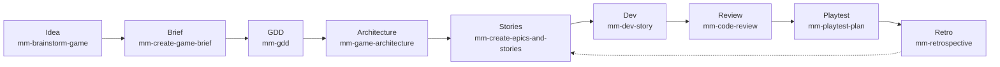

<p align="center">
  
</p>

<h1 align="center">MonkeyMode</h1>

<p align="center"><strong>I'm Monkey Game Developer 🐒</strong></p>

<p align="center">
  <a href="LICENSE"></a>
  <a href="#install"></a>
  <a href="#plugins"></a>
  <a href="CONTRIBUTING.md"></a>
</p>

<p align="center">
  <a href="#engines"></a>
  <a href="#engines"></a>
  <a href="#engines"></a>
  <a href="#engines"></a>
  <a href="#without-claude-code"></a>
</p>

<div align="center">

[English](README.md) · **한국어** · [日本語](README.ja.md) · [简体中文](README.zh-CN.md) · [繁體中文](README.zh-TW.md) · [Español](README.es.md) · [Português (Brasil)](README.pt-BR.md) · [Français](README.fr.md) · [Deutsch](README.de.md) · [Русский](README.ru.md) · [Tiếng Việt](README.vi.md)

</div>

<p align="center"><a href="#install">설치로 바로 가기 ↓</a></p>

---

> [!TIP]
> 조금 덜 똑똑한 에이전트(또는 개발자)도 MonkeyMode와 함께라면 똑똑해집니다.

MonkeyMode는 AI 코딩 에이전트를 위한 오픈소스 게임 개발 키트입니다. 에이전트는 이미 코드를 쓸 줄 압니다. MonkeyMode는 그 에이전트에게 **게임**을 만드는 법을 가르칩니다. 계획하고, 설계하고, 스토리 단위로 만들고, 자기 작업을 스스로 확인하고, 같은 엔진 실수를 두 번 하지 않게 합니다.

```text
idea → brief → GDD → architecture → stories → dev → review → playtest → retro
```

Claude Code 플러그인 마켓플레이스로 배포되며, `AGENTS.md`를 읽는 에이전트(Codex 등)에서도 동작합니다.

| 구성 | 수 | 내용 |
|---|---:|---|
| 워크플로 스킬 | 43 | `mm-core`: 브리프, GDD, 내러티브, UX, 아키텍처, 에픽과 스토리, 개발, 리뷰, 테스트, 플레이테스트, 회고, 그리고 `/mm-setup` |
| 페르소나 에이전트 | 9 | `mm-agents`: 게임 디자이너, 아키텍트, 개발자, 1인 개발자, 분석가, PM, UX 디자이너, 테크니컬 라이터, 파티 모드 |
| 아트·그래픽 도구 | 4 | `mm-art-tools`: 콘셉트 아트와 Blender, RenderDoc, Nsight Graphics CLI 하네스 |
| 엔진 어댑터 | 4 | Godot, Unity, Unreal, Bevy: 문서, 금지 패턴, 빌드·테스트 명령, 멀티플레이 노트 |
| 가드레일 | 3단계 | 편집할 때마다, 원하면 커밋할 때마다 기계적으로 검사하는 규칙 |
| 에이전트 운영 문서 | 15 | `docs/ai/`: 실행 정책, 검증 플레이북, 네트워크 권한, 인수인계, 커밋 전 절차 |

<a id="install"></a>

## 빠른 시작

**1. 설치** (Claude Code)

```
/plugin marketplace add AidenKim923/MonkeyMode
/plugin install mm-core@monkeymode
/plugin install mm-unity@monkeymode   # pick your engine: mm-godot, mm-unity, mm-unreal, mm-bevy
```

선택 팩: `/plugin install mm-agents@monkeymode`, `/plugin install mm-art-tools@monkeymode`.

**2. 게임 설정.** Claude Code에서 게임 프로젝트를 열고 **`/mm-setup`**을 실행합니다. 몇 가지를 물어본 뒤 모든 것을 설치하고 다음 단계를 알려 줍니다.

**3. 만들기 시작.** 추천받은 스킬을 실행합니다. 새 아이디어라면 `/mm-brainstorm-game`, 기존 코드베이스라면 `/mm-document-project`가 좋습니다. 다음에 뭘 해야 할지 모르겠으면 언제든 `/mm-help`에 물어보세요.

> [!NOTE]
> 요구 사항: Claude Code v2.1.271 이상(고정 선택지가 있는 플러그인 설정), Python 3.11+ 와 [`uv`](https://docs.astral.sh/uv/)(워크플로 스크립트와 가드레일), `.ps1` 도구용 PowerShell 7, 로컬 콘셉트/결정 페이지용 Node.js 18+.

<a id="features"></a>

## 왜 MonkeyMode인가

| 기능 | 의미 |
|---|---|
| **기획부터 출시까지의 워크플로** | 단계마다 스킬이 있고, 각 스킬은 남겨 둘 실제 파일을 씁니다: 브리프, GDD, 아키텍처, 스토리, 리뷰 노트, 플레이테스트 계획 |
| **주장하지 말고 확인하기** | 에이전트는 "완료"라고 말하기 전에 빌드, 테스트, 실행, 스크린샷으로 확인하고, 확인하지 못한 것은 `unverified`로 적습니다 |
| **가드레일** | 깨지기 쉬운 씬 탐색, 블로킹 호출, 안전하지 않은 네트워킹, 저장소 안의 비밀 정보를 편집할 때마다 막습니다 |
| **엔진 지식** | Godot, Unity, Unreal, Bevy는 각자 규칙, 명령, 멀티플레이 노트를 갖고, 나머지는 모두 공유합니다 |
| **사용자에게 맞춤** | 코드를 읽지 못한다고 하면 에이전트가 쉬운 말과 스크린샷으로 설명하고, 모든 것을 직접 확인하고, 위험한 작업 전에는 묻습니다 |
| **멀티플레이 대응** | 네트워크 작업을 위한 엔진 중립 권한 규칙과 테스트 등급(M0-M3) |

<a id="workflow"></a>

## 워크플로



| 단계 | 실행 | 결과물 |
|---|---|---|
| 1. 아이디어 | `mm-brainstorm-game` | `_mm-output/`의 브레인스토밍 세션 |
| 2. 브리프 | `mm-create-game-brief` | 핵심 판타지, 대상 플레이어, 훅, 레퍼런스, 범위 |
| 3. 설계 | `mm-gdd` (+ `mm-create-narrative`, `mm-ux`) | GDD, 에픽 개요, 결정 기록 |
| 4. 아키텍처 | `mm-game-architecture`, `mm-generate-project-context` | 아키텍처, 가드레일 제안, 프로젝트 규칙 시트 |
| 5. 스토리 | `mm-create-epics-and-stories`, `mm-check-implementation-readiness` | 위험도와 검증 수준이 붙은 에픽과 스토리 |
| 6. 스프린트 | `mm-sprint-planning`, `mm-sprint-status` | `sprint-status.yaml` |
| 7. 개발 | `mm-create-story` → `mm-dev-story` | 코드, 테스트, 4단 보고 |
| 8. 리뷰 | `mm-code-review` | 리뷰 결과와 후속 작업 |
| 9. 플레이테스트 | `mm-playtest-plan`, `mm-performance-test` | 플레이테스트 계획과 성능 테스트 계획 |
| 10. 회고 | `mm-retrospective` | 에픽마다 얻은 교훈 |

<details>
<summary><strong>지름길, 테스트, "완료"의 기준</strong></summary>

**지름길:** 전체 흐름 없이 작은 변경을 할 때는 `mm-quick-dev`, 스프린트가 틀어졌을 때는 `mm-correct-course`, 기존 코드베이스를 설명할 때는 `mm-document-project`, 디버깅에는 `mm-investigate`, 변경 사항을 안내받으려면 `mm-walkthrough`, 작업 중간에 멈출 때는 `mm-write-handoff`.

**테스트:** `mm-test-framework`는 엔진에 맞는 테스트 프레임워크를 준비하고, `mm-test-design`은 커버리지를 계획하고, `mm-test-automate`와 `mm-e2e-scaffold`는 테스트를 쓰고, `mm-test-review`는 테스트를 점검합니다.

**완료:** 모든 스토리는 네 부분으로 보고합니다. 무엇을 바꿨는지, 무엇에 영향을 줄 수 있는지, 어떻게 확인했는지(근거 포함), 후속 작업. 검증 수준은 L1(정적 검사), L2(동작 확인), L3(통합, 멀티플레이는 여러 플레이어를 접속해 M0-M3 등급)입니다.

단계별 출력 경로가 모두 담긴 표는 [사용자 가이드](docs/GUIDE.md#4-the-end-to-end-process)에 있습니다.

</details>

<a id="plugins"></a>

## 플러그인

| 플러그인 | 내용 |
|---|---|
| **`mm-core`** (필수) | `mm-` 워크플로 스킬 43개, `/mm-setup` 온보딩, 에이전트 운영 문서(`docs/ai/`), 편집 후 훅이 달린 가드레일 검사기, 비밀 정보·개인 경로 프로필, 콘셉트 갤러리와 결정 페이지 |
| **`mm-unity`** | C# 금지 API, 어셈블리 의존 방향 규칙, 배치 모드 테스트·빌드 스크립트, Mirror와 Netcode 노트, 에셋 임포트 체크리스트 |
| **`mm-godot`** | GDScript 노드 경로·시그널 규칙, 헤드리스 테스트 명령, 하이레벨 멀티플레이 노트 |
| **`mm-unreal`** | UObject/GC 규칙, 금지 C++ 패턴, UBT와 자동화 테스트 명령, 리플리케이션 노트 |
| **`mm-bevy`** | 시스템 안에서 블로킹 금지, 시스템 순서, Clippy 금지 항목, cargo test 명령, lightyear/replicon/renet 노트 |
| `mm-agents` (선택) | 페르소나 에이전트와 파티 모드 |
| `mm-art-tools` (선택) | `mm-concept-art`(ChatGPT 프롬프트, Codex CLI 또는 대안)와 Blender, RenderDoc, Nsight Graphics CLI 하네스 |

<details>
<summary><strong>mm-core: 스킬 43개 전체</strong></summary>

| 영역 | 스킬 |
|---|---|
| 아이디어와 설계 | `mm-brainstorm-game`, `mm-brainstorming`, `mm-forge-idea`, `mm-create-game-brief`, `mm-gdd`, `mm-create-narrative`, `mm-ux`, `mm-prd`, `mm-prfaq`, `mm-spec`, `mm-research` |
| 아키텍처와 계획 | `mm-game-architecture`, `mm-generate-project-context`, `mm-create-epics-and-stories`, `mm-check-implementation-readiness`, `mm-sprint-planning`, `mm-sprint-status`, `mm-correct-course` |
| 구현과 리뷰 | `mm-create-story`, `mm-dev-story`, `mm-quick-dev`, `mm-quick-dev-auto`, `mm-code-review`, `mm-review`, `mm-investigate`, `mm-walkthrough`, `mm-write-handoff`, `mm-document-project` |
| 테스트와 플레이테스트 | `mm-test-framework`, `mm-test-design`, `mm-test-automate`, `mm-e2e-scaffold`, `mm-test-review`, `mm-performance-test`, `mm-playtest-plan`, `mm-retrospective` |
| 도우미 | `mm-setup`, `mm-help`, `mm-customize`, `mm-advanced-elicitation`, `mm-clarify-ambiguous-request`, `mm-present-alternatives`, `mm-decision-picker` |

</details>

<details>
<summary><strong>mm-agents와 mm-art-tools</strong></summary>

| 플러그인 | 스킬 |
|---|---|
| `mm-agents` | `mm-agent-game-designer`, `mm-agent-game-architect`, `mm-agent-game-dev`, `mm-agent-game-solo-dev`, `mm-agent-analyst`, `mm-agent-pm`, `mm-agent-ux-designer`, `mm-agent-tech-writer`, `mm-party-mode` |
| `mm-art-tools` | `mm-concept-art`, `mm-cli-blender`, `mm-cli-renderdoc`, `mm-cli-nsight-graphics` |

</details>

<details>
<summary><strong>공통 vs. 엔진별</strong></summary>

| 공통 (mm-core) | 엔진별 (mm-&lt;engine&gt;) |
|---|---|
| 워크플로 템플릿: 게임 브리프, GDD, 내러티브, UX, PRD, 아키텍처, 에픽/스토리, 스토리, 플레이테스트 계획, 성능 테스트 계획, 테스트 설계, 코드 리뷰 체크리스트, 회고, 결정 기록, 프로젝트 컨텍스트 | 프로젝트 컨텍스트 템플릿 |
| 에이전트 행동, 검증, 인수인계, 범위 관리, git 위생, 팀 워크플로 | 아키텍처 부록(씬/에셋 구조; GDScript/C#, C#, C++/Blueprint, Rust/ECS) |
| 가드레일 검사기, 편집 후·커밋 전 훅, 비밀 정보 프로필 | 엔진 가드레일 프로필과 금지 패턴 |
| 자기 검증 도구(로그, 스크린샷, 다중 인스턴스 실행) | 빌드·테스트 명령(Unity는 스크립트도 포함) |
| 엔진 중립 네트워크 권한 규칙과 테스트 등급 | 멀티플레이 노트(Mirror/NGO, 리플리케이션, 하이레벨 멀티플레이, lightyear/renet) |
| 에셋·캐릭터 파이프라인 가이드 | `.gitignore` / LFS 힌트, 에셋 임포트(Unity) |

</details>

<a id="engines"></a>

## 엔진

| 엔진 | 플러그인 | 주요 내용 | 검증 상태 |
|---|---|---|---|
| **Godot 4** | `mm-godot` | 아래로는 호출, 위로는 시그널; 타입 지정 GDScript; `@rpc("any_peer")`는 보낸 쪽을 검증; GUT와 gdUnit4 명령 | Godot 4.7 공식 문서로 확인 |
| **Unity** | `mm-unity` | 씬 전체 `Find*`, `Resources.Load`, `async void` 금지; `.asmdef` 규칙; 배치 모드 스크립트; Mirror와 NGO 노트 | Unity 6 대상; 커뮤니티 검증 필요 |
| **Unreal Engine 5** | `mm-unreal` | `UPROPERTY() TObjectPtr<>` 멤버; 런타임 동기 로드 금지; 검증되는 Server RPC; `Automation RunTest` | UE 5.9 문서로 일부 확인 |
| **Bevy** | `mm-bevy` | 시스템은 블로킹하지 않음; 명시적 순서; 시뮬레이션은 `FixedUpdate`에서; Clippy `disallowed-methods` | Bevy 0.20 기준으로 확인 |

어댑터가 확인하지 못한 내용은 해당 문서에 *needs verification*으로 표시되어 있습니다. "기타" 엔진에는 직접 채우는 템플릿이 설치됩니다.

<a id="guardrails"></a>

## 가드레일과 코딩 수준

`mm-core`에는 사용자에 관한 설정이 두 가지 있습니다. `/plugin` → MonkeyMode core → configure(또는 `claude plugin configure mm-core@monkeymode`)에서 정합니다. 비워 두면 `/mm-setup`이 대신 물어봅니다.

| 설정 | 선택지 |
|---|---|
| `coding_level` | 코드를 읽을 수 있다 / 코드를 읽을 수 없다 |
| `uses_chatgpt` | 예 / 아니요("이미지는 ChatGPT를 추천합니다") |

| 코딩 수준 | 가드레일 | 에이전트의 작업 방식 |
|---|---|---|
| **코드를 읽을 수 없다** | 항상 **strict** | 모든 것을 직접 확인(테스트, 빌드, 게임 실행)하고, 쉬운 말과 스크린샷으로 설명하고, 삭제·리팩터링·설치·커밋·푸시 전에 묻습니다 |
| **코드를 읽을 수 있다** | **strict**, **standard**(기본) 또는 **relaxed** | 변경마다 이유를 붙인 diff 요약으로 보고합니다 |

| 단계 | 효과 |
|---|---|
| **strict** | 모든 규칙이 편집을 막습니다. 엔진 프로필에 있으면 주석 금지 규칙도 포함됩니다 |
| **standard** | 규칙이 막고, 주석은 허용합니다 |
| **relaxed** | 규칙 위반은 경고로만 보이고 막지 않습니다(선택한 커밋 전 훅은 계속 검사) |

<a id="setup"></a>

## `/mm-setup`이 묻는 것

<details>
<summary><strong>아홉 가지 질문</strong></summary>

| # | 질문 | 답에 따라 바뀌는 것 |
|---|---|---|
| 1 | 코드를 읽을 수 있나요? | "아니요"면 strict 가드레일과 쉬운 말로 스스로 검증하는 에이전트가 강제됩니다 |
| 2 | 엔진: Godot / Unity / Unreal / Bevy / 기타 | 해당 엔진 어댑터를 설치합니다(감지된 엔진이 미리 선택됨) |
| 3 | ChatGPT도 쓰나요? | 예: 콘셉트 아트를 바로 붙여 넣을 ChatGPT 프롬프트로 받습니다. 아니요: Codex CLI 또는 대안 |
| 4 | 1인 개발인가요, 팀인가요? | 팀이면 브랜치·풀 리퀘스트 규칙과 리뷰 체크리스트가 추가됩니다 |
| 5 | 장르, 대상 플랫폼 | `AGENTS.md`와 설정에 기록됩니다 |
| 6 | 멀티플레이인가요? (최대 인원) | 네트워킹 가이드와 네트워크 전용 가드레일이 추가됩니다 |
| 7 | 단계: 아이디어 / 기획 / 제작 / 다듬기 | 처음 추천할 스킬을 고릅니다 |
| 8 | 가드레일 단계(코드를 읽을 수 있을 때만) | strict / standard / relaxed |
| 9 | 문서 폴더 | MonkeyMode 문서가 모두 들어갈 곳(기본 `docs/`) |

분기 전체는 [`docs/ONBOARDING.md`](docs/ONBOARDING.md)에 있습니다.

</details>

<details>
<summary><strong>프로젝트에 설치되는 것</strong></summary>

```
AGENTS.md            MonkeyMode section (rules, your answers, engine snippet)
CLAUDE.md            @AGENTS.md
.monkeymode/         config.json (your project answers)
_mm/                 workflow runtime: config, catalog, scripts, custom/ overrides
docs/ai/             agent operating docs
docs/engine/         engine adapter docs
docs/project/        your approved design (filled over time)
docs/work/           work records and handoffs
guardrails/          secrets.json + <engine>.json
tools/               guardrail checker, verification tools
.githooks/           optional pre-commit guardrails
```

`/mm-setup`을 다시 실행하면 현재 답을 보여 주고 무엇을 바꿀지 묻습니다. MonkeyMode 구역 밖에서 직접 고친 내용은 그대로 남습니다.

</details>

<a id="without-claude-code"></a>

## Claude Code 없이 쓰기 (AGENTS.md 에이전트)

```
git clone <MonkeyMode repo URL>
uv run MonkeyMode/plugins/mm-core/skills/mm-setup/scripts/setup_project.py --target <your game> --interactive --apply --copy-skills agents
```

같은 질문을 하고, 같은 파일을 설치하고, 스킬을 `.agents/skills/`에 복사합니다. [`docs/ONBOARDING.md`](docs/ONBOARDING.md#without-claude-code-codex-and-other-agentsmd-agents)를 보세요.

## 커스터마이징

| 대상 | 위치 |
|---|---|
| 프로젝트 규칙 | 프로젝트의 `AGENTS.md`(MonkeyMode 마커 바깥), `docs/ai/`, `docs/engine/`. 스킬 지시보다 우선합니다 |
| 스킬 동작 | `_mm/custom/<skill-name>.toml`(팀) 또는 `<skill-name>.user.toml`(개인). `persistent_facts` 같은 배열은 기본값에 덧붙습니다. `/mm-customize`가 안내합니다 |
| 가드레일 | `guardrails/<engine>.json` 또는 새 `guardrails/<name>.json` 프로필(형식은 `docs/ai/12`). 에이전트는 스스로 규칙을 느슨하게 하지 않습니다 |

<details>
<summary><strong>설치 테스트</strong></summary>

```
claude plugin validate .                      # marketplace
claude plugin validate plugins/mm-core       # each plugin
claude --plugin-dir ./plugins/mm-core --plugin-dir ./plugins/mm-unity
```

마지막 명령은 마켓플레이스를 추가하지 않고 한 세션 동안만 플러그인을 불러와 Claude Code를 시작합니다. 기여자는 스크립트 테스트와 `uv run tools/scrub.py`도 실행합니다([CONTRIBUTING.md](CONTRIBUTING.md) 참고).

</details>

## 문서

| 문서 | 내용 |
|---|---|
| [사용자 가이드](docs/GUIDE.md) | 설치, 설정 인터뷰, 단계별 스킬과 출력 파일이 담긴 전체 워크플로, 가드레일, 이미지, 엔진 노트, FAQ |
| [온보딩](docs/ONBOARDING.md) | 설정 흐름도와 각 답이 바꾸는 것 |
| [인벤토리](docs/INVENTORY.md) | 공통 vs. 엔진별, 스킬 이름 대응표 |
| [기여하기](CONTRIBUTING.md) | 스킬, 엔진 어댑터, 가드레일 규칙 추가; 테스트; PR 체크리스트 |

## 기여하기

기여를 환영합니다. [CONTRIBUTING.md](CONTRIBUTING.md)와 [행동 강령](CODE_OF_CONDUCT.md)을 참고하세요. 엔진 어댑터 수정은 특히 환영합니다. 아직 남은 항목은 각 어댑터에 *needs verification*으로 표시되어 있습니다.

## 크레딧과 라이선스

MonkeyMode는 MIT 라이선스입니다([LICENSE](LICENSE)). 워크플로 스킬은 [BMad Method](https://github.com/bmad-code-org/BMAD-METHOD)와 BMad Game Dev Studio 모듈(MIT)을, 그래픽 도구 스킬은 [CLI-Anything](https://github.com/HKUDS/CLI-Anything)(Apache-2.0)을 바탕으로 합니다. MonkeyMode는 독립 프로젝트이며 원저작자의 보증을 받지 않았습니다. 자세한 내용과 모든 수정 사항: [NOTICE](NOTICE), [THIRD_PARTY_NOTICES.md](THIRD_PARTY_NOTICES.md).

## 스타 히스토리

<a href="https://www.star-history.com/#AidenKim923/MonkeyMode&Date">
 <picture>
   <source media="(prefers-color-scheme: dark)" srcset="https://api.star-history.com/svg?repos=AidenKim923/MonkeyMode&type=Date&theme=dark" />
   <source media="(prefers-color-scheme: light)" srcset="https://api.star-history.com/svg?repos=AidenKim923/MonkeyMode&type=Date" />
   
 </picture>
</a>

---

<p align="center">
  <br />
  <sub><strong>I'm Monkey Game Developer 🐒</strong> · MonkeyMode가 게임 만들기에 도움이 됐다면 스타를 눌러 주세요</sub>
</p>
