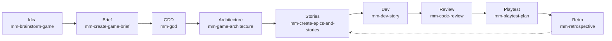

<p align="center">
  
</p>

<h1 align="center">MonkeyMode</h1>

<p align="center"><strong>I'm Monkey Game Developer 🐒</strong></p>

<p align="center">
  <a href="LICENSE"></a>
  <a href="#install"></a>
  <a href="#plugins"></a>
  <a href="CONTRIBUTING.md"></a>
</p>

<p align="center">
  <a href="#engines"></a>
  <a href="#engines"></a>
  <a href="#engines"></a>
  <a href="#engines"></a>
  <a href="#without-claude-code"></a>
</p>

<div align="center">

**English** · [한국어](README.ko.md) · [日本語](README.ja.md) · [简体中文](README.zh-CN.md) · [繁體中文](README.zh-TW.md) · [Español](README.es.md) · [Português (Brasil)](README.pt-BR.md) · [Français](README.fr.md) · [Deutsch](README.de.md) · [Русский](README.ru.md) · [Tiếng Việt](README.vi.md)

</div>

<p align="center"><a href="#install">Jump to install ↓</a></p>

---

> [!TIP]
> Even a not-so-smart agent (or dev) gets smart when it runs with MonkeyMode.

MonkeyMode is an open-source game-dev kit for AI coding agents. Your agent can already write code; MonkeyMode teaches it to make a **game**: plan it, design it, build it story by story, check its own work, and stop making the same engine mistakes twice.

```text
idea → brief → GDD → architecture → stories → dev → review → playtest → retro
```

It ships as a Claude Code plugin marketplace and also works for agents that read `AGENTS.md` (Codex and others).

| Included | Count | What it gives you |
|---|---:|---|
| Workflow skills | 43 | `mm-core`: brief, GDD, narrative, UX, architecture, epics and stories, dev, review, tests, playtest, retro, plus `/mm-setup` |
| Persona agents | 9 | `mm-agents`: game designer, architect, developer, solo dev, analyst, PM, UX designer, tech writer, party mode |
| Art and graphics tools | 4 | `mm-art-tools`: concept art and CLI harnesses for Blender, RenderDoc, Nsight Graphics |
| Engine adapters | 4 | Godot, Unity, Unreal, Bevy: docs, banned patterns, build and test commands, multiplayer notes |
| Guardrails | 3 levels | Machine-checked rules after every edit and, optionally, before every commit |
| Agent operating docs | 15 | `docs/ai/`: execution policy, verification playbook, network authority, handoff, pre-commit procedure |

<a id="install"></a>

## Quick start

**1. Install** (Claude Code)

```
/plugin marketplace add <owner>/MonkeyMode
/plugin install mm-core@monkeymode
/plugin install mm-unity@monkeymode   # pick your engine: mm-godot, mm-unity, mm-unreal, mm-bevy
```

Optional packs: `/plugin install mm-agents@monkeymode`, `/plugin install mm-art-tools@monkeymode`.

**2. Set up your game.** Open your game project in Claude Code and run **`/mm-setup`**. It interviews you, installs everything and tells you the next step.

**3. Start making it.** Run the skill it recommends, for example `/mm-brainstorm-game` for a fresh idea or `/mm-document-project` for an existing codebase. Ask `/mm-help` whenever you are unsure what comes next.

> [!NOTE]
> Requirements: Claude Code v2.1.271 or later (plugin settings with fixed choices), Python 3.11+ and [`uv`](https://docs.astral.sh/uv/) (workflow scripts and guardrails), PowerShell 7 for the `.ps1` tools, Node.js 18+ for the local concept/decision page.

<a id="features"></a>

## Why MonkeyMode

| Feature | What it means |
|---|---|
| **Design-to-ship workflow** | Each step is a skill that writes a real file you keep: brief, GDD, architecture, stories, review notes, playtest plans |
| **Verify, don't claim** | Agents build, test, run and screenshot before saying "done"; anything unchecked is written as `unverified` |
| **Guardrails** | Fragile scene lookups, blocking calls, unsafe networking and secrets in the repo are blocked after every edit |
| **Engine knowledge** | Godot, Unity, Unreal and Bevy each get their own rules, commands and multiplayer notes; everything else is shared |
| **Adapts to you** | Say you don't read code, and agents explain in plain words with screenshots, verify everything and ask before risky steps |
| **Multiplayer-aware** | Engine-neutral authority rules and test grades (M0-M3) for networked work |

<a id="workflow"></a>

## The workflow



| Step | Run | Produces |
|---|---|---|
| 1. Idea | `mm-brainstorm-game` | A brainstorming session in `_mm-output/` |
| 2. Brief | `mm-create-game-brief` | Core fantasy, audience, hook, references, scope |
| 3. Design | `mm-gdd` (+ `mm-create-narrative`, `mm-ux`) | GDD, epics outline, decision log |
| 4. Architecture | `mm-game-architecture`, `mm-generate-project-context` | Architecture, guardrail proposals, project rule sheet |
| 5. Stories | `mm-create-epics-and-stories`, `mm-check-implementation-readiness` | Epics and stories with risk and verification levels |
| 6. Sprint | `mm-sprint-planning`, `mm-sprint-status` | `sprint-status.yaml` |
| 7. Dev | `mm-create-story` → `mm-dev-story` | Code, tests and a four-part report |
| 8. Review | `mm-code-review` | Review findings and follow-up tasks |
| 9. Playtest | `mm-playtest-plan`, `mm-performance-test` | Playtest and performance test plans |
| 10. Retro | `mm-retrospective` | Lessons after each epic |

<details>
<summary><strong>Shortcuts, tests and how "done" works</strong></summary>

**Shortcuts:** `mm-quick-dev` for small changes without the full chain; `mm-correct-course` when a sprint goes off track; `mm-document-project` to describe an existing codebase; `mm-investigate` for debugging; `mm-walkthrough` for a guided tour of a change; `mm-write-handoff` when you stop mid-task.

**Tests:** `mm-test-framework` sets up a test framework for your engine, `mm-test-design` plans coverage, `mm-test-automate` and `mm-e2e-scaffold` write tests, `mm-test-review` checks them.

**Done:** every story is reported in four parts: what changed, what it can affect, how it was verified (with evidence), and follow-ups. Verification levels are L1 (static checks), L2 (behavior observed) and L3 (integration; with several players connected for multiplayer, grades M0-M3).

The full step table with output paths is in the [user guide](docs/GUIDE.md#4-the-end-to-end-process).

</details>

<a id="plugins"></a>

## Plugins

| Plugin | What you get |
|---|---|
| **`mm-core`** (required) | 43 `mm-` workflow skills, `/mm-setup` onboarding, agent operating docs (`docs/ai/`), the guardrail checker with an after-edit hook, a secrets/personal-path profile, a concept gallery and decision page |
| **`mm-unity`** | C# banned APIs, assembly direction rules, batch-mode test/build scripts, Mirror and Netcode notes, asset import checklist |
| **`mm-godot`** | GDScript node path and signal rules, headless test commands, high-level multiplayer notes |
| **`mm-unreal`** | UObject/GC rules, banned C++ patterns, UBT and automation-test commands, replication notes |
| **`mm-bevy`** | No blocking in systems, system ordering, Clippy bans, cargo test commands, lightyear/replicon/renet notes |
| `mm-agents` (optional) | Persona agents and party mode |
| `mm-art-tools` (optional) | `mm-concept-art` (ChatGPT prompts, Codex CLI, or alternatives) and CLI harnesses for Blender, RenderDoc, Nsight Graphics |

<details>
<summary><strong>mm-core: all 43 skills</strong></summary>

| Area | Skills |
|---|---|
| Ideas and design | `mm-brainstorm-game`, `mm-brainstorming`, `mm-forge-idea`, `mm-create-game-brief`, `mm-gdd`, `mm-create-narrative`, `mm-ux`, `mm-prd`, `mm-prfaq`, `mm-spec`, `mm-research` |
| Architecture and planning | `mm-game-architecture`, `mm-generate-project-context`, `mm-create-epics-and-stories`, `mm-check-implementation-readiness`, `mm-sprint-planning`, `mm-sprint-status`, `mm-correct-course` |
| Build and review | `mm-create-story`, `mm-dev-story`, `mm-quick-dev`, `mm-quick-dev-auto`, `mm-code-review`, `mm-review`, `mm-investigate`, `mm-walkthrough`, `mm-write-handoff`, `mm-document-project` |
| Tests and playtests | `mm-test-framework`, `mm-test-design`, `mm-test-automate`, `mm-e2e-scaffold`, `mm-test-review`, `mm-performance-test`, `mm-playtest-plan`, `mm-retrospective` |
| Helpers | `mm-setup`, `mm-help`, `mm-customize`, `mm-advanced-elicitation`, `mm-clarify-ambiguous-request`, `mm-present-alternatives`, `mm-decision-picker` |

</details>

<details>
<summary><strong>mm-agents and mm-art-tools</strong></summary>

| Plugin | Skills |
|---|---|
| `mm-agents` | `mm-agent-game-designer`, `mm-agent-game-architect`, `mm-agent-game-dev`, `mm-agent-game-solo-dev`, `mm-agent-analyst`, `mm-agent-pm`, `mm-agent-ux-designer`, `mm-agent-tech-writer`, `mm-party-mode` |
| `mm-art-tools` | `mm-concept-art`, `mm-cli-blender`, `mm-cli-renderdoc`, `mm-cli-nsight-graphics` |

</details>

<details>
<summary><strong>Shared vs. per engine</strong></summary>

| Shared (mm-core) | Per engine (mm-&lt;engine&gt;) |
|---|---|
| Workflow templates: game brief, GDD, narrative, UX, PRD, architecture, epics/stories, story, playtest plan, performance test plan, test design, code review checklist, retrospective, decision log, project context | Project-context template |
| Agent behavior, verification, handoff, scope control, git hygiene, team workflow | Architecture addendum (scene/asset structure; GDScript/C#, C#, C++/Blueprint, Rust/ECS) |
| Guardrail checker, after-edit and pre-commit hooks, secrets profile | Engine guardrail profile and banned patterns |
| Self-verification tools (logs, screenshots, multi-instance launch) | Build and test commands (Unity also ships scripts) |
| Engine-neutral network authority rules and test grades | Multiplayer notes (Mirror/NGO, replication, high-level multiplayer, lightyear/renet) |
| Asset and character pipeline guides | `.gitignore` / LFS hints, asset import (Unity) |

</details>

<a id="engines"></a>

## Engines

| Engine | Plugin | Highlights | Verification |
|---|---|---|---|
| **Godot 4** | `mm-godot` | Call down, signal up; typed GDScript; `@rpc("any_peer")` validates the sender; GUT and gdUnit4 commands | Checked against the Godot 4.7 docs |
| **Unity** | `mm-unity` | No scene-wide `Find*`, `Resources.Load` or `async void`; `.asmdef` rules; batch-mode scripts; Mirror and NGO notes | Targets Unity 6; needs community verification |
| **Unreal Engine 5** | `mm-unreal` | `UPROPERTY() TObjectPtr<>` members; no synchronous loads at runtime; validated Server RPCs; `Automation RunTest` | Partly checked against the UE 5.9 docs |
| **Bevy** | `mm-bevy` | Systems never block; explicit ordering; simulation in `FixedUpdate`; Clippy `disallowed-methods` | Checked against Bevy 0.20 |

Anything an adapter could not confirm is marked *needs verification* in its docs. "Other" engines get a fill-in template.

<a id="guardrails"></a>

## Guardrails and coding levels

`mm-core` has two settings about you, set in `/plugin` → MonkeyMode core → configure (or `claude plugin configure mm-core@monkeymode`). If you leave them unset, `/mm-setup` asks instead.

| Setting | Choices |
|---|---|
| `coding_level` | I can read code / I can't read code |
| `uses_chatgpt` | yes / no ("For images we recommend ChatGPT") |

| Coding level | Guardrails | How agents work |
|---|---|---|
| **I can't read code** | Always **strict** | Verify everything themselves (tests, build, run the game), explain in plain words and screenshots, ask before deleting, refactoring, installing, committing or pushing |
| **I can read code** | **strict**, **standard** (default) or **relaxed** | Reports come as a diff summary with the reason for each change |

| Level | Effect |
|---|---|
| **strict** | Every rule blocks the edit, including the no-comment rule where the engine profile has it |
| **standard** | Rules block; comments allowed |
| **relaxed** | Rule hits are shown as warnings; nothing blocks (the optional pre-commit hook still checks) |

<a id="setup"></a>

## What `/mm-setup` asks

<details>
<summary><strong>The nine questions</strong></summary>

| # | Question | What the answer changes |
|---|---|---|
| 1 | Can you read code? | "I can't" forces strict guardrails and plain-language, self-verifying agents |
| 2 | Engine: Godot / Unity / Unreal / Bevy / Other | Installs that engine's adapter (the detected engine is pre-selected) |
| 3 | Do you also use ChatGPT? | Yes: concept art arrives as paste-ready ChatGPT prompts. No: Codex CLI or alternatives |
| 4 | Solo or team? | Team adds branch and pull request rules and a review checklist |
| 5 | Genre, target platforms | Recorded in `AGENTS.md` and the config |
| 6 | Multiplayer? (and max players) | Adds the networking guides and networked-only guardrails |
| 7 | Stage: idea / planning / building / polishing | Picks the recommended first skill |
| 8 | Guardrail level (only if you read code) | strict / standard / relaxed |
| 9 | Docs folder | Where all MonkeyMode docs go (default `docs/`) |

The full branching flow is in [`docs/ONBOARDING.md`](docs/ONBOARDING.md).

</details>

<details>
<summary><strong>What lands in your project</strong></summary>

```
AGENTS.md            MonkeyMode section (rules, your answers, engine snippet)
CLAUDE.md            @AGENTS.md
.monkeymode/         config.json (your project answers)
_mm/                 workflow runtime: config, catalog, scripts, custom/ overrides
docs/ai/             agent operating docs
docs/engine/         engine adapter docs
docs/project/        your approved design (filled over time)
docs/work/           work records and handoffs
guardrails/          secrets.json + <engine>.json
tools/               guardrail checker, verification tools
.githooks/           optional pre-commit guardrails
```

Running `/mm-setup` again shows your current answers and asks what to change; your own edits outside the MonkeyMode sections are kept.

</details>

<a id="without-claude-code"></a>

## Without Claude Code (AGENTS.md agents)

```
git clone <MonkeyMode repo URL>
uv run MonkeyMode/plugins/mm-core/skills/mm-setup/scripts/setup_project.py --target <your game> --interactive --apply --copy-skills agents
```

This asks the same questions, installs the same files, and copies the skills to `.agents/skills/`. See [`docs/ONBOARDING.md`](docs/ONBOARDING.md#without-claude-code-codex-and-other-agentsmd-agents).

## Customizing

| What | Where |
|---|---|
| Project rules | `AGENTS.md` (outside the MonkeyMode markers), `docs/ai/` and `docs/engine/` in your project. They override skill instructions |
| Skill behavior | `_mm/custom/<skill-name>.toml` (team) or `<skill-name>.user.toml` (personal); arrays such as `persistent_facts` append to the defaults. `/mm-customize` walks you through it |
| Guardrails | `guardrails/<engine>.json` or a new `guardrails/<name>.json` profile (format in `docs/ai/12`). Agents never loosen them on their own |

<details>
<summary><strong>Testing the install</strong></summary>

```
claude plugin validate .                      # marketplace
claude plugin validate plugins/mm-core       # each plugin
claude --plugin-dir ./plugins/mm-core --plugin-dir ./plugins/mm-unity
```

The last command starts Claude Code with the plugins loaded for one session, without adding the marketplace. Contributors also run the script tests and `uv run tools/scrub.py` (see [CONTRIBUTING.md](CONTRIBUTING.md)).

</details>

## Documentation

| Doc | What's in it |
|---|---|
| [User guide](docs/GUIDE.md) | Install, the setup interview, the full workflow with the skill and output file for each step, guardrails, images, engine notes, FAQ |
| [Onboarding](docs/ONBOARDING.md) | The setup flow chart and what each answer changes |
| [Inventory](docs/INVENTORY.md) | Shared vs. per-engine, skill name map |
| [Contributing](CONTRIBUTING.md) | Adding skills, engine adapters and guardrail rules; tests; PR checklist |

## Contributing

Contributions are welcome: see [CONTRIBUTING.md](CONTRIBUTING.md) and the [Code of Conduct](CODE_OF_CONDUCT.md). Corrections to the engine adapters are especially welcome: open items are marked *needs verification* in each adapter.

## Credits and license

MonkeyMode is MIT-licensed ([LICENSE](LICENSE)). Its workflow skills are based on [BMad Method](https://github.com/bmad-code-org/BMAD-METHOD) and the BMad Game Dev Studio module (MIT), and the graphics-tool skills on [CLI-Anything](https://github.com/HKUDS/CLI-Anything) (Apache-2.0). MonkeyMode is independent and not endorsed by their authors. Details and every modification: [NOTICE](NOTICE), [THIRD_PARTY_NOTICES.md](THIRD_PARTY_NOTICES.md).

---

<p align="center">
  <br />
  <sub><strong>I'm Monkey Game Developer 🐒</strong> · If MonkeyMode helps your game, give it a star</sub>
</p>

<!-- Star history: once the repository has a public owner, replace <owner> below and uncomment.
<p align="center"><a href="https://www.star-history.com/#<owner>/MonkeyMode&Date">/MonkeyMode&type=Date" alt="Star history" width="600" /></a></p>
-->
