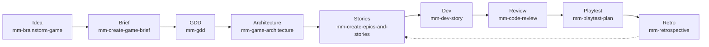

<p align="center">
  
</p>

<h1 align="center">MonkeyMode</h1>

<p align="center"><strong>I'm Monkey Game Developer 🐒</strong></p>

<p align="center">
  <a href="LICENSE"></a>
  <a href="#install"></a>
  <a href="#plugins"></a>
  <a href="CONTRIBUTING.md"></a>
</p>

<p align="center">
  <a href="#engines"></a>
  <a href="#engines"></a>
  <a href="#engines"></a>
  <a href="#engines"></a>
  <a href="#without-claude-code"></a>
</p>

<div align="center">

[English](README.md) · [한국어](README.ko.md) · [日本語](README.ja.md) · [简体中文](README.zh-CN.md) · [繁體中文](README.zh-TW.md) · [Español](README.es.md) · **Português (Brasil)** · [Français](README.fr.md) · [Deutsch](README.de.md) · [Русский](README.ru.md) · [Tiếng Việt](README.vi.md)

</div>

<p align="center"><a href="#install">Ir para a instalação ↓</a></p>

---

> [!TIP]
> Até um agente (ou dev) não tão esperto fica esperto quando roda com o MonkeyMode.

O MonkeyMode é um kit de desenvolvimento de jogos open source para agentes de programação com IA. Seu agente já sabe escrever código; o MonkeyMode ensina ele a fazer um **jogo**: planejar, projetar, construir história por história, conferir o próprio trabalho e parar de repetir os mesmos erros de engine.

```text
idea → brief → GDD → architecture → stories → dev → review → playtest → retro
```

Ele é distribuído como um marketplace de plugins do Claude Code e também funciona com agentes que leem `AGENTS.md` (Codex e outros).

| Incluído | Quantidade | O que você ganha |
|---|---:|---|
| Skills de fluxo de trabalho | 43 | `mm-core`: brief, GDD, narrativa, UX, arquitetura, épicos e histórias, desenvolvimento, revisão, testes, playtest, retrospectiva, e `/mm-setup` |
| Agentes com persona | 9 | `mm-agents`: game designer, arquiteto, desenvolvedor, dev solo, analista, PM, designer de UX, redator técnico, modo festa |
| Ferramentas de arte e gráficos | 4 | `mm-art-tools`: arte conceitual e CLIs para Blender, RenderDoc, Nsight Graphics |
| Adaptadores de engine | 4 | Godot, Unity, Unreal, Bevy: documentação, padrões proibidos, comandos de build e teste, notas de multiplayer |
| Guardrails | 3 níveis | Regras checadas automaticamente após cada edição e, se você quiser, antes de cada commit |
| Documentos operacionais para agentes | 15 | `docs/ai/`: política de execução, guia de verificação, autoridade de rede, passagem de bastão, procedimento antes do commit |

<a id="install"></a>

## Início rápido

**1. Instale** (Claude Code)

```
/plugin marketplace add AidenKim923/MonkeyMode
/plugin install mm-core@monkeymode
/plugin install mm-unity@monkeymode   # pick your engine: mm-godot, mm-unity, mm-unreal, mm-bevy
```

Pacotes opcionais: `/plugin install mm-agents@monkeymode`, `/plugin install mm-art-tools@monkeymode`.

**2. Configure seu jogo.** Abra o projeto do jogo no Claude Code e rode **`/mm-setup`**. Ele faz algumas perguntas, instala tudo e diz qual é o próximo passo.

**3. Comece a fazer.** Rode a skill recomendada, por exemplo `/mm-brainstorm-game` para uma ideia nova ou `/mm-document-project` para um código existente. Pergunte ao `/mm-help` sempre que não souber o que vem depois.

> [!NOTE]
> Requisitos: Claude Code v2.1.271 ou mais recente (configurações de plugin com opções fixas), Python 3.11+ e [`uv`](https://docs.astral.sh/uv/) (scripts do fluxo e guardrails), PowerShell 7 para as ferramentas `.ps1`, Node.js 18+ para a página local de conceitos/decisões.

<a id="features"></a>

## Por que MonkeyMode

| Recurso | O que significa |
|---|---|
| **Fluxo do design ao lançamento** | Cada passo é uma skill que escreve um arquivo de verdade que você guarda: brief, GDD, arquitetura, histórias, notas de revisão, planos de playtest |
| **Verificar, não alegar** | Os agentes compilam, testam, executam e tiram screenshots antes de dizer "pronto"; o que não foi checado é escrito como `unverified` |
| **Guardrails** | Buscas frágeis na cena, chamadas bloqueantes, rede insegura e segredos no repositório são bloqueados após cada edição |
| **Conhecimento de engine** | Godot, Unity, Unreal e Bevy têm suas próprias regras, comandos e notas de multiplayer; todo o resto é compartilhado |
| **Se adapta a você** | Se você diz que não lê código, os agentes explicam com palavras simples e screenshots, verificam tudo sozinhos e perguntam antes de passos arriscados |
| **Pronto para multiplayer** | Regras de autoridade independentes de engine e graus de teste (M0-M3) para o trabalho em rede |

<a id="workflow"></a>

## O fluxo de trabalho



| Passo | Rode | Gera |
|---|---|---|
| 1. Ideia | `mm-brainstorm-game` | Uma sessão de brainstorming em `_mm-output/` |
| 2. Brief | `mm-create-game-brief` | Fantasia central, público, gancho, referências, escopo |
| 3. Design | `mm-gdd` (+ `mm-create-narrative`, `mm-ux`) | GDD, esboço de épicos, registro de decisões |
| 4. Arquitetura | `mm-game-architecture`, `mm-generate-project-context` | Arquitetura, propostas de guardrails, folha de regras do projeto |
| 5. Histórias | `mm-create-epics-and-stories`, `mm-check-implementation-readiness` | Épicos e histórias com níveis de risco e de verificação |
| 6. Sprint | `mm-sprint-planning`, `mm-sprint-status` | `sprint-status.yaml` |
| 7. Desenvolvimento | `mm-create-story` → `mm-dev-story` | Código, testes e um relatório em quatro partes |
| 8. Revisão | `mm-code-review` | Achados da revisão e tarefas de acompanhamento |
| 9. Playtest | `mm-playtest-plan`, `mm-performance-test` | Planos de playtest e de teste de desempenho |
| 10. Retro | `mm-retrospective` | Lições após cada épico |

<details>
<summary><strong>Atalhos, testes e como funciona o "pronto"</strong></summary>

**Atalhos:** `mm-quick-dev` para mudanças pequenas sem a cadeia completa; `mm-correct-course` quando um sprint sai do rumo; `mm-document-project` para descrever um código existente; `mm-investigate` para depurar; `mm-walkthrough` para um tour guiado por uma mudança; `mm-write-handoff` quando você para no meio de uma tarefa.

**Testes:** `mm-test-framework` prepara um framework de testes para sua engine, `mm-test-design` planeja a cobertura, `mm-test-automate` e `mm-e2e-scaffold` escrevem testes e `mm-test-review` os revisa.

**Pronto:** cada história é relatada em quatro partes: o que mudou, o que pode afetar, como foi verificado (com evidências) e próximos passos. Os níveis de verificação são L1 (checagens estáticas), L2 (comportamento observado) e L3 (integração; com vários jogadores conectados no multiplayer, graus M0-M3).

A tabela completa de passos com os caminhos de saída está no [guia do usuário](docs/GUIDE.md#4-the-end-to-end-process).

</details>

<a id="plugins"></a>

## Plugins

| Plugin | O que vem |
|---|---|
| **`mm-core`** (obrigatório) | 43 skills de fluxo `mm-`, o onboarding `/mm-setup`, documentos operacionais para agentes (`docs/ai/`), o verificador de guardrails com um hook após cada edição, um perfil de segredos e caminhos pessoais, uma galeria de conceitos e uma página de decisões |
| **`mm-unity`** | APIs de C# proibidas, regras de direção entre assemblies, scripts de teste/build em modo batch, notas de Mirror e Netcode, checklist de importação de assets |
| **`mm-godot`** | Regras de caminhos de nós e sinais em GDScript, comandos de teste headless, notas de multiplayer de alto nível |
| **`mm-unreal`** | Regras de UObject/GC, padrões de C++ proibidos, comandos de UBT e testes automatizados, notas de replicação |
| **`mm-bevy`** | Nada de bloqueio em sistemas, ordem de sistemas, proibições do Clippy, comandos de cargo test, notas de lightyear/replicon/renet |
| `mm-agents` (opcional) | Agentes com persona e modo festa |
| `mm-art-tools` (opcional) | `mm-concept-art` (prompts para o ChatGPT, Codex CLI ou alternativas) e CLIs para Blender, RenderDoc, Nsight Graphics |

<details>
<summary><strong>mm-core: todas as 43 skills</strong></summary>

| Área | Skills |
|---|---|
| Ideias e design | `mm-brainstorm-game`, `mm-brainstorming`, `mm-forge-idea`, `mm-create-game-brief`, `mm-gdd`, `mm-create-narrative`, `mm-ux`, `mm-prd`, `mm-prfaq`, `mm-spec`, `mm-research` |
| Arquitetura e planejamento | `mm-game-architecture`, `mm-generate-project-context`, `mm-create-epics-and-stories`, `mm-check-implementation-readiness`, `mm-sprint-planning`, `mm-sprint-status`, `mm-correct-course` |
| Construção e revisão | `mm-create-story`, `mm-dev-story`, `mm-quick-dev`, `mm-quick-dev-auto`, `mm-code-review`, `mm-review`, `mm-investigate`, `mm-walkthrough`, `mm-write-handoff`, `mm-document-project` |
| Testes e playtests | `mm-test-framework`, `mm-test-design`, `mm-test-automate`, `mm-e2e-scaffold`, `mm-test-review`, `mm-performance-test`, `mm-playtest-plan`, `mm-retrospective` |
| Auxiliares | `mm-setup`, `mm-help`, `mm-customize`, `mm-advanced-elicitation`, `mm-clarify-ambiguous-request`, `mm-present-alternatives`, `mm-decision-picker` |

</details>

<details>
<summary><strong>mm-agents e mm-art-tools</strong></summary>

| Plugin | Skills |
|---|---|
| `mm-agents` | `mm-agent-game-designer`, `mm-agent-game-architect`, `mm-agent-game-dev`, `mm-agent-game-solo-dev`, `mm-agent-analyst`, `mm-agent-pm`, `mm-agent-ux-designer`, `mm-agent-tech-writer`, `mm-party-mode` |
| `mm-art-tools` | `mm-concept-art`, `mm-cli-blender`, `mm-cli-renderdoc`, `mm-cli-nsight-graphics` |

</details>

<details>
<summary><strong>Compartilhado vs. por engine</strong></summary>

| Compartilhado (mm-core) | Por engine (mm-&lt;engine&gt;) |
|---|---|
| Modelos do fluxo: brief, GDD, narrativa, UX, PRD, arquitetura, épicos/histórias, história, plano de playtest, plano de teste de desempenho, design de testes, checklist de revisão de código, retrospectiva, registro de decisões, contexto do projeto | Modelo de contexto do projeto |
| Comportamento do agente, verificação, passagem de bastão, controle de escopo, higiene de git, fluxo de equipe | Adendo de arquitetura (estrutura de cenas/assets; GDScript/C#, C#, C++/Blueprint, Rust/ECS) |
| Verificador de guardrails, hooks após a edição e antes do commit, perfil de segredos | Perfil de guardrails da engine e padrões proibidos |
| Ferramentas de autoverificação (logs, screenshots, várias instâncias) | Comandos de build e teste (a Unity também traz scripts) |
| Regras de autoridade de rede e graus de teste independentes de engine | Notas de multiplayer (Mirror/NGO, replicação, multiplayer de alto nível, lightyear/renet) |
| Guias do pipeline de assets e personagens | Dicas de `.gitignore` / LFS, importação de assets (Unity) |

</details>

<a id="engines"></a>

## Engines

| Engine | Plugin | Destaques | Verificação |
|---|---|---|---|
| **Godot 4** | `mm-godot` | Chamar para baixo, sinalizar para cima; GDScript tipado; `@rpc("any_peer")` valida o remetente; comandos de GUT e gdUnit4 | Conferido com a documentação do Godot 4.7 |
| **Unity** | `mm-unity` | Sem `Find*` na cena inteira, `Resources.Load` ou `async void`; regras de `.asmdef`; scripts em modo batch; notas de Mirror e NGO | Voltado para a Unity 6; precisa de verificação da comunidade |
| **Unreal Engine 5** | `mm-unreal` | Membros `UPROPERTY() TObjectPtr<>`; sem carregamento síncrono em tempo de execução; Server RPCs validados; `Automation RunTest` | Conferido em parte com a documentação da UE 5.9 |
| **Bevy** | `mm-bevy` | Sistemas nunca bloqueiam; ordem explícita; simulação em `FixedUpdate`; Clippy `disallowed-methods` | Conferido com o Bevy 0.20 |

Tudo o que um adaptador não conseguiu confirmar está marcado como *needs verification* na documentação dele. Engines "Outra" recebem um modelo para preencher.

<a id="guardrails"></a>

## Guardrails e nível de programação

O `mm-core` tem duas configurações sobre você, definidas em `/plugin` → MonkeyMode core → configure (ou `claude plugin configure mm-core@monkeymode`). Se você deixar em branco, o `/mm-setup` pergunta.

| Configuração | Opções |
|---|---|
| `coding_level` | Consigo ler código / Não consigo ler código |
| `uses_chatgpt` | sim / não ("Para imagens recomendamos o ChatGPT") |

| Nível de programação | Guardrails | Como os agentes trabalham |
|---|---|---|
| **Não consigo ler código** | Sempre **strict** | Verificam tudo sozinhos (testes, build, rodar o jogo), explicam com palavras simples e screenshots, e perguntam antes de apagar, refatorar, instalar, fazer commit ou push |
| **Consigo ler código** | **strict**, **standard** (padrão) ou **relaxed** | Relatam com um resumo do diff e o motivo de cada mudança |

| Nível | Efeito |
|---|---|
| **strict** | Toda regra bloqueia a edição, incluindo a regra de não comentar quando o perfil da engine a tem |
| **standard** | As regras bloqueiam; comentários são permitidos |
| **relaxed** | Violações aparecem como avisos; nada bloqueia (o hook opcional antes do commit continua checando) |

<a id="setup"></a>

## O que o `/mm-setup` pergunta

<details>
<summary><strong>As nove perguntas</strong></summary>

| # | Pergunta | O que a resposta muda |
|---|---|---|
| 1 | Você consegue ler código? | "Não" impõe guardrails strict e agentes que se autoverificam e falam em linguagem simples |
| 2 | Engine: Godot / Unity / Unreal / Bevy / Outra | Instala o adaptador dessa engine (a engine detectada já vem selecionada) |
| 3 | Você também usa o ChatGPT? | Sim: a arte conceitual chega como prompts do ChatGPT prontos para colar. Não: Codex CLI ou alternativas |
| 4 | Solo ou em equipe? | Em equipe entram regras de branch e pull request e um checklist de revisão |
| 5 | Gênero, plataformas-alvo | Registrados no `AGENTS.md` e na configuração |
| 6 | Multiplayer? (e máximo de jogadores) | Adiciona os guias de rede e os guardrails só para rede |
| 7 | Fase: ideia / planejamento / produção / polimento | Escolhe a primeira skill recomendada |
| 8 | Nível de guardrails (só se você lê código) | strict / standard / relaxed |
| 9 | Pasta de documentação | Onde fica toda a documentação do MonkeyMode (padrão `docs/`) |

O fluxo completo com todas as ramificações está em [`docs/ONBOARDING.md`](docs/ONBOARDING.md).

</details>

<details>
<summary><strong>O que vai para o seu projeto</strong></summary>

```
AGENTS.md            MonkeyMode section (rules, your answers, engine snippet)
CLAUDE.md            @AGENTS.md
.monkeymode/         config.json (your project answers)
_mm/                 workflow runtime: config, catalog, scripts, custom/ overrides
docs/ai/             agent operating docs
docs/engine/         engine adapter docs
docs/project/        your approved design (filled over time)
docs/work/           work records and handoffs
guardrails/          secrets.json + <engine>.json
tools/               guardrail checker, verification tools
.githooks/           optional pre-commit guardrails
```

Rodar o `/mm-setup` de novo mostra suas respostas atuais e pergunta o que mudar; suas próprias edições fora das seções do MonkeyMode são mantidas.

</details>

<a id="without-claude-code"></a>

## Sem o Claude Code (agentes com AGENTS.md)

```
git clone <MonkeyMode repo URL>
uv run MonkeyMode/plugins/mm-core/skills/mm-setup/scripts/setup_project.py --target <your game> --interactive --apply --copy-skills agents
```

Faz as mesmas perguntas, instala os mesmos arquivos e copia as skills para `.agents/skills/`. Veja [`docs/ONBOARDING.md`](docs/ONBOARDING.md#without-claude-code-codex-and-other-agentsmd-agents).

## Personalização

| O quê | Onde |
|---|---|
| Regras do projeto | `AGENTS.md` (fora dos marcadores do MonkeyMode), `docs/ai/` e `docs/engine/` no seu projeto. Elas têm prioridade sobre as instruções das skills |
| Comportamento das skills | `_mm/custom/<skill-name>.toml` (equipe) ou `<skill-name>.user.toml` (pessoal); arrays como `persistent_facts` são somados aos padrões. O `/mm-customize` guia você |
| Guardrails | `guardrails/<engine>.json` ou um novo perfil `guardrails/<name>.json` (formato em `docs/ai/12`). Os agentes nunca os afrouxam por conta própria |

<details>
<summary><strong>Testando a instalação</strong></summary>

```
claude plugin validate .                      # marketplace
claude plugin validate plugins/mm-core       # each plugin
claude --plugin-dir ./plugins/mm-core --plugin-dir ./plugins/mm-unity
```

O último comando inicia o Claude Code com os plugins carregados por uma sessão, sem adicionar o marketplace. Quem contribui também roda os testes dos scripts e `uv run tools/scrub.py` (veja [CONTRIBUTING.md](CONTRIBUTING.md)).

</details>

## Documentação

| Documento | O que tem |
|---|---|
| [Guia do usuário](docs/GUIDE.md) | Instalação, a entrevista de configuração, o fluxo completo com a skill e o arquivo de saída de cada passo, guardrails, imagens, notas de engines, FAQ |
| [Onboarding](docs/ONBOARDING.md) | O fluxograma da configuração e o que cada resposta muda |
| [Inventário](docs/INVENTORY.md) | Compartilhado vs. por engine, mapa de nomes das skills |
| [Como contribuir](CONTRIBUTING.md) | Adicionar skills, adaptadores de engine e regras de guardrails; testes; checklist de PR |

## Como contribuir

Contribuições são bem-vindas: veja [CONTRIBUTING.md](CONTRIBUTING.md) e o [Código de Conduta](CODE_OF_CONDUCT.md). Correções nos adaptadores de engine são especialmente bem-vindas: os itens em aberto estão marcados como *needs verification* em cada adaptador.

## Créditos e licença

O MonkeyMode é licenciado sob MIT ([LICENSE](LICENSE)). As skills de fluxo de trabalho são baseadas no [BMad Method](https://github.com/bmad-code-org/BMAD-METHOD) e no módulo BMad Game Dev Studio (MIT), e as skills de ferramentas gráficas no [CLI-Anything](https://github.com/HKUDS/CLI-Anything) (Apache-2.0). O MonkeyMode é independente e não tem o endosso dos autores. Detalhes e cada modificação: [NOTICE](NOTICE), [THIRD_PARTY_NOTICES.md](THIRD_PARTY_NOTICES.md).

## Histórico de estrelas

<a href="https://www.star-history.com/#AidenKim923/MonkeyMode&Date">
 <picture>
   <source media="(prefers-color-scheme: dark)" srcset="https://api.star-history.com/svg?repos=AidenKim923/MonkeyMode&type=Date&theme=dark" />
   <source media="(prefers-color-scheme: light)" srcset="https://api.star-history.com/svg?repos=AidenKim923/MonkeyMode&type=Date" />
   
 </picture>
</a>

---

<p align="center">
  <br />
  <sub><strong>I'm Monkey Game Developer 🐒</strong> · Se o MonkeyMode ajudar no seu jogo, deixe uma estrela</sub>
</p>
