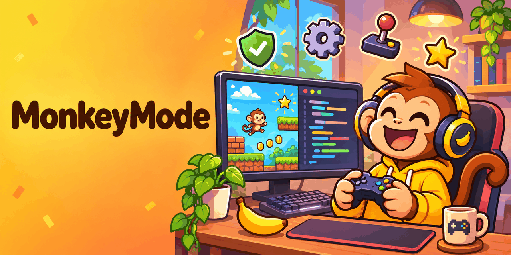
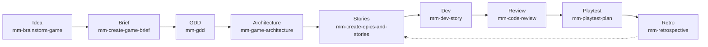

<p align="center">
  
</p>

<h1 align="center">MonkeyMode</h1>

<p align="center"><strong>I'm Monkey Game Developer 🐒</strong></p>

<p align="center">
  <a href="LICENSE"></a>
  <a href="#install"></a>
  <a href="#plugins"></a>
  <a href="CONTRIBUTING.md"></a>
</p>

<p align="center">
  <a href="#engines"></a>
  <a href="#engines"></a>
  <a href="#engines"></a>
  <a href="#engines"></a>
  <a href="#without-claude-code"></a>
</p>

<div align="center">

[English](README.md) · [한국어](README.ko.md) · [日本語](README.ja.md) · [简体中文](README.zh-CN.md) · [繁體中文](README.zh-TW.md) · [Español](README.es.md) · [Português (Brasil)](README.pt-BR.md) · [Français](README.fr.md) · [Deutsch](README.de.md) · **Русский** · [Tiếng Việt](README.vi.md)

</div>

<p align="center"><a href="#install">К установке ↓</a></p>

---

> [!TIP]
> Даже не самый умный агент (или разработчик) становится умным, когда работает с MonkeyMode.

MonkeyMode — набор с открытым исходным кодом для разработки игр с помощью ИИ-агентов для программирования. Ваш агент уже умеет писать код; MonkeyMode учит его делать **игру**: планировать, проектировать, собирать историю за историей, проверять собственную работу и не повторять одни и те же ошибки движка дважды.

```text
idea → brief → GDD → architecture → stories → dev → review → playtest → retro
```

Он распространяется как маркетплейс плагинов Claude Code и также работает с агентами, которые читают `AGENTS.md` (Codex и другие).

| Что входит | Кол-во | Что это даёт |
|---|---:|---|
| Навыки рабочего процесса | 43 | `mm-core`: бриф, GDD, нарратив, UX, архитектура, эпики и истории, разработка, ревью, тесты, плейтест, ретроспектива, а также `/mm-setup` |
| Агенты-персоны | 9 | `mm-agents`: геймдизайнер, архитектор, разработчик, соло-разработчик, аналитик, PM, UX-дизайнер, технический писатель, режим вечеринки |
| Инструменты для арта и графики | 4 | `mm-art-tools`: концепт-арт и CLI-обвязки для Blender, RenderDoc, Nsight Graphics |
| Адаптеры движков | 4 | Godot, Unity, Unreal, Bevy: документация, запрещённые шаблоны, команды сборки и тестов, заметки о мультиплеере |
| Ограничители | 3 уровня | Правила, которые автоматически проверяются после каждой правки и, по желанию, перед каждым коммитом |
| Рабочие документы для агентов | 15 | `docs/ai/`: политика выполнения, руководство по проверке, сетевые полномочия, передача работы, процедура перед коммитом |

<a id="install"></a>

## Быстрый старт

**1. Установка** (Claude Code)

```
/plugin marketplace add AidenKim923/MonkeyMode
/plugin install mm-core@monkeymode
/plugin install mm-unity@monkeymode   # pick your engine: mm-godot, mm-unity, mm-unreal, mm-bevy
```

Дополнительные пакеты: `/plugin install mm-agents@monkeymode`, `/plugin install mm-art-tools@monkeymode`.

**2. Настройте игру.** Откройте проект игры в Claude Code и запустите **`/mm-setup`**. Он задаст несколько вопросов, всё установит и подскажет следующий шаг.

**3. Начинайте делать.** Запустите рекомендованный навык, например `/mm-brainstorm-game` для новой идеи или `/mm-document-project` для существующего кода. Если не знаете, что дальше, спросите `/mm-help`.

> [!NOTE]
> Требования: Claude Code v2.1.271 или новее (настройки плагина с фиксированными вариантами), Python 3.11+ и [`uv`](https://docs.astral.sh/uv/) (скрипты рабочего процесса и ограничители), PowerShell 7 для инструментов `.ps1`, Node.js 18+ для локальной страницы концептов и решений.

<a id="features"></a>

## Почему MonkeyMode

| Возможность | Что это значит |
|---|---|
| **Процесс от дизайна до релиза** | Каждый шаг — навык, который пишет настоящий файл, остающийся у вас: бриф, GDD, архитектура, истории, заметки ревью, планы плейтестов |
| **Проверять, а не заявлять** | Перед словом «готово» агенты собирают, тестируют, запускают и делают скриншоты; всё непроверенное помечается как `unverified` |
| **Ограничители** | Хрупкий поиск по сцене, блокирующие вызовы, небезопасный сетевой код и секреты в репозитории блокируются после каждой правки |
| **Знание движков** | У Godot, Unity, Unreal и Bevy свои правила, команды и заметки о мультиплеере; всё остальное общее |
| **Подстраивается под вас** | Если вы скажете, что не читаете код, агенты объясняют простыми словами со скриншотами, всё проверяют сами и спрашивают перед рискованными шагами |
| **Готов к мультиплееру** | Не зависящие от движка правила полномочий и уровни тестирования (M0-M3) для сетевой части |

<a id="workflow"></a>

## Рабочий процесс



| Шаг | Запуск | Результат |
|---|---|---|
| 1. Идея | `mm-brainstorm-game` | Сессия мозгового штурма в `_mm-output/` |
| 2. Бриф | `mm-create-game-brief` | Ключевая фантазия, аудитория, крючок, референсы, объём |
| 3. Дизайн | `mm-gdd` (+ `mm-create-narrative`, `mm-ux`) | GDD, план эпиков, журнал решений |
| 4. Архитектура | `mm-game-architecture`, `mm-generate-project-context` | Архитектура, предложения ограничителей, лист правил проекта |
| 5. Истории | `mm-create-epics-and-stories`, `mm-check-implementation-readiness` | Эпики и истории с уровнями риска и проверки |
| 6. Спринт | `mm-sprint-planning`, `mm-sprint-status` | `sprint-status.yaml` |
| 7. Разработка | `mm-create-story` → `mm-dev-story` | Код, тесты и отчёт из четырёх частей |
| 8. Ревью | `mm-code-review` | Замечания ревью и последующие задачи |
| 9. Плейтест | `mm-playtest-plan`, `mm-performance-test` | Планы плейтеста и тестов производительности |
| 10. Ретро | `mm-retrospective` | Выводы после каждого эпика |

<details>
<summary><strong>Короткие пути, тесты и что значит «готово»</strong></summary>

**Короткие пути:** `mm-quick-dev` для небольших изменений без всей цепочки; `mm-correct-course`, когда спринт сбился с курса; `mm-document-project`, чтобы описать существующий код; `mm-investigate` для отладки; `mm-walkthrough` для экскурсии по изменению; `mm-write-handoff`, когда вы останавливаетесь посреди задачи.

**Тесты:** `mm-test-framework` настраивает тестовый фреймворк для вашего движка, `mm-test-design` планирует покрытие, `mm-test-automate` и `mm-e2e-scaffold` пишут тесты, `mm-test-review` их проверяет.

**Готово:** каждая история сдаётся отчётом из четырёх частей: что изменилось, на что это может повлиять, как проверено (с доказательствами) и что дальше. Уровни проверки: L1 (статические проверки), L2 (поведение наблюдалось) и L3 (интеграция; для мультиплеера с несколькими подключёнными игроками, уровни M0-M3).

Полная таблица шагов с путями к результатам — в [руководстве пользователя](docs/GUIDE.md#4-the-end-to-end-process).

</details>

<a id="plugins"></a>

## Плагины

| Плагин | Что внутри |
|---|---|
| **`mm-core`** (обязательный) | 43 навыка рабочего процесса `mm-`, онбординг `/mm-setup`, рабочие документы для агентов (`docs/ai/`), проверка ограничителей с хуком после правки, профиль секретов и личных путей, галерея концептов и страница решений |
| **`mm-unity`** | Запрещённые API C#, правила направления зависимостей сборок, скрипты тестов и сборки в batch-режиме, заметки о Mirror и Netcode, чек-лист импорта ассетов |
| **`mm-godot`** | Правила путей к узлам и сигналов в GDScript, команды headless-тестов, заметки о высокоуровневом мультиплеере |
| **`mm-unreal`** | Правила UObject/GC, запрещённые шаблоны C++, команды UBT и автотестов, заметки о репликации |
| **`mm-bevy`** | Никаких блокировок в системах, порядок систем, запреты Clippy, команды cargo test, заметки о lightyear/replicon/renet |
| `mm-agents` (необязательный) | Агенты-персоны и режим вечеринки |
| `mm-art-tools` (необязательный) | `mm-concept-art` (промпты для ChatGPT, Codex CLI или альтернативы) и CLI-обвязки для Blender, RenderDoc, Nsight Graphics |

<details>
<summary><strong>mm-core: все 43 навыка</strong></summary>

| Область | Навыки |
|---|---|
| Идеи и дизайн | `mm-brainstorm-game`, `mm-brainstorming`, `mm-forge-idea`, `mm-create-game-brief`, `mm-gdd`, `mm-create-narrative`, `mm-ux`, `mm-prd`, `mm-prfaq`, `mm-spec`, `mm-research` |
| Архитектура и планирование | `mm-game-architecture`, `mm-generate-project-context`, `mm-create-epics-and-stories`, `mm-check-implementation-readiness`, `mm-sprint-planning`, `mm-sprint-status`, `mm-correct-course` |
| Разработка и ревью | `mm-create-story`, `mm-dev-story`, `mm-quick-dev`, `mm-quick-dev-auto`, `mm-code-review`, `mm-review`, `mm-investigate`, `mm-walkthrough`, `mm-write-handoff`, `mm-document-project` |
| Тесты и плейтесты | `mm-test-framework`, `mm-test-design`, `mm-test-automate`, `mm-e2e-scaffold`, `mm-test-review`, `mm-performance-test`, `mm-playtest-plan`, `mm-retrospective` |
| Помощники | `mm-setup`, `mm-help`, `mm-customize`, `mm-advanced-elicitation`, `mm-clarify-ambiguous-request`, `mm-present-alternatives`, `mm-decision-picker` |

</details>

<details>
<summary><strong>mm-agents и mm-art-tools</strong></summary>

| Плагин | Навыки |
|---|---|
| `mm-agents` | `mm-agent-game-designer`, `mm-agent-game-architect`, `mm-agent-game-dev`, `mm-agent-game-solo-dev`, `mm-agent-analyst`, `mm-agent-pm`, `mm-agent-ux-designer`, `mm-agent-tech-writer`, `mm-party-mode` |
| `mm-art-tools` | `mm-concept-art`, `mm-cli-blender`, `mm-cli-renderdoc`, `mm-cli-nsight-graphics` |

</details>

<details>
<summary><strong>Общее vs. для каждого движка</strong></summary>

| Общее (mm-core) | Для каждого движка (mm-&lt;engine&gt;) |
|---|---|
| Шаблоны процесса: бриф игры, GDD, нарратив, UX, PRD, архитектура, эпики/истории, история, план плейтеста, план тестов производительности, дизайн тестов, чек-лист код-ревью, ретроспектива, журнал решений, контекст проекта | Шаблон контекста проекта |
| Поведение агентов, проверка, передача работы, контроль объёма, гигиена git, командный процесс | Дополнение к архитектуре (структура сцен/ассетов; GDScript/C#, C#, C++/Blueprint, Rust/ECS) |
| Проверка ограничителей, хуки после правки и перед коммитом, профиль секретов | Профиль ограничителей движка и запрещённые шаблоны |
| Инструменты самопроверки (логи, скриншоты, запуск нескольких экземпляров) | Команды сборки и тестов (для Unity есть ещё и скрипты) |
| Не зависящие от движка правила сетевых полномочий и уровни тестирования | Заметки о мультиплеере (Mirror/NGO, репликация, высокоуровневый мультиплеер, lightyear/renet) |
| Руководства по пайплайну ассетов и персонажей | Подсказки по `.gitignore` / LFS, импорт ассетов (Unity) |

</details>

<a id="engines"></a>

## Движки

| Движок | Плагин | Главное | Проверка |
|---|---|---|---|
| **Godot 4** | `mm-godot` | Вызовы вниз, сигналы вверх; типизированный GDScript; `@rpc("any_peer")` проверяет отправителя; команды GUT и gdUnit4 | Сверено с документацией Godot 4.7 |
| **Unity** | `mm-unity` | Никаких `Find*` по всей сцене, `Resources.Load` и `async void`; правила `.asmdef`; скрипты batch-режима; заметки о Mirror и NGO | Для Unity 6; нужна проверка сообществом |
| **Unreal Engine 5** | `mm-unreal` | Члены `UPROPERTY() TObjectPtr<>`; никакой синхронной загрузки во время работы; проверяемые Server RPC; `Automation RunTest` | Частично сверено с документацией UE 5.9 |
| **Bevy** | `mm-bevy` | Системы никогда не блокируют; явный порядок; симуляция в `FixedUpdate`; Clippy `disallowed-methods` | Сверено с Bevy 0.20 |

Всё, что адаптер не смог подтвердить, помечено в его документации как *needs verification*. Для «другого» движка ставится шаблон для заполнения.

<a id="guardrails"></a>

## Ограничители и уровень владения кодом

У `mm-core` есть две настройки о вас; они задаются в `/plugin` → MonkeyMode core → configure (или `claude plugin configure mm-core@monkeymode`). Если их не задать, `/mm-setup` спросит сам.

| Настройка | Варианты |
|---|---|
| `coding_level` | Я умею читать код / Я не умею читать код |
| `uses_chatgpt` | да / нет («Для изображений рекомендуем ChatGPT») |

| Уровень | Ограничители | Как работают агенты |
|---|---|---|
| **Я не умею читать код** | Всегда **strict** | Всё проверяют сами (тесты, сборка, запуск игры), объясняют простыми словами со скриншотами и спрашивают перед удалением, рефакторингом, установкой, коммитом или пушем |
| **Я умею читать код** | **strict**, **standard** (по умолчанию) или **relaxed** | Отчёты приходят в виде сводки diff с причиной каждого изменения |

| Уровень | Действие |
|---|---|
| **strict** | Каждое правило блокирует правку, включая запрет комментариев, если он есть в профиле движка |
| **standard** | Правила блокируют; комментарии разрешены |
| **relaxed** | Нарушения показываются как предупреждения; ничего не блокируется (необязательный хук перед коммитом всё равно проверяет) |

<a id="setup"></a>

## О чём спрашивает `/mm-setup`

<details>
<summary><strong>Девять вопросов</strong></summary>

| # | Вопрос | Что меняет ответ |
|---|---|---|
| 1 | Вы умеете читать код? | «Нет» включает ограничители strict и агентов, которые сами всё проверяют и объясняют простыми словами |
| 2 | Движок: Godot / Unity / Unreal / Bevy / Другой | Устанавливает адаптер этого движка (обнаруженный движок выбран заранее) |
| 3 | Вы также пользуетесь ChatGPT? | Да: концепт-арт приходит в виде готовых к вставке промптов для ChatGPT. Нет: Codex CLI или альтернативы |
| 4 | Один или в команде? | Для команды добавляются правила веток и пул-реквестов и чек-лист ревью |
| 5 | Жанр, целевые платформы | Записываются в `AGENTS.md` и конфигурацию |
| 6 | Мультиплеер? (и максимум игроков) | Добавляет руководства по сети и ограничители только для сетевых игр |
| 7 | Стадия: идея / планирование / разработка / полировка | Определяет первый рекомендуемый навык |
| 8 | Уровень ограничителей (только если вы читаете код) | strict / standard / relaxed |
| 9 | Папка документации | Куда попадает вся документация MonkeyMode (по умолчанию `docs/`) |

Полная схема со всеми ветвлениями — в [`docs/ONBOARDING.md`](docs/ONBOARDING.md).

</details>

<details>
<summary><strong>Что появится в вашем проекте</strong></summary>

```
AGENTS.md            MonkeyMode section (rules, your answers, engine snippet)
CLAUDE.md            @AGENTS.md
.monkeymode/         config.json (your project answers)
_mm/                 workflow runtime: config, catalog, scripts, custom/ overrides
docs/ai/             agent operating docs
docs/engine/         engine adapter docs
docs/project/        your approved design (filled over time)
docs/work/           work records and handoffs
guardrails/          secrets.json + <engine>.json
tools/               guardrail checker, verification tools
.githooks/           optional pre-commit guardrails
```

Повторный запуск `/mm-setup` покажет ваши текущие ответы и спросит, что изменить; ваши собственные правки вне разделов MonkeyMode сохраняются.

</details>

<a id="without-claude-code"></a>

## Без Claude Code (агенты с AGENTS.md)

```
git clone <MonkeyMode repo URL>
uv run MonkeyMode/plugins/mm-core/skills/mm-setup/scripts/setup_project.py --target <your game> --interactive --apply --copy-skills agents
```

Задаёт те же вопросы, ставит те же файлы и копирует навыки в `.agents/skills/`. См. [`docs/ONBOARDING.md`](docs/ONBOARDING.md#without-claude-code-codex-and-other-agentsmd-agents).

## Настройка

| Что | Где |
|---|---|
| Правила проекта | `AGENTS.md` (вне маркеров MonkeyMode), `docs/ai/` и `docs/engine/` в вашем проекте. Они важнее инструкций навыков |
| Поведение навыков | `_mm/custom/<skill-name>.toml` (команда) или `<skill-name>.user.toml` (лично); массивы вроде `persistent_facts` дополняют значения по умолчанию. `/mm-customize` проведёт по шагам |
| Ограничители | `guardrails/<engine>.json` или новый профиль `guardrails/<name>.json` (формат в `docs/ai/12`). Агенты никогда не ослабляют их сами |

<details>
<summary><strong>Проверка установки</strong></summary>

```
claude plugin validate .                      # marketplace
claude plugin validate plugins/mm-core       # each plugin
claude --plugin-dir ./plugins/mm-core --plugin-dir ./plugins/mm-unity
```

Последняя команда запускает Claude Code с загруженными плагинами на одну сессию, не добавляя маркетплейс. Участники также запускают тесты скриптов и `uv run tools/scrub.py` (см. [CONTRIBUTING.md](CONTRIBUTING.md)).

</details>

## Документация

| Документ | Содержание |
|---|---|
| [Руководство пользователя](docs/GUIDE.md) | Установка, опрос при настройке, весь процесс с навыком и выходным файлом для каждого шага, ограничители, изображения, заметки о движках, FAQ |
| [Онбординг](docs/ONBOARDING.md) | Схема процесса настройки и что меняет каждый ответ |
| [Состав](docs/INVENTORY.md) | Общее vs. для каждого движка, таблица имён навыков |
| [Участие](CONTRIBUTING.md) | Добавление навыков, адаптеров движков и правил ограничителей; тесты; чек-лист PR |

## Участие

Вклад приветствуется: см. [CONTRIBUTING.md](CONTRIBUTING.md) и [Кодекс поведения](CODE_OF_CONDUCT.md). Особенно ждём исправлений в адаптерах движков: открытые пункты помечены в каждом адаптере как *needs verification*.

## Благодарности и лицензия

MonkeyMode распространяется по лицензии MIT ([LICENSE](LICENSE)). Навыки рабочего процесса основаны на [BMad Method](https://github.com/bmad-code-org/BMAD-METHOD) и модуле BMad Game Dev Studio (MIT), навыки графических инструментов — на [CLI-Anything](https://github.com/HKUDS/CLI-Anything) (Apache-2.0). MonkeyMode — независимый проект, не одобренный их авторами. Подробности и все изменения: [NOTICE](NOTICE), [THIRD_PARTY_NOTICES.md](THIRD_PARTY_NOTICES.md).

## История звёзд

<a href="https://www.star-history.com/#AidenKim923/MonkeyMode&Date">
 <picture>
   <source media="(prefers-color-scheme: dark)" srcset="https://api.star-history.com/svg?repos=AidenKim923/MonkeyMode&type=Date&theme=dark" />
   <source media="(prefers-color-scheme: light)" srcset="https://api.star-history.com/svg?repos=AidenKim923/MonkeyMode&type=Date" />
   
 </picture>
</a>

---

<p align="center">
  <br />
  <sub><strong>I'm Monkey Game Developer 🐒</strong> · Если MonkeyMode помогает вашей игре, поставьте звезду</sub>
</p>
