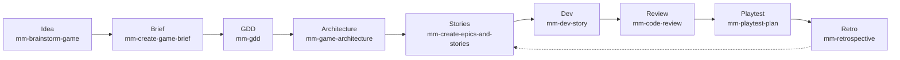

<p align="center">
  
</p>

<h1 align="center">MonkeyMode</h1>

<p align="center"><strong>I'm Monkey Game Developer 🐒</strong></p>

<p align="center">
  <a href="LICENSE"></a>
  <a href="#install"></a>
  <a href="#plugins"></a>
  <a href="CONTRIBUTING.md"></a>
</p>

<p align="center">
  <a href="#engines"></a>
  <a href="#engines"></a>
  <a href="#engines"></a>
  <a href="#engines"></a>
  <a href="#without-claude-code"></a>
</p>

<div align="center">

[English](README.md) · [한국어](README.ko.md) · [日本語](README.ja.md) · [简体中文](README.zh-CN.md) · [繁體中文](README.zh-TW.md) · [Español](README.es.md) · [Português (Brasil)](README.pt-BR.md) · [Français](README.fr.md) · [Deutsch](README.de.md) · [Русский](README.ru.md) · **Tiếng Việt**

</div>

<p align="center"><a href="#install">Đến phần cài đặt ↓</a></p>

---

> [!TIP]
> Ngay cả một agent (hay dev) không quá thông minh cũng trở nên thông minh khi chạy cùng MonkeyMode.

MonkeyMode là bộ công cụ phát triển game mã nguồn mở dành cho các agent lập trình AI. Agent của bạn vốn đã biết viết code; MonkeyMode dạy nó làm **game**: lên kế hoạch, thiết kế, xây dựng từng story, tự kiểm tra công việc của mình và không lặp lại cùng một lỗi engine hai lần.

```text
idea → brief → GDD → architecture → stories → dev → review → playtest → retro
```

Nó được phát hành dưới dạng marketplace plugin cho Claude Code và cũng hoạt động với các agent đọc `AGENTS.md` (Codex và các agent khác).

| Bao gồm | Số lượng | Bạn nhận được gì |
|---|---:|---|
| Skill quy trình | 43 | `mm-core`: brief, GDD, cốt truyện, UX, kiến trúc, epic và story, phát triển, review, kiểm thử, playtest, retrospective, cùng `/mm-setup` |
| Agent nhân vật | 9 | `mm-agents`: game designer, kiến trúc sư, lập trình viên, dev độc lập, chuyên viên phân tích, PM, UX designer, người viết tài liệu kỹ thuật, chế độ party |
| Công cụ mỹ thuật và đồ họa | 4 | `mm-art-tools`: concept art và CLI cho Blender, RenderDoc, Nsight Graphics |
| Adapter engine | 4 | Godot, Unity, Unreal, Bevy: tài liệu, mẫu bị cấm, lệnh build và kiểm thử, ghi chú multiplayer |
| Guardrail | 3 mức | Quy tắc được kiểm tra tự động sau mỗi lần sửa và, nếu muốn, trước mỗi commit |
| Tài liệu vận hành cho agent | 15 | `docs/ai/`: chính sách thực thi, sổ tay kiểm chứng, quyền mạng, bàn giao, quy trình trước commit |

<a id="install"></a>

## Bắt đầu nhanh

**1. Cài đặt** (Claude Code)

```
/plugin marketplace add <owner>/MonkeyMode
/plugin install mm-core@monkeymode
/plugin install mm-unity@monkeymode   # pick your engine: mm-godot, mm-unity, mm-unreal, mm-bevy
```

Gói tùy chọn: `/plugin install mm-agents@monkeymode`, `/plugin install mm-art-tools@monkeymode`.

**2. Thiết lập game.** Mở dự án game trong Claude Code và chạy **`/mm-setup`**. Nó hỏi bạn vài câu, cài đặt mọi thứ và cho biết bước tiếp theo.

**3. Bắt tay vào làm.** Chạy skill được đề xuất, ví dụ `/mm-brainstorm-game` cho ý tưởng mới hoặc `/mm-document-project` cho codebase có sẵn. Hãy hỏi `/mm-help` bất cứ khi nào bạn không chắc bước tiếp theo là gì.

> [!NOTE]
> Yêu cầu: Claude Code v2.1.271 trở lên (thiết lập plugin với các lựa chọn cố định), Python 3.11+ và [`uv`](https://docs.astral.sh/uv/) (script quy trình và guardrail), PowerShell 7 cho các công cụ `.ps1`, Node.js 18+ cho trang concept/quyết định cục bộ.

<a id="features"></a>

## Vì sao chọn MonkeyMode

| Tính năng | Ý nghĩa |
|---|---|
| **Quy trình từ thiết kế đến phát hành** | Mỗi bước là một skill viết ra một tệp thật mà bạn giữ lại: brief, GDD, kiến trúc, story, ghi chú review, kế hoạch playtest |
| **Kiểm chứng, không tuyên bố** | Agent build, kiểm thử, chạy và chụp màn hình trước khi nói "xong"; những gì chưa kiểm tra được ghi là `unverified` |
| **Guardrail** | Tìm kiếm scene dễ vỡ, lời gọi chặn, mã mạng không an toàn và bí mật trong repository bị chặn sau mỗi lần sửa |
| **Kiến thức engine** | Godot, Unity, Unreal và Bevy mỗi engine có quy tắc, lệnh và ghi chú multiplayer riêng; mọi thứ khác dùng chung |
| **Thích ứng với bạn** | Nếu bạn nói mình không đọc code, agent giải thích bằng lời đơn giản kèm ảnh chụp màn hình, tự kiểm chứng mọi thứ và hỏi trước các bước rủi ro |
| **Sẵn sàng cho multiplayer** | Quy tắc quyền độc lập với engine và các mức kiểm thử (M0-M3) cho phần chơi mạng |

<a id="workflow"></a>

## Quy trình



| Bước | Chạy | Kết quả |
|---|---|---|
| 1. Ý tưởng | `mm-brainstorm-game` | Một buổi brainstorm trong `_mm-output/` |
| 2. Brief | `mm-create-game-brief` | Trải nghiệm cốt lõi, người chơi mục tiêu, điểm hút, tham khảo, phạm vi |
| 3. Thiết kế | `mm-gdd` (+ `mm-create-narrative`, `mm-ux`) | GDD, dàn ý epic, nhật ký quyết định |
| 4. Kiến trúc | `mm-game-architecture`, `mm-generate-project-context` | Kiến trúc, đề xuất guardrail, bảng quy tắc dự án |
| 5. Story | `mm-create-epics-and-stories`, `mm-check-implementation-readiness` | Epic và story kèm mức rủi ro và mức kiểm chứng |
| 6. Sprint | `mm-sprint-planning`, `mm-sprint-status` | `sprint-status.yaml` |
| 7. Phát triển | `mm-create-story` → `mm-dev-story` | Code, kiểm thử và báo cáo bốn phần |
| 8. Review | `mm-code-review` | Kết quả review và việc cần làm tiếp |
| 9. Playtest | `mm-playtest-plan`, `mm-performance-test` | Kế hoạch playtest và kiểm thử hiệu năng |
| 10. Retro | `mm-retrospective` | Bài học sau mỗi epic |

<details>
<summary><strong>Lối tắt, kiểm thử và thế nào là "xong"</strong></summary>

**Lối tắt:** `mm-quick-dev` cho thay đổi nhỏ không cần cả chuỗi; `mm-correct-course` khi sprint đi chệch hướng; `mm-document-project` để mô tả codebase có sẵn; `mm-investigate` để gỡ lỗi; `mm-walkthrough` để được dẫn qua một thay đổi; `mm-write-handoff` khi bạn dừng giữa chừng.

**Kiểm thử:** `mm-test-framework` thiết lập framework kiểm thử cho engine của bạn, `mm-test-design` lên kế hoạch độ phủ, `mm-test-automate` và `mm-e2e-scaffold` viết test, `mm-test-review` kiểm tra test.

**Xong:** mỗi story được báo cáo theo bốn phần: đã thay đổi gì, có thể ảnh hưởng đến đâu, đã kiểm chứng thế nào (kèm bằng chứng) và việc cần làm tiếp. Các mức kiểm chứng là L1 (kiểm tra tĩnh), L2 (đã quan sát hành vi) và L3 (tích hợp; với multiplayer là nhiều người chơi kết nối, mức M0-M3).

Bảng đầy đủ các bước cùng đường dẫn đầu ra có trong [hướng dẫn sử dụng](docs/GUIDE.md#4-the-end-to-end-process).

</details>

<a id="plugins"></a>

## Plugin

| Plugin | Bạn nhận được |
|---|---|
| **`mm-core`** (bắt buộc) | 43 skill quy trình `mm-`, onboarding `/mm-setup`, tài liệu vận hành cho agent (`docs/ai/`), trình kiểm tra guardrail với hook sau khi sửa, hồ sơ bí mật/đường dẫn cá nhân, thư viện concept và trang quyết định |
| **`mm-unity`** | API C# bị cấm, quy tắc hướng phụ thuộc giữa assembly, script kiểm thử/build ở chế độ batch, ghi chú Mirror và Netcode, checklist nhập asset |
| **`mm-godot`** | Quy tắc đường dẫn node và signal trong GDScript, lệnh kiểm thử headless, ghi chú multiplayer cấp cao |
| **`mm-unreal`** | Quy tắc UObject/GC, mẫu C++ bị cấm, lệnh UBT và kiểm thử tự động, ghi chú replication |
| **`mm-bevy`** | Không chặn trong system, thứ tự system, các lệnh cấm của Clippy, lệnh cargo test, ghi chú lightyear/replicon/renet |
| `mm-agents` (tùy chọn) | Agent nhân vật và chế độ party |
| `mm-art-tools` (tùy chọn) | `mm-concept-art` (prompt ChatGPT, Codex CLI hoặc phương án khác) và CLI cho Blender, RenderDoc, Nsight Graphics |

<details>
<summary><strong>mm-core: toàn bộ 43 skill</strong></summary>

| Lĩnh vực | Skill |
|---|---|
| Ý tưởng và thiết kế | `mm-brainstorm-game`, `mm-brainstorming`, `mm-forge-idea`, `mm-create-game-brief`, `mm-gdd`, `mm-create-narrative`, `mm-ux`, `mm-prd`, `mm-prfaq`, `mm-spec`, `mm-research` |
| Kiến trúc và lập kế hoạch | `mm-game-architecture`, `mm-generate-project-context`, `mm-create-epics-and-stories`, `mm-check-implementation-readiness`, `mm-sprint-planning`, `mm-sprint-status`, `mm-correct-course` |
| Xây dựng và review | `mm-create-story`, `mm-dev-story`, `mm-quick-dev`, `mm-quick-dev-auto`, `mm-code-review`, `mm-review`, `mm-investigate`, `mm-walkthrough`, `mm-write-handoff`, `mm-document-project` |
| Kiểm thử và playtest | `mm-test-framework`, `mm-test-design`, `mm-test-automate`, `mm-e2e-scaffold`, `mm-test-review`, `mm-performance-test`, `mm-playtest-plan`, `mm-retrospective` |
| Trợ giúp | `mm-setup`, `mm-help`, `mm-customize`, `mm-advanced-elicitation`, `mm-clarify-ambiguous-request`, `mm-present-alternatives`, `mm-decision-picker` |

</details>

<details>
<summary><strong>mm-agents và mm-art-tools</strong></summary>

| Plugin | Skill |
|---|---|
| `mm-agents` | `mm-agent-game-designer`, `mm-agent-game-architect`, `mm-agent-game-dev`, `mm-agent-game-solo-dev`, `mm-agent-analyst`, `mm-agent-pm`, `mm-agent-ux-designer`, `mm-agent-tech-writer`, `mm-party-mode` |
| `mm-art-tools` | `mm-concept-art`, `mm-cli-blender`, `mm-cli-renderdoc`, `mm-cli-nsight-graphics` |

</details>

<details>
<summary><strong>Dùng chung vs. theo engine</strong></summary>

| Dùng chung (mm-core) | Theo engine (mm-&lt;engine&gt;) |
|---|---|
| Mẫu quy trình: game brief, GDD, cốt truyện, UX, PRD, kiến trúc, epic/story, story, kế hoạch playtest, kế hoạch kiểm thử hiệu năng, thiết kế kiểm thử, checklist review code, retrospective, nhật ký quyết định, ngữ cảnh dự án | Mẫu ngữ cảnh dự án |
| Hành vi agent, kiểm chứng, bàn giao, kiểm soát phạm vi, vệ sinh git, quy trình nhóm | Phụ lục kiến trúc (cấu trúc scene/asset; GDScript/C#, C#, C++/Blueprint, Rust/ECS) |
| Trình kiểm tra guardrail, hook sau khi sửa và trước commit, hồ sơ bí mật | Hồ sơ guardrail của engine và các mẫu bị cấm |
| Công cụ tự kiểm chứng (log, ảnh chụp màn hình, chạy nhiều instance) | Lệnh build và kiểm thử (Unity có thêm script) |
| Quy tắc quyền mạng và mức kiểm thử độc lập với engine | Ghi chú multiplayer (Mirror/NGO, replication, multiplayer cấp cao, lightyear/renet) |
| Hướng dẫn pipeline asset và nhân vật | Gợi ý `.gitignore` / LFS, nhập asset (Unity) |

</details>

<a id="engines"></a>

## Engine

| Engine | Plugin | Điểm nổi bật | Kiểm chứng |
|---|---|---|---|
| **Godot 4** | `mm-godot` | Gọi xuống, phát signal lên; GDScript có kiểu; `@rpc("any_peer")` xác thực người gửi; lệnh GUT và gdUnit4 | Đã đối chiếu với tài liệu Godot 4.7 |
| **Unity** | `mm-unity` | Không `Find*` toàn scene, `Resources.Load` hay `async void`; quy tắc `.asmdef`; script chế độ batch; ghi chú Mirror và NGO | Nhắm tới Unity 6; cần cộng đồng kiểm chứng |
| **Unreal Engine 5** | `mm-unreal` | Thành viên `UPROPERTY() TObjectPtr<>`; không tải đồng bộ lúc chạy; Server RPC có xác thực; `Automation RunTest` | Đã đối chiếu một phần với tài liệu UE 5.9 |
| **Bevy** | `mm-bevy` | System không bao giờ chặn; thứ tự tường minh; mô phỏng trong `FixedUpdate`; Clippy `disallowed-methods` | Đã đối chiếu với Bevy 0.20 |

Những gì adapter chưa xác nhận được đều được đánh dấu *needs verification* trong tài liệu của nó. Engine "Khác" nhận một mẫu để tự điền.

<a id="guardrails"></a>

## Guardrail và trình độ lập trình

`mm-core` có hai thiết lập về bạn, đặt trong `/plugin` → MonkeyMode core → configure (hoặc `claude plugin configure mm-core@monkeymode`). Nếu để trống, `/mm-setup` sẽ hỏi thay.

| Thiết lập | Lựa chọn |
|---|---|
| `coding_level` | Tôi đọc được code / Tôi không đọc được code |
| `uses_chatgpt` | có / không ("Với hình ảnh, chúng tôi khuyên dùng ChatGPT") |

| Trình độ | Guardrail | Cách agent làm việc |
|---|---|---|
| **Tôi không đọc được code** | Luôn là **strict** | Tự kiểm chứng mọi thứ (kiểm thử, build, chạy game), giải thích bằng lời đơn giản kèm ảnh chụp màn hình, và hỏi trước khi xóa, refactor, cài đặt, commit hoặc push |
| **Tôi đọc được code** | **strict**, **standard** (mặc định) hoặc **relaxed** | Báo cáo dưới dạng tóm tắt diff kèm lý do của từng thay đổi |

| Mức | Tác dụng |
|---|---|
| **strict** | Mọi quy tắc đều chặn thao tác sửa, kể cả quy tắc cấm comment nếu hồ sơ engine có |
| **standard** | Quy tắc chặn; cho phép comment |
| **relaxed** | Vi phạm chỉ hiện dưới dạng cảnh báo; không chặn gì (hook trước commit tùy chọn vẫn kiểm tra) |

<a id="setup"></a>

## `/mm-setup` hỏi gì

<details>
<summary><strong>Chín câu hỏi</strong></summary>

| # | Câu hỏi | Câu trả lời thay đổi điều gì |
|---|---|---|
| 1 | Bạn có đọc được code không? | "Không" sẽ bắt buộc guardrail strict và agent tự kiểm chứng, nói bằng ngôn ngữ đơn giản |
| 2 | Engine: Godot / Unity / Unreal / Bevy / Khác | Cài adapter của engine đó (engine phát hiện được sẽ được chọn sẵn) |
| 3 | Bạn có dùng ChatGPT không? | Có: concept art đến dưới dạng prompt ChatGPT sẵn để dán. Không: Codex CLI hoặc phương án khác |
| 4 | Làm một mình hay theo nhóm? | Theo nhóm sẽ thêm quy tắc branch và pull request cùng checklist review |
| 5 | Thể loại, nền tảng mục tiêu | Được ghi vào `AGENTS.md` và cấu hình |
| 6 | Có multiplayer không? (và số người chơi tối đa) | Thêm hướng dẫn mạng và guardrail chỉ dành cho game mạng |
| 7 | Giai đoạn: ý tưởng / lập kế hoạch / sản xuất / hoàn thiện | Chọn skill đầu tiên được đề xuất |
| 8 | Mức guardrail (chỉ khi bạn đọc được code) | strict / standard / relaxed |
| 9 | Thư mục tài liệu | Nơi chứa toàn bộ tài liệu MonkeyMode (mặc định `docs/`) |

Toàn bộ luồng rẽ nhánh có trong [`docs/ONBOARDING.md`](docs/ONBOARDING.md).

</details>

<details>
<summary><strong>Những gì được cài vào dự án</strong></summary>

```
AGENTS.md            MonkeyMode section (rules, your answers, engine snippet)
CLAUDE.md            @AGENTS.md
.monkeymode/         config.json (your project answers)
_mm/                 workflow runtime: config, catalog, scripts, custom/ overrides
docs/ai/             agent operating docs
docs/engine/         engine adapter docs
docs/project/        your approved design (filled over time)
docs/work/           work records and handoffs
guardrails/          secrets.json + <engine>.json
tools/               guardrail checker, verification tools
.githooks/           optional pre-commit guardrails
```

Chạy lại `/mm-setup` sẽ hiển thị câu trả lời hiện tại và hỏi bạn muốn đổi gì; những chỉnh sửa của bạn bên ngoài các phần MonkeyMode được giữ nguyên.

</details>

<a id="without-claude-code"></a>

## Không dùng Claude Code (agent đọc AGENTS.md)

```
git clone <MonkeyMode repo URL>
uv run MonkeyMode/plugins/mm-core/skills/mm-setup/scripts/setup_project.py --target <your game> --interactive --apply --copy-skills agents
```

Lệnh này hỏi cùng các câu hỏi, cài cùng các tệp và sao chép skill vào `.agents/skills/`. Xem [`docs/ONBOARDING.md`](docs/ONBOARDING.md#without-claude-code-codex-and-other-agentsmd-agents).

## Tùy biến

| Đối tượng | Vị trí |
|---|---|
| Quy tắc dự án | `AGENTS.md` (bên ngoài các marker MonkeyMode), `docs/ai/` và `docs/engine/` trong dự án của bạn. Chúng được ưu tiên hơn chỉ dẫn của skill |
| Hành vi skill | `_mm/custom/<skill-name>.toml` (nhóm) hoặc `<skill-name>.user.toml` (cá nhân); các mảng như `persistent_facts` được nối thêm vào giá trị mặc định. `/mm-customize` sẽ hướng dẫn bạn |
| Guardrail | `guardrails/<engine>.json` hoặc một hồ sơ mới `guardrails/<name>.json` (định dạng trong `docs/ai/12`). Agent không bao giờ tự nới lỏng chúng |

<details>
<summary><strong>Kiểm tra cài đặt</strong></summary>

```
claude plugin validate .                      # marketplace
claude plugin validate plugins/mm-core       # each plugin
claude --plugin-dir ./plugins/mm-core --plugin-dir ./plugins/mm-unity
```

Lệnh cuối khởi động Claude Code với các plugin được nạp trong một phiên, không cần thêm marketplace. Người đóng góp cũng chạy test của các script và `uv run tools/scrub.py` (xem [CONTRIBUTING.md](CONTRIBUTING.md)).

</details>

## Tài liệu

| Tài liệu | Nội dung |
|---|---|
| [Hướng dẫn sử dụng](docs/GUIDE.md) | Cài đặt, buổi hỏi đáp thiết lập, toàn bộ quy trình với skill và tệp đầu ra của từng bước, guardrail, hình ảnh, ghi chú engine, FAQ |
| [Onboarding](docs/ONBOARDING.md) | Sơ đồ luồng thiết lập và mỗi câu trả lời thay đổi điều gì |
| [Danh mục](docs/INVENTORY.md) | Dùng chung vs. theo engine, bảng tên skill |
| [Đóng góp](CONTRIBUTING.md) | Thêm skill, adapter engine và quy tắc guardrail; kiểm thử; checklist PR |

## Đóng góp

Mọi đóng góp đều được hoan nghênh: xem [CONTRIBUTING.md](CONTRIBUTING.md) và [Bộ quy tắc ứng xử](CODE_OF_CONDUCT.md). Đặc biệt hoan nghênh các chỉnh sửa cho adapter engine: các mục còn mở được đánh dấu *needs verification* trong từng adapter.

## Ghi công và giấy phép

MonkeyMode dùng giấy phép MIT ([LICENSE](LICENSE)). Các skill quy trình dựa trên [BMad Method](https://github.com/bmad-code-org/BMAD-METHOD) và module BMad Game Dev Studio (MIT), còn các skill công cụ đồ họa dựa trên [CLI-Anything](https://github.com/HKUDS/CLI-Anything) (Apache-2.0). MonkeyMode là dự án độc lập và không được các tác giả đó bảo chứng. Chi tiết và mọi thay đổi: [NOTICE](NOTICE), [THIRD_PARTY_NOTICES.md](THIRD_PARTY_NOTICES.md).

---

<p align="center">
  <br />
  <sub><strong>I'm Monkey Game Developer 🐒</strong> · Nếu MonkeyMode giúp ích cho game của bạn, hãy tặng một ngôi sao</sub>
</p>

<!-- Star history: once the repository has a public owner, replace <owner> below and uncomment.
<p align="center"><a href="https://www.star-history.com/#<owner>/MonkeyMode&Date">/MonkeyMode&type=Date" alt="Star history" width="600" /></a></p>
-->
