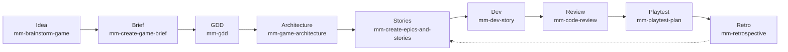

<p align="center">
  
</p>

<h1 align="center">MonkeyMode</h1>

<p align="center"><strong>I'm Monkey Game Developer 🐒</strong></p>

<p align="center">
  <a href="LICENSE"></a>
  <a href="#install"></a>
  <a href="#plugins"></a>
  <a href="#plugins"></a>
  <a href="CONTRIBUTING.md"></a>
  <a href="https://github.com/sponsors/AidenKim923"></a>
</p>

<p align="center">
  <a href="#engines"></a>
  <a href="#engines"></a>
  <a href="#engines"></a>
  <a href="#engines"></a>
  <a href="#without-claude-code"></a>
</p>

<div align="center">

[English](README.md) · [한국어](README.ko.md) · [日本語](README.ja.md) · **简体中文** · [繁體中文](README.zh-TW.md) · [Español](README.es.md) · [Português (Brasil)](README.pt-BR.md) · [Français](README.fr.md) · [Deutsch](README.de.md) · [Русский](README.ru.md) · [Tiếng Việt](README.vi.md)

</div>

<p align="center"><a href="#install">跳到安装 ↓</a></p>

---

> [!TIP]
> 就算是不太聪明的智能体(或开发者),用上 MonkeyMode 也会变聪明。

MonkeyMode 是一个面向 AI 编程智能体的开源游戏开发工具包。智能体本来就会写代码;MonkeyMode 教它做**游戏**:先规划、再设计、按故事逐步构建、自己检查自己的工作,并且不再重复犯同样的引擎错误。

```text
idea → brief → GDD → architecture → stories → dev → review → playtest → retro
```

它以 Claude Code 插件市场的形式发布,也适用于读取 `AGENTS.md` 的智能体(Codex 等)。

| 包含内容 | 数量 | 用途 |
|---|---:|---|
| 工作流技能 | 43 | `mm-core`:简报、GDD、叙事、UX、架构、史诗与故事、开发、评审、测试、试玩、回顾,以及 `/mm-setup` |
| 角色智能体 | 9 | `mm-agents`:游戏设计师、架构师、开发者、独立开发者、分析师、产品经理、UX 设计师、技术写作者、派对模式 |
| 子智能体 | 20 | `mm-agents`(16 个),外加每个引擎插件各一个专家:设计、关卡、玩法代码、只读评审、QA、性能、网络、技术美术、UI/UX、叙事、音频、经济、构建与发布、本地化、护栏审计、文档 |
| 美术与图形工具 | 4 | `mm-art-tools`:概念图,以及 Blender、RenderDoc、Nsight Graphics 的 CLI 工具 |
| 引擎适配器 | 4 | Godot、Unity、Unreal、Bevy:文档、禁用模式、构建与测试命令、多人游戏说明 |
| 护栏 | 3 个级别 | 每次编辑后(可选:每次提交前)自动检查的规则 |
| 智能体运行文档 | 15 | `docs/ai/`:执行策略、验证手册、网络权威、交接、提交前流程 |

## Star 历史

<a href="https://www.star-history.com/#AidenKim923/MonkeyMode&Date">
 <picture>
   <source media="(prefers-color-scheme: dark)" srcset="https://api.star-history.com/svg?repos=AidenKim923/MonkeyMode&type=Date&theme=dark" />
   <source media="(prefers-color-scheme: light)" srcset="https://api.star-history.com/svg?repos=AidenKim923/MonkeyMode&type=Date" />
   
 </picture>
</a>

<a id="install"></a>

## 快速开始

**1. 安装**(Claude Code)

```
/plugin marketplace add AidenKim923/MonkeyMode
/plugin install mm-core@monkeymode
/plugin install mm-unity@monkeymode   # pick your engine: mm-godot, mm-unity, mm-unreal, mm-bevy
```

可选包:`/plugin install mm-agents@monkeymode`、`/plugin install mm-art-tools@monkeymode`。

**2. 设置你的游戏。** 在 Claude Code 中打开游戏项目并运行 **`/mm-setup`**。它会问你几个问题,安装所有内容,并告诉你下一步做什么。

**3. 开始制作。** 运行它推荐的技能,例如新点子用 `/mm-brainstorm-game`,已有代码库用 `/mm-document-project`。不确定下一步时,随时问 `/mm-help`。

> [!NOTE]
> 要求:Claude Code v2.1.271 或更高版本(带固定选项的插件设置)、Python 3.11+ 和 [`uv`](https://docs.astral.sh/uv/)(工作流脚本与护栏)、用于 `.ps1` 工具的 PowerShell 7、用于本地概念/决策页面的 Node.js 18+。

<a id="features"></a>

## 为什么选择 MonkeyMode

| 特性 | 含义 |
|---|---|
| **从设计到发布的工作流** | 每一步都是一个技能,都会写出你能保留的真实文件:简报、GDD、架构、故事、评审记录、试玩计划 |
| **验证,而不是声称** | 智能体在说"完成"之前会构建、测试、运行并截图;没有检查过的内容一律写成 `unverified` |
| **护栏** | 每次编辑后拦截脆弱的场景查找、阻塞调用、不安全的网络代码以及仓库中的密钥 |
| **引擎知识** | Godot、Unity、Unreal 和 Bevy 各有自己的规则、命令和多人游戏说明;其余全部共享 |
| **因人而异** | 如果你说自己不会看代码,智能体会用通俗的话和截图来解释,所有事情都自己验证,并在高风险操作前先询问 |
| **支持多人游戏** | 面向联网功能的引擎无关权威规则和测试等级(M0-M3) |

<a id="workflow"></a>

## 工作流



| 步骤 | 运行 | 产出 |
|---|---|---|
| 1. 点子 | `mm-brainstorm-game` | `_mm-output/` 中的头脑风暴记录 |
| 2. 简报 | `mm-create-game-brief` | 核心幻想、目标玩家、卖点、参考、范围 |
| 3. 设计 | `mm-gdd`(+ `mm-create-narrative`、`mm-ux`) | GDD、史诗大纲、决策日志 |
| 4. 架构 | `mm-game-architecture`、`mm-generate-project-context` | 架构、护栏提案、项目规则表 |
| 5. 故事 | `mm-create-epics-and-stories`、`mm-check-implementation-readiness` | 带风险和验证级别的史诗与故事 |
| 6. 冲刺 | `mm-sprint-planning`、`mm-sprint-status` | `sprint-status.yaml` |
| 7. 开发 | `mm-create-story` → `mm-dev-story` | 代码、测试和四段式报告 |
| 8. 评审 | `mm-code-review` | 评审结果和后续任务 |
| 9. 试玩 | `mm-playtest-plan`、`mm-performance-test` | 试玩计划和性能测试计划 |
| 10. 回顾 | `mm-retrospective` | 每个史诗之后的经验教训 |

<details>
<summary><strong>捷径、测试,以及"完成"的标准</strong></summary>

**捷径:** 不走完整流程的小改动用 `mm-quick-dev`;冲刺偏离轨道时用 `mm-correct-course`;描述已有代码库用 `mm-document-project`;调试用 `mm-investigate`;想要变更导览用 `mm-walkthrough`;中途停下时用 `mm-write-handoff`。

**测试:** `mm-test-framework` 为你的引擎搭建测试框架,`mm-test-design` 规划覆盖范围,`mm-test-automate` 和 `mm-e2e-scaffold` 编写测试,`mm-test-review` 检查测试。

**完成:** 每个故事都分四部分报告:改了什么、可能影响什么、如何验证(附证据)、后续事项。验证级别为 L1(静态检查)、L2(观察到行为)和 L3(集成;多人游戏需连接多名玩家,等级 M0-M3)。

包含输出路径的完整步骤表见[用户指南](docs/GUIDE.md#4-the-end-to-end-process)。

</details>

<a id="plugins"></a>

## 插件

| 插件 | 内容 |
|---|---|
| **`mm-core`**(必需) | 43 个 `mm-` 工作流技能、`/mm-setup` 引导、智能体运行文档(`docs/ai/`)、带编辑后钩子的护栏检查器、密钥/个人路径配置、概念图库和决策页面 |
| **`mm-unity`** | C# 禁用 API、程序集依赖方向规则、批处理模式测试/构建脚本、Mirror 和 Netcode 说明、资源导入清单、`mm-unity-expert` 子智能体 |
| **`mm-godot`** | GDScript 节点路径和信号规则、无头测试命令、高级多人游戏说明、`mm-godot-expert` 子智能体 |
| **`mm-unreal`** | UObject/GC 规则、禁用 C++ 模式、UBT 和自动化测试命令、复制说明、`mm-unreal-expert` 子智能体 |
| **`mm-bevy`** | 系统中禁止阻塞、系统顺序、Clippy 禁用项、cargo test 命令、lightyear/replicon/renet 说明、`mm-bevy-expert` 子智能体 |
| `mm-agents`(可选) | 16 个 Claude Code 子智能体、角色智能体和派对模式 |
| `mm-art-tools`(可选) | `mm-concept-art`(ChatGPT 提示词、Codex CLI 或其他方案)以及 Blender、RenderDoc、Nsight Graphics 的 CLI 工具 |

<details>
<summary><strong>mm-core:全部 43 个技能</strong></summary>

| 领域 | 技能 |
|---|---|
| 点子与设计 | `mm-brainstorm-game`, `mm-brainstorming`, `mm-forge-idea`, `mm-create-game-brief`, `mm-gdd`, `mm-create-narrative`, `mm-ux`, `mm-prd`, `mm-prfaq`, `mm-spec`, `mm-research` |
| 架构与规划 | `mm-game-architecture`, `mm-generate-project-context`, `mm-create-epics-and-stories`, `mm-check-implementation-readiness`, `mm-sprint-planning`, `mm-sprint-status`, `mm-correct-course` |
| 构建与评审 | `mm-create-story`, `mm-dev-story`, `mm-quick-dev`, `mm-quick-dev-auto`, `mm-code-review`, `mm-review`, `mm-investigate`, `mm-walkthrough`, `mm-write-handoff`, `mm-document-project` |
| 测试与试玩 | `mm-test-framework`, `mm-test-design`, `mm-test-automate`, `mm-e2e-scaffold`, `mm-test-review`, `mm-performance-test`, `mm-playtest-plan`, `mm-retrospective` |
| 辅助 | `mm-setup`, `mm-help`, `mm-customize`, `mm-advanced-elicitation`, `mm-clarify-ambiguous-request`, `mm-present-alternatives`, `mm-decision-picker` |

</details>

<details>
<summary><strong>mm-agents 和 mm-art-tools</strong></summary>

| 插件 | 技能 |
|---|---|
| `mm-agents` | `mm-agent-game-designer`, `mm-agent-game-architect`, `mm-agent-game-dev`, `mm-agent-game-solo-dev`, `mm-agent-analyst`, `mm-agent-pm`, `mm-agent-ux-designer`, `mm-agent-tech-writer`, `mm-party-mode` |
| `mm-art-tools` | `mm-concept-art`, `mm-cli-blender`, `mm-cli-renderdoc`, `mm-cli-nsight-graphics` |

| 插件 | 子智能体 |
|---|---|
| `mm-agents` | `mm-game-designer`, `mm-level-designer`, `mm-gameplay-programmer`, `mm-code-reviewer`, `mm-qa-tester`, `mm-performance-profiler`, `mm-network-engineer`, `mm-technical-artist`, `mm-ui-ux-designer`, `mm-narrative-writer`, `mm-audio-designer`, `mm-economy-balancer`, `mm-build-release-engineer`, `mm-localization`, `mm-guardrail-auditor`, `mm-docs-writer` |
| `mm-godot`, `mm-unity`, `mm-unreal`, `mm-bevy` | `mm-godot-expert`, `mm-unity-expert`, `mm-unreal-expert`, `mm-bevy-expert` |

当你的请求与某个子智能体的职责相符时,Claude 会自动交给它;你也可以直接调用:`@agent-mm-agents:mm-qa-tester` 或"用 mm-code-reviewer 智能体评审一下"。各自何时使用:[用户指南](docs/GUIDE.md#5-agents)。

</details>

<details>
<summary><strong>共享 vs. 按引擎</strong></summary>

| 共享 (mm-core) | 按引擎 (mm-&lt;engine&gt;) |
|---|---|
| 工作流模板:游戏简报、GDD、叙事、UX、PRD、架构、史诗/故事、故事、试玩计划、性能测试计划、测试设计、代码评审清单、回顾、决策日志、项目上下文 | 项目上下文模板 |
| 智能体行为、验证、交接、范围控制、git 规范、团队工作流 | 架构附录(场景/资源结构;GDScript/C#、C#、C++/Blueprint、Rust/ECS) |
| 护栏检查器、编辑后和提交前钩子、密钥配置 | 引擎护栏配置和禁用模式 |
| 自我验证工具(日志、截图、多实例启动) | 构建和测试命令(Unity 还附带脚本) |
| 引擎无关的网络权威规则和测试等级 | 多人游戏说明(Mirror/NGO、复制、高级多人游戏、lightyear/renet) |
| 资源与角色管线指南 | `.gitignore` / LFS 提示、资源导入(Unity) |

</details>

<a id="engines"></a>

## 引擎

| 引擎 | 插件 | 要点 | 验证状态 |
|---|---|---|---|
| **Godot 4** | `mm-godot` | 向下调用,向上发信号;带类型的 GDScript;`@rpc("any_peer")` 校验发送方;GUT 和 gdUnit4 命令 | 已对照 Godot 4.7 官方文档核对 |
| **Unity** | `mm-unity` | 禁止全场景 `Find*`、`Resources.Load` 和 `async void`;`.asmdef` 规则;批处理模式脚本;Mirror 和 NGO 说明 | 面向 Unity 6;需要社区验证 |
| **Unreal Engine 5** | `mm-unreal` | `UPROPERTY() TObjectPtr<>` 成员;运行时禁止同步加载;经过校验的 Server RPC;`Automation RunTest` | 部分对照 UE 5.9 文档核对 |
| **Bevy** | `mm-bevy` | 系统从不阻塞;显式顺序;模拟放在 `FixedUpdate`;Clippy `disallowed-methods` | 已对照 Bevy 0.20 核对 |

适配器无法确认的内容都在其文档中标为 *needs verification*。"其他"引擎会得到一份待填写的模板。

<a id="guardrails"></a>

## 护栏与编程水平

`mm-core` 有两项关于你本人的设置,在 `/plugin` → MonkeyMode core → configure(或 `claude plugin configure mm-core@monkeymode`)中设置。如果不设置,`/mm-setup` 会改为询问你。

| 设置 | 选项 |
|---|---|
| `coding_level` | 我能看懂代码 / 我看不懂代码 |
| `uses_chatgpt` | 是 / 否("图像推荐使用 ChatGPT") |

| 编程水平 | 护栏 | 智能体如何工作 |
|---|---|---|
| **我看不懂代码** | 始终为 **strict** | 所有事情都自己验证(测试、构建、运行游戏),用通俗的话和截图解释,在删除、重构、安装、提交或推送之前先询问 |
| **我能看懂代码** | **strict**、**standard**(默认)或 **relaxed** | 以 diff 摘要报告,并说明每处改动的原因 |

| 级别 | 效果 |
|---|---|
| **strict** | 每条规则都会拦截编辑,包括引擎配置中存在的禁止注释规则 |
| **standard** | 规则会拦截;允许注释 |
| **relaxed** | 命中规则只显示为警告,不拦截(可选的提交前钩子仍会检查) |

<a id="setup"></a>

## `/mm-setup` 会问什么

<details>
<summary><strong>九个问题</strong></summary>

| # | 问题 | 答案会改变什么 |
|---|---|---|
| 1 | 你能看懂代码吗? | 选"不能"会强制 strict 护栏,以及用通俗语言、自我验证的智能体 |
| 2 | 引擎:Godot / Unity / Unreal / Bevy / 其他 | 安装该引擎的适配器(检测到的引擎会预先选中) |
| 3 | 你也使用 ChatGPT 吗? | 是:概念图以可直接粘贴的 ChatGPT 提示词形式提供。否:Codex CLI 或其他方案 |
| 4 | 单人还是团队? | 团队会加入分支和拉取请求规则以及评审清单 |
| 5 | 类型、目标平台 | 记录在 `AGENTS.md` 和配置中 |
| 6 | 多人游戏吗?(及最多玩家数) | 加入网络指南和仅联网时使用的护栏 |
| 7 | 阶段:点子 / 规划 / 制作 / 打磨 | 决定推荐的第一个技能 |
| 8 | 护栏级别(仅在能看懂代码时) | strict / standard / relaxed |
| 9 | 文档文件夹 | 所有 MonkeyMode 文档的存放位置(默认 `docs/`) |

完整的分支流程见 [`docs/ONBOARDING.md`](docs/ONBOARDING.md)。

</details>

<details>
<summary><strong>会安装到项目中的内容</strong></summary>

```
AGENTS.md            MonkeyMode section (rules, your answers, engine snippet)
CLAUDE.md            @AGENTS.md
.monkeymode/         config.json (your project answers)
_mm/                 workflow runtime: config, catalog, scripts, custom/ overrides
docs/ai/             agent operating docs
docs/engine/         engine adapter docs
docs/project/        your approved design (filled over time)
docs/work/           work records and handoffs
guardrails/          secrets.json + <engine>.json
tools/               guardrail checker, verification tools
.githooks/           optional pre-commit guardrails
```

再次运行 `/mm-setup` 会显示你当前的答案并询问要改什么;你在 MonkeyMode 区块之外做的修改都会保留。

</details>

<a id="without-claude-code"></a>

## 不使用 Claude Code(AGENTS.md 智能体)

```
git clone <MonkeyMode repo URL>
uv run MonkeyMode/plugins/mm-core/skills/mm-setup/scripts/setup_project.py --target <your game> --interactive --apply --copy-skills agents
```

它会问同样的问题、安装同样的文件,并把技能复制到 `.agents/skills/`。参见 [`docs/ONBOARDING.md`](docs/ONBOARDING.md#without-claude-code-codex-and-other-agentsmd-agents)。

## 自定义

| 对象 | 位置 |
|---|---|
| 项目规则 | 项目中的 `AGENTS.md`(MonkeyMode 标记之外)、`docs/ai/` 和 `docs/engine/`。它们优先于技能指令 |
| 技能行为 | `_mm/custom/<skill-name>.toml`(团队)或 `<skill-name>.user.toml`(个人);`persistent_facts` 等数组会追加到默认值上。`/mm-customize` 会一步步引导你 |
| 护栏 | `guardrails/<engine>.json` 或新的 `guardrails/<name>.json` 配置(格式见 `docs/ai/12`)。智能体绝不会自行放宽规则 |

<details>
<summary><strong>测试安装</strong></summary>

```
claude plugin validate .                      # marketplace
claude plugin validate plugins/mm-core       # each plugin
claude --plugin-dir ./plugins/mm-core --plugin-dir ./plugins/mm-unity
```

最后一条命令会在不添加插件市场的情况下,加载插件并启动一次 Claude Code 会话。贡献者还会运行脚本测试和 `uv run tools/scrub.py`(参见 [CONTRIBUTING.md](CONTRIBUTING.md))。

</details>

## 文档

| 文档 | 内容 |
|---|---|
| [用户指南](docs/GUIDE.md) | 安装、设置问答、包含每一步技能和输出文件的完整工作流、护栏、图像、引擎说明、常见问题 |
| [引导](docs/ONBOARDING.md) | 设置流程图以及每个答案会改变什么 |
| [清单](docs/INVENTORY.md) | 共享 vs. 按引擎、技能名称对照表 |
| [参与贡献](CONTRIBUTING.md) | 添加技能、引擎适配器和护栏规则;测试;PR 清单 |

## 参与贡献

欢迎贡献:请参阅 [CONTRIBUTING.md](CONTRIBUTING.md) 和[行为准则](CODE_OF_CONDUCT.md)。特别欢迎对引擎适配器的修正:尚未解决的条目在每个适配器中都标为 *needs verification*。

## 赞助

MonkeyMode 免费提供,由维护者利用业余时间维护。如果它为你的游戏开发节省了时间,可以通过 GitHub Sponsors 支持后续维护(引擎适配器核对、新的智能体和技能、11 种语言的文档)。

<p align="center">
  <a href="https://github.com/sponsors/AidenKim923"></a>
</p>

## 致谢与许可证

MonkeyMode 采用 MIT 许可证([LICENSE](LICENSE))。其工作流技能基于 [BMad Method](https://github.com/bmad-code-org/BMAD-METHOD) 和 BMad Game Dev Studio 模块(MIT),图形工具技能基于 [CLI-Anything](https://github.com/HKUDS/CLI-Anything)(Apache-2.0)。MonkeyMode 是独立项目,未获得其作者的背书。详情及全部修改:[NOTICE](NOTICE)、[THIRD_PARTY_NOTICES.md](THIRD_PARTY_NOTICES.md)。

---

<p align="center">
  <br />
  <sub><strong>I'm Monkey Game Developer 🐒</strong> · 如果 MonkeyMode 对你的游戏有帮助,请点个 Star</sub>
</p>
