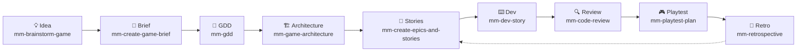

<p align="center">
  
</p>

<h1 align="center">MonkeyMode</h1>

<p align="center"><strong>I'm Monkey Game Developer 🐒</strong></p>

<p align="center">
  <a href="LICENSE"></a>
  <a href="#install"></a>
  <a href="#plugins"></a>
  <a href="CONTRIBUTING.md"></a>
</p>

<p align="center">
  <a href="#engines"></a>
  <a href="#engines"></a>
  <a href="#engines"></a>
  <a href="#engines"></a>
  <a href="#without-claude-code"></a>
</p>

<div align="center">

[English](README.md) · [한국어](README.ko.md) · [日本語](README.ja.md) · [简体中文](README.zh-CN.md) · **繁體中文** · [Español](README.es.md) · [Português (Brasil)](README.pt-BR.md) · [Français](README.fr.md) · [Deutsch](README.de.md) · [Русский](README.ru.md) · [Tiếng Việt](README.vi.md)

</div>

<p align="center"><a href="#install">跳到安裝 ↓</a></p>

---

> [!TIP]
> 就算是不太聰明的代理(或開發者),用上 MonkeyMode 也會變聰明。

MonkeyMode 是一套給 AI 程式代理使用的開源遊戲開發工具包。代理本來就會寫程式;MonkeyMode 教它做**遊戲**:先規劃、再設計、依故事逐步打造、自己檢查自己的工作,而且不再重複犯同樣的引擎錯誤。

```text
idea → brief → GDD → architecture → stories → dev → review → playtest → retro
```

它以 Claude Code 外掛市集的形式發布,也適用於會讀取 `AGENTS.md` 的代理(Codex 等)。

| 內容 | 數量 | 用途 |
|---|---:|---|
| 🧭 工作流程技能 | 43 | `mm-core`:簡報、GDD、敘事、UX、架構、史詩與故事、開發、審查、測試、試玩、回顧,以及 `/mm-setup` |
| 🎭 角色代理 | 9 | `mm-agents`:遊戲設計師、架構師、開發者、獨立開發者、分析師、產品經理、UX 設計師、技術寫作者、派對模式 |
| 🎨 美術與圖形工具 | 4 | `mm-art-tools`:概念圖,以及 Blender、RenderDoc、Nsight Graphics 的 CLI 工具 |
| 🎮 引擎轉接器 | 4 | Godot、Unity、Unreal、Bevy:文件、禁用模式、建置與測試指令、多人遊戲筆記 |
| 🛡️ 護欄 | 3 個等級 | 每次編輯後(可選:每次提交前)自動檢查的規則 |
| 📜 代理運作文件 | 15 | `docs/ai/`:執行政策、驗證手冊、網路權威、交接、提交前程序 |

<a id="install"></a>

## ⚡ 快速開始

**1. 安裝**(Claude Code)

```
/plugin marketplace add <owner>/MonkeyMode
/plugin install mm-core@monkeymode
/plugin install mm-unity@monkeymode   # pick your engine: mm-godot, mm-unity, mm-unreal, mm-bevy
```

選用套件:`/plugin install mm-agents@monkeymode`、`/plugin install mm-art-tools@monkeymode`。

**2. 設定你的遊戲。** 在 Claude Code 中開啟遊戲專案並執行 **`/mm-setup`**。它會問你幾個問題,安裝所有東西,並告訴你下一步。

**3. 開始製作。** 執行它推薦的技能,例如新點子用 `/mm-brainstorm-game`,既有程式碼庫用 `/mm-document-project`。不確定下一步時,隨時問 `/mm-help`。

> [!NOTE]
> 需求:Claude Code v2.1.271 或更新版本(具固定選項的外掛設定)、Python 3.11+ 與 [`uv`](https://docs.astral.sh/uv/)(工作流程腳本與護欄)、`.ps1` 工具所需的 PowerShell 7、本機概念/決策頁面所需的 Node.js 18+。

<a id="features"></a>

## ✨ 為什麼選擇 MonkeyMode

| | 特色 | 意義 |
|---|---|---|
| 🗺️ | **從設計到發行的工作流程** | 每一步都是一個技能,都會寫出你能保留的真實檔案:簡報、GDD、架構、故事、審查筆記、試玩計畫 |
| ✅ | **驗證,而不是宣稱** | 代理在說「完成」之前會建置、測試、執行並截圖;沒檢查過的內容一律寫成 `unverified` |
| 🛡️ | **護欄** | 每次編輯後攔下脆弱的場景搜尋、阻塞呼叫、不安全的網路程式碼,以及儲存庫中的機密 |
| 🎮 | **引擎知識** | Godot、Unity、Unreal 與 Bevy 各有自己的規則、指令與多人遊戲筆記;其餘全部共用 |
| 🙈 | **配合你** | 如果你說自己看不懂程式碼,代理會用淺白的話和截圖說明,所有事情都自己驗證,並在高風險操作前先詢問 |
| 🌐 | **支援多人遊戲** | 針對連線功能的引擎中立權威規則與測試等級(M0-M3) |

<a id="workflow"></a>

## 🗺️ 工作流程



| 步驟 | 執行 | 產出 |
|---|---|---|
| 1. 點子 | `mm-brainstorm-game` | `_mm-output/` 中的腦力激盪紀錄 |
| 2. 簡報 | `mm-create-game-brief` | 核心幻想、目標玩家、賣點、參考、範圍 |
| 3. 設計 | `mm-gdd`(+ `mm-create-narrative`、`mm-ux`) | GDD、史詩大綱、決策紀錄 |
| 4. 架構 | `mm-game-architecture`、`mm-generate-project-context` | 架構、護欄提案、專案規則表 |
| 5. 故事 | `mm-create-epics-and-stories`、`mm-check-implementation-readiness` | 附風險與驗證等級的史詩與故事 |
| 6. 衝刺 | `mm-sprint-planning`、`mm-sprint-status` | `sprint-status.yaml` |
| 7. 開發 | `mm-create-story` → `mm-dev-story` | 程式碼、測試與四段式報告 |
| 8. 審查 | `mm-code-review` | 審查結果與後續任務 |
| 9. 試玩 | `mm-playtest-plan`、`mm-performance-test` | 試玩計畫與效能測試計畫 |
| 10. 回顧 | `mm-retrospective` | 每個史詩之後的心得 |

<details>
<summary><strong>捷徑、測試,以及「完成」的標準</strong></summary>

**捷徑:** 不走完整流程的小變更用 `mm-quick-dev`;衝刺偏離方向時用 `mm-correct-course`;描述既有程式碼庫用 `mm-document-project`;除錯用 `mm-investigate`;想要變更導覽用 `mm-walkthrough`;中途停下時用 `mm-write-handoff`。

**測試:** `mm-test-framework` 為你的引擎建立測試框架,`mm-test-design` 規劃涵蓋範圍,`mm-test-automate` 與 `mm-e2e-scaffold` 撰寫測試,`mm-test-review` 檢查測試。

**完成:** 每個故事都分四部分回報:改了什麼、可能影響什麼、如何驗證(附證據)、後續事項。驗證等級為 L1(靜態檢查)、L2(觀察到行為)與 L3(整合;多人遊戲需連線多名玩家,等級 M0-M3)。

包含輸出路徑的完整步驟表請見[使用者指南](docs/GUIDE.md#4-the-end-to-end-process)。

</details>

<a id="plugins"></a>

## 📦 外掛

| 外掛 | 內容 |
|---|---|
| **`mm-core`**(必要) | 43 個 `mm-` 工作流程技能、`/mm-setup` 引導、代理運作文件(`docs/ai/`)、具編輯後掛鉤的護欄檢查器、機密/個人路徑設定檔、概念圖庫與決策頁面 |
| **`mm-unity`** | C# 禁用 API、組件相依方向規則、批次模式測試/建置腳本、Mirror 與 Netcode 筆記、資源匯入檢查表 |
| **`mm-godot`** | GDScript 節點路徑與訊號規則、無頭測試指令、高階多人遊戲筆記 |
| **`mm-unreal`** | UObject/GC 規則、禁用 C++ 模式、UBT 與自動化測試指令、複寫筆記 |
| **`mm-bevy`** | 系統內禁止阻塞、系統順序、Clippy 禁用項目、cargo test 指令、lightyear/replicon/renet 筆記 |
| `mm-agents`(選用) | 角色代理與派對模式 |
| `mm-art-tools`(選用) | `mm-concept-art`(ChatGPT 提示詞、Codex CLI 或其他方案)以及 Blender、RenderDoc、Nsight Graphics 的 CLI 工具 |

<details>
<summary><strong>🧭 mm-core:全部 43 個技能</strong></summary>

| 領域 | 技能 |
|---|---|
| 點子與設計 | `mm-brainstorm-game`, `mm-brainstorming`, `mm-forge-idea`, `mm-create-game-brief`, `mm-gdd`, `mm-create-narrative`, `mm-ux`, `mm-prd`, `mm-prfaq`, `mm-spec`, `mm-research` |
| 架構與規劃 | `mm-game-architecture`, `mm-generate-project-context`, `mm-create-epics-and-stories`, `mm-check-implementation-readiness`, `mm-sprint-planning`, `mm-sprint-status`, `mm-correct-course` |
| 實作與審查 | `mm-create-story`, `mm-dev-story`, `mm-quick-dev`, `mm-quick-dev-auto`, `mm-code-review`, `mm-review`, `mm-investigate`, `mm-walkthrough`, `mm-write-handoff`, `mm-document-project` |
| 測試與試玩 | `mm-test-framework`, `mm-test-design`, `mm-test-automate`, `mm-e2e-scaffold`, `mm-test-review`, `mm-performance-test`, `mm-playtest-plan`, `mm-retrospective` |
| 輔助 | `mm-setup`, `mm-help`, `mm-customize`, `mm-advanced-elicitation`, `mm-clarify-ambiguous-request`, `mm-present-alternatives`, `mm-decision-picker` |

</details>

<details>
<summary><strong>🎭 mm-agents 與 🎨 mm-art-tools</strong></summary>

| 外掛 | 技能 |
|---|---|
| `mm-agents` | `mm-agent-game-designer`, `mm-agent-game-architect`, `mm-agent-game-dev`, `mm-agent-game-solo-dev`, `mm-agent-analyst`, `mm-agent-pm`, `mm-agent-ux-designer`, `mm-agent-tech-writer`, `mm-party-mode` |
| `mm-art-tools` | `mm-concept-art`, `mm-cli-blender`, `mm-cli-renderdoc`, `mm-cli-nsight-graphics` |

</details>

<details>
<summary><strong>共用 vs. 各引擎</strong></summary>

| 共用 (mm-core) | 各引擎 (mm-&lt;engine&gt;) |
|---|---|
| 工作流程範本:遊戲簡報、GDD、敘事、UX、PRD、架構、史詩/故事、故事、試玩計畫、效能測試計畫、測試設計、程式碼審查檢查表、回顧、決策紀錄、專案脈絡 | 專案脈絡範本 |
| 代理行為、驗證、交接、範圍控制、git 規範、團隊工作流程 | 架構附錄(場景/資源結構;GDScript/C#、C#、C++/Blueprint、Rust/ECS) |
| 護欄檢查器、編輯後與提交前掛鉤、機密設定檔 | 引擎護欄設定檔與禁用模式 |
| 自我驗證工具(日誌、截圖、多實例啟動) | 建置與測試指令(Unity 另附腳本) |
| 引擎中立的網路權威規則與測試等級 | 多人遊戲筆記(Mirror/NGO、複寫、高階多人遊戲、lightyear/renet) |
| 資源與角色管線指南 | `.gitignore` / LFS 提示、資源匯入(Unity) |

</details>

<a id="engines"></a>

## 🎮 引擎

| 引擎 | 外掛 | 重點 | 驗證狀態 |
|---|---|---|---|
| **Godot 4** | `mm-godot` | 往下呼叫,往上發訊號;具型別的 GDScript;`@rpc("any_peer")` 驗證傳送者;GUT 與 gdUnit4 指令 | 已對照 Godot 4.7 官方文件 |
| **Unity** | `mm-unity` | 禁止全場景 `Find*`、`Resources.Load` 與 `async void`;`.asmdef` 規則;批次模式腳本;Mirror 與 NGO 筆記 | 以 Unity 6 為目標;需要社群驗證 |
| **Unreal Engine 5** | `mm-unreal` | `UPROPERTY() TObjectPtr<>` 成員;執行期禁止同步載入;經驗證的 Server RPC;`Automation RunTest` | 部分對照 UE 5.9 文件 |
| **Bevy** | `mm-bevy` | 系統絕不阻塞;明確的順序;模擬放在 `FixedUpdate`;Clippy `disallowed-methods` | 已對照 Bevy 0.20 |

轉接器無法確認的內容,都在其文件中標為 *needs verification*。「其他」引擎會得到一份待填寫的範本。

<a id="guardrails"></a>

## 🛡️ 護欄與程式能力

`mm-core` 有兩項關於你本人的設定,在 `/plugin` → MonkeyMode core → configure(或 `claude plugin configure mm-core@monkeymode`)中設定。若不設定,`/mm-setup` 會改為詢問你。

| 設定 | 選項 |
|---|---|
| `coding_level` | 我看得懂程式碼 / 我看不懂程式碼 |
| `uses_chatgpt` | 是 / 否(「圖片推薦使用 ChatGPT」) |

| 程式能力 | 護欄 | 代理如何工作 |
|---|---|---|
| 🙈 **我看不懂程式碼** | 一律 **strict** | 所有事情都自己驗證(測試、建置、執行遊戲),用淺白的話和截圖說明,在刪除、重構、安裝、提交或推送前先詢問 |
| 👀 **我看得懂程式碼** | **strict**、**standard**(預設)或 **relaxed** | 以 diff 摘要回報,並說明每處變更的原因 |

| 等級 | 效果 |
|---|---|
| **strict** | 每條規則都會攔下編輯,包括引擎設定檔中有的禁止註解規則 |
| **standard** | 規則會攔下;允許註解 |
| **relaxed** | 違反規則只會顯示警告,不會攔下(選用的提交前掛鉤仍會檢查) |

<a id="setup"></a>

## 🧭 `/mm-setup` 會問什麼

<details>
<summary><strong>九個問題</strong></summary>

| # | 問題 | 答案會改變什麼 |
|---|---|---|
| 1 | 你看得懂程式碼嗎? | 選「看不懂」會強制 strict 護欄,以及用淺白語言、自我驗證的代理 |
| 2 | 引擎:Godot / Unity / Unreal / Bevy / 其他 | 安裝該引擎的轉接器(偵測到的引擎會預先選取) |
| 3 | 你也使用 ChatGPT 嗎? | 是:概念圖以可直接貼上的 ChatGPT 提示詞提供。否:Codex CLI 或其他方案 |
| 4 | 單人還是團隊? | 團隊會加入分支與拉取請求規則,以及審查檢查表 |
| 5 | 類型、目標平台 | 記錄在 `AGENTS.md` 與設定中 |
| 6 | 多人遊戲嗎?(及最多玩家數) | 加入網路指南與僅連線時使用的護欄 |
| 7 | 階段:點子 / 規劃 / 製作 / 打磨 | 決定推薦的第一個技能 |
| 8 | 護欄等級(僅在看得懂程式碼時) | strict / standard / relaxed |
| 9 | 文件資料夾 | 所有 MonkeyMode 文件的存放位置(預設 `docs/`) |

完整的分支流程請見 [`docs/ONBOARDING.md`](docs/ONBOARDING.md)。

</details>

<details>
<summary><strong>會安裝到專案中的內容</strong></summary>

```
AGENTS.md            MonkeyMode section (rules, your answers, engine snippet)
CLAUDE.md            @AGENTS.md
.monkeymode/         config.json (your project answers)
_mm/                 workflow runtime: config, catalog, scripts, custom/ overrides
docs/ai/             agent operating docs
docs/engine/         engine adapter docs
docs/project/        your approved design (filled over time)
docs/work/           work records and handoffs
guardrails/          secrets.json + <engine>.json
tools/               guardrail checker, verification tools
.githooks/           optional pre-commit guardrails
```

再次執行 `/mm-setup` 會顯示你目前的答案並詢問要改什麼;你在 MonkeyMode 區塊之外所做的修改都會保留。

</details>

<a id="without-claude-code"></a>

## 🤖 不使用 Claude Code(AGENTS.md 代理)

```
git clone <MonkeyMode repo URL>
uv run MonkeyMode/plugins/mm-core/skills/mm-setup/scripts/setup_project.py --target <your game> --interactive --apply --copy-skills agents
```

它會問同樣的問題、安裝同樣的檔案,並把技能複製到 `.agents/skills/`。請參閱 [`docs/ONBOARDING.md`](docs/ONBOARDING.md#without-claude-code-codex-and-other-agentsmd-agents)。

## 🧩 自訂

| 對象 | 位置 |
|---|---|
| 專案規則 | 專案中的 `AGENTS.md`(MonkeyMode 標記之外)、`docs/ai/` 與 `docs/engine/`。它們優先於技能指示 |
| 技能行為 | `_mm/custom/<skill-name>.toml`(團隊)或 `<skill-name>.user.toml`(個人);`persistent_facts` 等陣列會附加到預設值上。`/mm-customize` 會一步步引導你 |
| 護欄 | `guardrails/<engine>.json` 或新的 `guardrails/<name>.json` 設定檔(格式見 `docs/ai/12`)。代理絕不會自行放寬規則 |

<details>
<summary><strong>🧪 測試安裝</strong></summary>

```
claude plugin validate .                      # marketplace
claude plugin validate plugins/mm-core       # each plugin
claude --plugin-dir ./plugins/mm-core --plugin-dir ./plugins/mm-unity
```

最後一個指令會在不加入外掛市集的情況下,載入外掛並啟動一次 Claude Code 工作階段。貢獻者也會執行腳本測試與 `uv run tools/scrub.py`(請參閱 [CONTRIBUTING.md](CONTRIBUTING.md))。

</details>

## 📚 文件

| 文件 | 內容 |
|---|---|
| 📘 [使用者指南](docs/GUIDE.md) | 安裝、設定問答、包含每一步技能與輸出檔案的完整工作流程、護欄、圖片、引擎筆記、常見問題 |
| 🧭 [引導](docs/ONBOARDING.md) | 設定流程圖以及每個答案會改變什麼 |
| 📋 [清單](docs/INVENTORY.md) | 共用 vs. 各引擎、技能名稱對照表 |
| 🤝 [參與貢獻](CONTRIBUTING.md) | 新增技能、引擎轉接器與護欄規則;測試;PR 檢查表 |

## 🤝 參與貢獻

歡迎貢獻:請參閱 [CONTRIBUTING.md](CONTRIBUTING.md) 與[行為準則](CODE_OF_CONDUCT.md)。特別歡迎對引擎轉接器的修正:尚未解決的項目在每個轉接器中都標為 *needs verification*。

## 📜 致謝與授權

MonkeyMode 採用 MIT 授權([LICENSE](LICENSE))。其工作流程技能以 [BMad Method](https://github.com/bmad-code-org/BMAD-METHOD) 與 BMad Game Dev Studio 模組(MIT)為基礎,圖形工具技能以 [CLI-Anything](https://github.com/HKUDS/CLI-Anything)(Apache-2.0)為基礎。MonkeyMode 是獨立專案,未獲原作者背書。詳情與所有修改:[NOTICE](NOTICE)、[THIRD_PARTY_NOTICES.md](THIRD_PARTY_NOTICES.md)。

---

<p align="center">
  <br />
  <sub><strong>I'm Monkey Game Developer 🐒</strong> · 如果 MonkeyMode 對你的遊戲有幫助,請給個 ⭐</sub>
</p>

<!-- Star history: once the repository has a public owner, replace <owner> below and uncomment.
<p align="center"><a href="https://www.star-history.com/#<owner>/MonkeyMode&Date">/MonkeyMode&type=Date" alt="Star history" width="600" /></a></p>
-->
